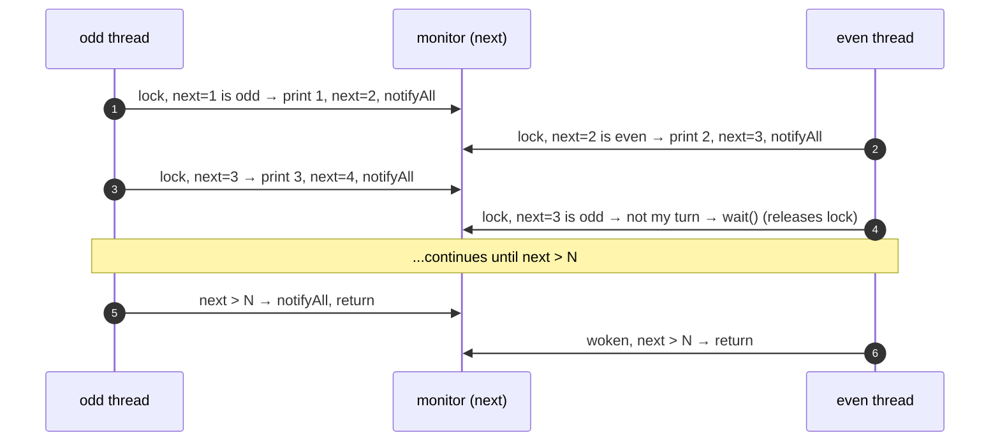
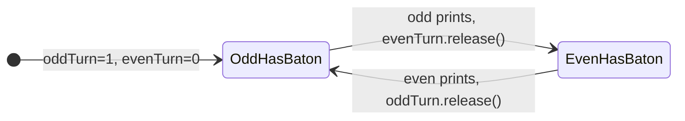

# 1. Odd/Even Printer

<span class="level l1">L1</span> ★☆☆ · `wait/notifyAll` · `Semaphore`

## Problem

> Two threads print the numbers 1 to N. The **odd** thread prints only odd numbers and the **even** thread prints only even
> numbers. The output must be in order: `1 2 3 4 … N`.

This is the "hello world" of thread coordination. The interviewer is checking three things: do you know that a thread has to
**wait for its turn** (rather than busy-spin), that the turn must be **handed over explicitly**, and that both threads must
**terminate**?

## Key idea

There is one piece of shared state, `next`, and it decides whose turn it is. A thread whose turn it isn't goes to sleep.
After printing, a thread advances `next` and wakes the other thread.



## Approach 1: monitor with `wait`/`notifyAll`

```java
--8<-- "examples/interview-coding/OddEvenPrinter.java:monitor"
```

**Line by line:**

| Code | Why |
|---|---|
| `private int next = 1; // guarded by "this"` | The **only** shared mutable state. Every read and write happens inside `synchronized (this)`, which gives both atomicity and visibility. |
| `synchronized (this) { while (true) {` | The thread holds the monitor for its whole life, **except while it's inside `wait()`**, which releases it. That's what lets the other thread in. |
| `while (next <= max && isOdd(next) != odd) wait();` | The **guarded wait**. It's a `while`, not an `if`, because a thread can wake up spuriously, or wake because of a `notifyAll` meant for someone else. Re-check the condition every time. |
| `if (next > max) { notifyAll(); return; }` | **Termination.** Without the `notifyAll` here, the other thread could be left in `wait()` forever after the last number. |
| `out.add(...); next++; notifyAll();` | Do the work, hand the turn over, and wake the waiter. `notifyAll` rather than `notify`: with two threads `notify` happens to work, but `notifyAll` is the safe default (see problem 3). |

## Approach 2: two semaphores as a baton

```java
--8<-- "examples/interview-coding/OddEvenPrinter.java:semaphore"
```



* **Invariant:** the two semaphores together hold **exactly one** permit. Whoever can `acquire` it holds the baton.
* There's no shared counter, because each thread knows its own numbers (`i += 2`).
* Termination is automatic: each loop runs a fixed number of times.
* **Visibility:** `release()` *happens-before* the matching `acquire()`, so the plain `ArrayList` writes are safely
  published from one thread to the other.

## The test harness

```java
--8<-- "examples/interview-coding/OddEvenPrinter.java:main"
```

The monitor version runs on **platform** threads and the semaphore version on **virtual** threads. Both work the same way.
`join()` creates the happens-before edge that makes it safe for `main` to read the list afterwards.

## Run it

```bash
java OddEvenPrinter.java
```

```text
monitor  : [odd:1, even:2, odd:3, even:4, odd:5, even:6, odd:7, even:8, odd:9, even:10]
semaphore: [odd:1, even:2, odd:3, even:4, odd:5, even:6, odd:7, even:8, odd:9, even:10]
PASS
```

## Common mistakes

| Mistake | What goes wrong |
|---|---|
| `if (wrong turn) wait();` | A spurious or misdirected wakeup prints out of turn |
| Busy loop `while (!myTurn) {}` with a non-volatile flag | 100% CPU, and the JIT may hoist the read, so the loop never ends |
| `volatile int next` with no lock | Visibility is fine, but check-then-increment still races |
| Forgetting the final `notifyAll` | The other thread hangs, and `join()` never returns |
| Calling `wait()` without holding the monitor | `IllegalMonitorStateException` |

## Follow-up questions

??? question "Generalize to N threads."
    See [problem 2](02-round-robin.md). Use `owner = (next-1) % N`, and preferably one `Condition` per thread, so you wake exactly the next one.

??? question "Which version would you ship?"
    The semaphore version is simpler and has no shared counter. In real code you'd rarely need either. Ordering usually comes from a
    single thread or a queue.

??? question "Does `notify()` work here?"
    With exactly two threads, yes, because the only waiter is always the one whose turn it is. With more threads it can wake the wrong one, which then
    waits again, and you lose the wake-up.

??? question "Would virtual threads change anything?"
    Not the logic. On JDK 21–23, `wait()` inside `synchronized` pins the virtual thread's carrier. That's harmless for two threads, but it matters at scale
    (see [problem 8](08-read-write-lock.md)).

??? example "Full source: OddEvenPrinter.java"
    ```java
    --8<-- "examples/interview-coding/OddEvenPrinter.java"
    ```
