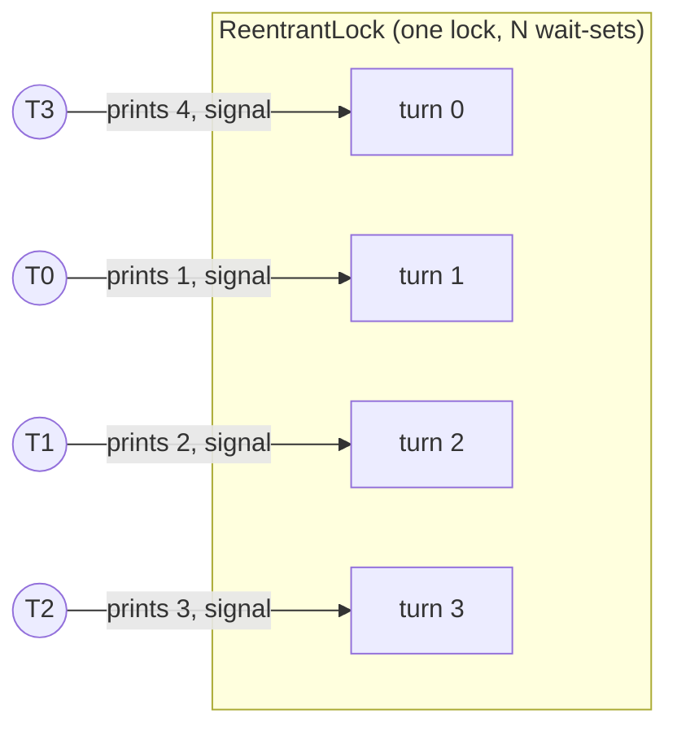
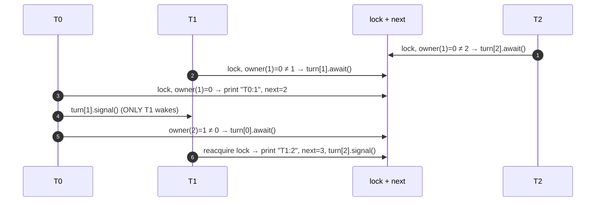

# 2. Round-Robin with N Threads

<span class="level l2">L2</span> ★★☆ · `ReentrantLock` · one `Condition` per thread

## Problem

> N threads print the numbers 1 to M in strict rotation: T0 prints 1, T1 prints 2, …, T(N-1) prints N, then T0 prints N+1, and so on.

This is the generalization of [problem 1](01-odd-even.md). The interesting part is **efficiency of wake-ups**. With a single
monitor and `notifyAll`, every print wakes all N threads, and N-1 of them immediately go back to sleep. That's a *thundering herd*.
The better answer gives each thread its **own wait-set** and wakes exactly the next one.

## Key idea

`owner(number) = (number - 1) % N` decides whose turn it is. Each thread waits on `turn[id]`. After printing, a thread
signals `turn[owner(next)]`, so only the next thread wakes up.





## Code walkthrough

```java
--8<-- "examples/interview-coding/RoundRobinPrinter.java:core"
```

| Code | Why |
|---|---|
| `Condition[] turn` created from **one** `lock` | Conditions are wait-sets attached to a lock. One lock keeps `next` consistent, and N conditions give targeted wake-ups. |
| `owner(n) = (n - 1) % threads` | Maps number → thread id. `next` is the single source of truth. Threads don't keep their own counters. |
| `while (next <= max && owner(next) != id) turn[id].await();` | Guarded wait. `await()` atomically releases the lock and parks. On wake-up it **reacquires** the lock before returning, then re-checks. |
| `if (next > max) { for (Condition c : turn) c.signalAll(); return; }` | Termination: whoever sees the end wakes **everyone**, so the sleepers re-check `next > max` and exit. Otherwise the remaining threads hang. |
| `turn[owner(next)].signal()` | The key optimization. Exactly one thread can make progress, so wake exactly that one. |
| `lock.lock(); try { … } finally { lock.unlock(); }` | Always unlock in `finally`. An exception must not leave the lock held forever. |

## Why it's correct

* **Mutual exclusion and visibility:** every access to `next` and `out` happens while holding `lock`, and `unlock`→`lock` is a happens-before edge.
* **No lost wake-up:** a thread checks its condition and calls `await()` while holding the lock. The signaller also holds the
  lock, so the signal can't slip in between "check" and "sleep".
* **Progress:** exactly one thread is runnable at a time (the owner). After printing it signals the next owner, and that chain
  never breaks.
* **Termination:** `signalAll` on every condition after the last number.

## Run it

```bash
java RoundRobinPrinter.java
```

```text
[T0:1, T1:2, T2:3, T3:4, T0:5, T1:6, T2:7, T3:8, T0:9, T1:10, T2:11, T3:12, T0:13, T1:14, T2:15, T3:16, T0:17, T1:18, T2:19, T3:20]
PASS
```

The threads are started in **reverse** order (T3 first) on purpose. The ordering comes only from the protocol, never
from start order.

## `notifyAll` vs targeted `signal`: the cost

| Approach | Wake-ups per printed number | Context switches with N=100 |
|---|---|---|
| Monitor + `notifyAll` | N (all threads) | ~100 per number |
| `Condition` per thread + `signal` | 1 | ~1 per number |

## Common mistakes

* `signal()` on the **same** condition everyone waits on: it may wake a thread whose turn it isn't, and then the wake-up is lost.
* Using `if` instead of `while` around `await()`.
* Forgetting the termination `signalAll`.
* Calling `await()` without holding the lock → `IllegalMonitorStateException`.

## Follow-up questions

??? question "Can you do it with semaphores?"
    Yes. Use `Semaphore[] sem` with `sem[0]=1` and the rest at 0. Thread i loops: `sem[i].acquire(); print; sem[(i+1)%N].release();`. Each thread
    knows its own numbers (`id+1, id+1+N, …`). This is the N-thread version of the baton in problem 1.

??? question "Is this a good use of threads?"
    No. It's fully sequential, so one thread would be faster. It's a coordination exercise. In real systems, ordering comes from a single
    consumer or a partitioned queue.

??? question "What about virtual threads?"
    It works unchanged. `Condition.await()` parks the virtual thread without pinning (j.u.c locks never pin).

??? example "Full source: RoundRobinPrinter.java"
    ```java
    --8<-- "examples/interview-coding/RoundRobinPrinter.java"
    ```
