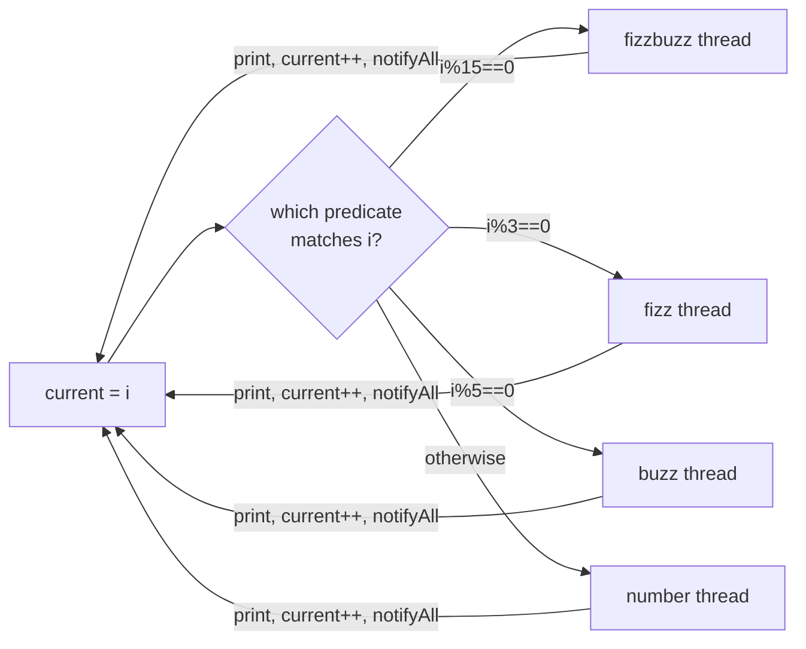
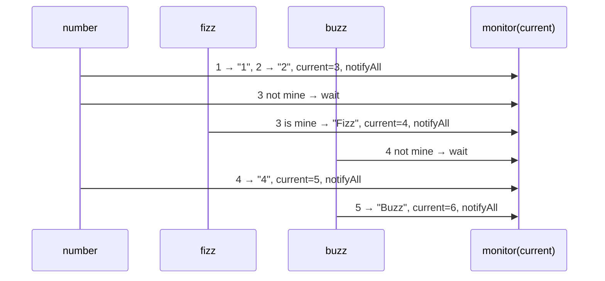
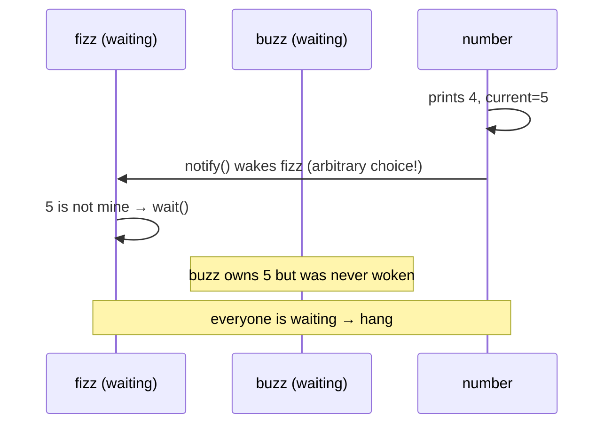

# 3. Multithreaded FizzBuzz

<span class="level l1">L1</span> ★★☆ · generic turn-taking monitor · LeetCode 1195

## Problem

> Four threads share one `FizzBuzz` object. Thread A calls `fizz()` (prints "Fizz" for numbers divisible by 3 but not 5),
> B calls `buzz()` (divisible by 5 but not 3), C calls `fizzbuzz()` (divisible by 15), and D calls `number()` (all others).
> Together they must print the normal FizzBuzz sequence for 1..n.

## Key idea

This is the same pattern as odd/even, but with **four predicates**. Each number belongs to exactly one thread. Write the
"wait for my turn → print → advance → wake others" loop **once** and pass in the predicate and the renderer.





## Code walkthrough

```java
--8<-- "examples/interview-coding/FizzBuzzMultithreaded.java:core"
```

| Code | Why |
|---|---|
| `private synchronized void loop(IntPredicate mine, IntFunction<String> render)` | One method holds the entire protocol. `synchronized` on the method locks `this`, which is the same monitor that `wait`/`notifyAll` use. |
| `while (current <= n && !mine.test(current)) wait();` | Each thread sleeps until the current number is **its** number, or until the sequence is finished. |
| `notifyAll()` (not `notify()`) | With four threads, `notify()` might wake e.g. `buzz` when the next number belongs to `number`. `buzz` sees it's not its turn and goes back to sleep, and **nobody else was woken**, so the program hangs. `notifyAll` wakes everyone, and exactly one proceeds. |
| Four one-line public methods | Each one is just a predicate plus a renderer. The predicates are **mutually exclusive and exhaustive**, which is what guarantees progress. |

## Why `notify()` deadlocks here: a concrete trace



## Run it

```bash
java FizzBuzzMultithreaded.java
```

```text
1 2 Fizz 4 Buzz Fizz 7 8 Fizz Buzz 11 Fizz 13 14 FizzBuzz 16 17 Fizz 19 Buzz Fizz 22 23 Fizz Buzz 26 Fizz 28 29 FizzBuzz
PASS
```

## Common mistakes

* Overlapping predicates (`i % 3 == 0` for fizz *and* `i % 15 == 0` for fizzbuzz): two threads both think it's their turn.
* Loop condition `while (current <= n)` **outside** the synchronized block: you read `current` without the lock.
* Using `notify()`.

## Follow-up questions

??? question "How would you avoid waking all four threads each time?"
    Use one `Condition` per role (as in [problem 2](02-round-robin.md)). After printing `current`, compute which role owns `current+1` and
    signal only that condition.

??? question "Solve it with semaphores."
    Give each role its own semaphore, with `number` starting at 1. A dispatcher loop (or the number thread) decides who owns the next number and releases that
    semaphore. Each printer does `acquire → print → release(dispatcher)`.

??? example "Full source: FizzBuzzMultithreaded.java"
    ```java
    --8<-- "examples/interview-coding/FizzBuzzMultithreaded.java"
    ```
