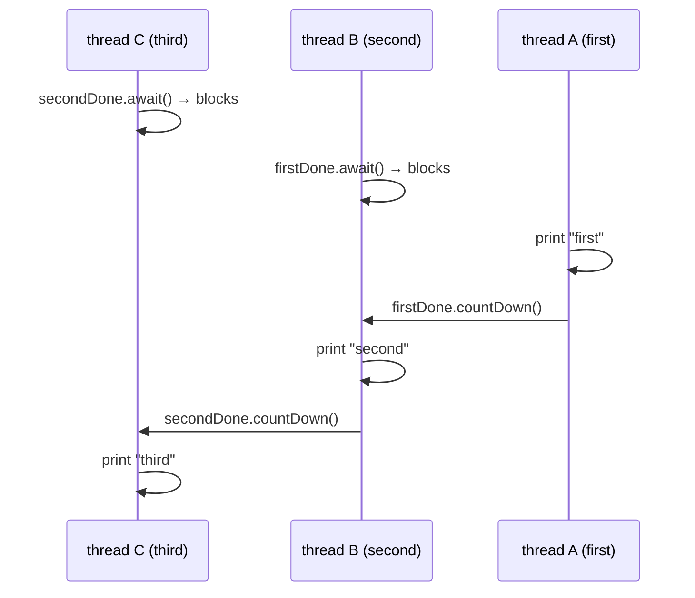

# 4. Print in Order

<span class="level l1">L1</span> ★☆☆ · `CountDownLatch` · `CompletableFuture` · LeetCode 1114

## Problem

> The same `Foo` instance is passed to three threads. Thread A calls `first()`, B calls `second()`, and C calls `third()`. The threads
> may be scheduled in **any** order, but the output must always be `first second third`.

## Key idea

This is a **one-time dependency**, not turn-taking: "second may run only after first has happened". A one-shot gate is exactly a
`CountDownLatch(1)`. Two gates give you a chain.




## Code walkthrough: latches

```java
--8<-- "examples/interview-coding/PrintInOrder.java:latch"
```

| Code | Why |
|---|---|
| `new CountDownLatch(1)` ×2 | Each latch is a gate that opens once and stays open. A thread arriving after it opened passes straight through (no lost signal). |
| `printFirst.run(); firstDone.countDown();` | The **order matters**: print *then* open the gate. `countDown()` happens-before a successful `await()` returns, so everything `first` did is visible to `second`. |
| `firstDone.await()` | Blocks (parks) until the count reaches zero. On a virtual thread, this unmounts and costs nothing. |

## Code walkthrough: CompletableFuture

```java
--8<-- "examples/interview-coding/PrintInOrder.java:cf"
```

A `CompletableFuture<Void>` is also a one-shot, publish-once gate: `complete(null)` opens it and `join()` waits on it. This version
reads like a dependency graph, and it extends naturally to "third needs **both** first and second":
`CompletableFuture.allOf(a, b).join()`.

## Why not `volatile boolean` flags?

```java
while (!firstDone) { }   // busy-wait: burns a CPU core, and with virtual threads it never yields the carrier
```

It's correct if the flag is `volatile`, but it wastes CPU. A latch **parks** the thread instead.

## Run it

The test repeats 200 rounds, and in each round starts the threads in **reverse** order (third, second, first):

```text
200 rounds, threads started in reverse order, always: first second third
PASS
```

## Follow-up questions

??? question "What if `first()` may be called many times, with alternating first/second?"
    Then it's turn-taking, not a one-shot dependency. Use semaphores (as in [problem 1](01-odd-even.md)), because a latch can't be reset.

??? question "Latch vs `join()`?"
    `t1.join()` requires a reference to the thread. A latch decouples *who* signals from *who* waits, and works with pools and virtual threads.

??? example "Full source: PrintInOrder.java"
    ```java
    --8<-- "examples/interview-coding/PrintInOrder.java"
    ```
