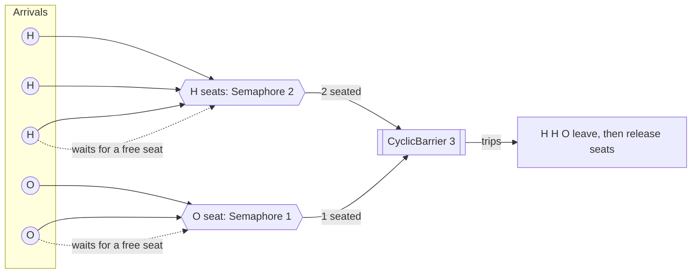
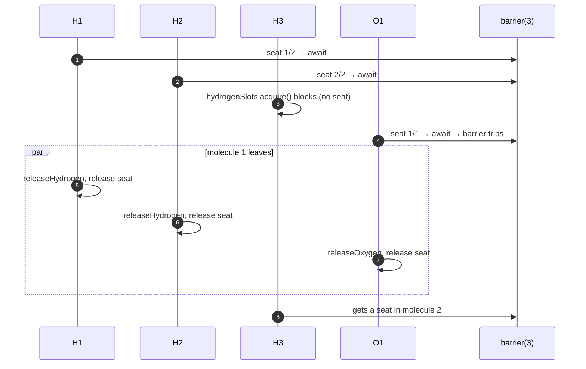

# 5. Building H2O

<span class="level l2">L2</span> ★★★ · `Semaphore` + `CyclicBarrier` · LeetCode 1117

## Problem

> Hydrogen and oxygen threads arrive in random order. They must leave (call `releaseHydrogen()` / `releaseOxygen()`) in
> **groups of three: exactly 2 H and 1 O**. A group must finish leaving before atoms of the next group leave.

## Key idea: two separate concerns

1. **Admission (who may join the current molecule):** a `Semaphore(2)` for H and a `Semaphore(1)` for O. They act as "seats".
2. **Rendezvous (wait until the molecule is complete):** a `CyclicBarrier(3)`. All three seated atoms wait for each other, then
   leave together. The barrier resets itself for the next molecule.





## Code walkthrough

```java
--8<-- "examples/interview-coding/H2OBuilder.java:core"
```

| Step | Code | Why |
|---|---|---|
| 1 | `hydrogenSlots.acquire()` | A third H can't join the molecule being formed. It blocks until a seat is freed. |
| 2 | `molecule.await()` | Waits until 3 atoms are seated. Because of the seat limits, those 3 are always 2 H + 1 O. |
| 3 | `releaseHydrogen.run()` | "Bond": print after the barrier, so no atom of an incomplete molecule ever prints. |
| 4 | `hydrogenSlots.release()` in `finally` | Free the seat **after** printing. That's what keeps molecule *n+1* from printing before molecule *n* is done. |

## Why groups can't interleave

The next molecule needs 2 free H seats and 1 free O seat, which are only released **after** their holders have printed.
So molecule *n+1*'s barrier can't trip until all three atoms of molecule *n* have printed. The test checks this over 500 shuffled
molecules: every consecutive block of 3 outputs contains exactly 2 H.

```text
500 molecules, every consecutive group of 3 is 2xH + 1xO, e.g. [H, O, H, H, H, O, H, H, O]
PASS
```

## Common mistakes

* Releasing the seat **before** printing: the next molecule can start printing in the middle of the current one.
* Using only a barrier with no seats: three H atoms could trip the barrier together.
* Counting atoms with `int` fields without a lock.

## Follow-up questions

??? question "What happens if a thread is interrupted while waiting at the barrier?"
    The barrier becomes **broken**: the others get `BrokenBarrierException`. In production, reset it (`barrier.reset()`) or fail the whole
    group. The `finally` still frees the seat.

??? question "Can you do it without CyclicBarrier?"
    Yes, with a lock, counters `h` and `o`, and a condition. When `h>=2 && o>=1`, form a molecule by decrementing and signalling the members. It's longer,
    but it shows you understand what the barrier does internally (see [problem 9](09-cyclic-barrier.md)).

??? example "Full source: H2OBuilder.java"
    ```java
    --8<-- "examples/interview-coding/H2OBuilder.java"
    ```
