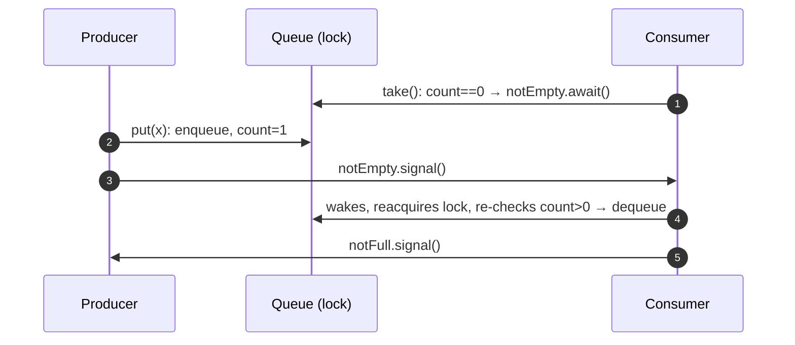

# 6. Bounded Blocking Queue

<span class="level l2">L2</span> ★★☆ · `ReentrantLock` + two `Condition`s · circular buffer · LeetCode 1188

## Problem

> Implement a thread-safe bounded queue: `put(e)` blocks while the queue is full, `take()` blocks while it's empty, and
> `offer(e, timeout)` gives up after the timeout. Don't use `java.util.concurrent` collections.

This is the most-asked "build it yourself" question, because the bounded queue is the backbone of producer/consumer systems,
thread pools, and backpressure.

## Key idea

* **Storage:** a fixed array used as a **circular buffer** (`head`, `tail`, `count`). Both operations are O(1) with no allocation.
* **Coordination:** one lock, **two wait-sets**: producers wait on `notFull`, and consumers wait on `notEmpty`. A put wakes
  one consumer, and a take wakes one producer.

<div class="pb-slots" role="img" aria-label="A ring buffer with 8 slots. Slots 2 to 6 hold A to E. Head is slot 2, tail is slot 7.">
<div class="pb-slot is-empty"><i>0</i><b>·</b></div>
<div class="pb-slot is-empty"><i>1</i><b>·</b></div>
<div class="pb-slot is-full is-head"><i>2</i><b>A</b><em>head → take()</em></div>
<div class="pb-slot is-full"><i>3</i><b>B</b></div>
<div class="pb-slot is-full"><i>4</i><b>C</b></div>
<div class="pb-slot is-full"><i>5</i><b>D</b></div>
<div class="pb-slot is-full"><i>6</i><b>E</b></div>
<div class="pb-slot is-empty is-tail"><i>7</i><b>·</b><em>tail ← put()</em></div>
</div>
<p class="pb-slots-caption"><code>items[8]</code> used as a ring · <code>count = 5</code> · producers wait on <code>notFull</code> when <code>count == 8</code> · consumers wait on <code>notEmpty</code> when <code>count == 0</code></p>

After `put` the tail moves to slot 0 (it wraps around: `(7 + 1) % 8`). After `take` the head moves to slot 3.



## Code walkthrough

### Fields and constructor

```java
--8<-- "examples/interview-coding/BoundedBlockingQueue.java:fields"
```

* `head`, `tail`, and `count` are all **guarded by `lock`**. Write that comment in the interview. It shows you think about ownership.
* Keeping `count` separately avoids the classic ambiguity of `head == tail`, which can mean either *full* or *empty*.

### put / take

```java
--8<-- "examples/interview-coding/BoundedBlockingQueue.java:put-take"
```

| Code | Why |
|---|---|
| `lock.lockInterruptibly()` | A producer blocked trying to get the lock can still be cancelled with `interrupt()`. Plain `lock()` would ignore it. |
| `while (count == items.length) notFull.await();` | Guarded wait. `await` releases the lock, parks, and reacquires the lock before returning. Use `while` because of spurious wake-ups and because another producer may have filled the slot first. |
| `notEmpty.signal()` after enqueue | One new item means **one** consumer can progress, so use `signal` rather than `signalAll` (it's safe because all waiters on `notEmpty` wait for the same condition). |
| `finally { lock.unlock(); }` | Unlock on every path, including `InterruptedException` from `await()`. |

### Timed offer

```java
--8<-- "examples/interview-coding/BoundedBlockingQueue.java:offer"
```

`awaitNanos(n)` returns the **remaining** time. Looping with the returned value handles spurious wake-ups correctly
without extending the total timeout. That detail separates good answers from great ones.

### Helpers

```java
--8<-- "examples/interview-coding/BoundedBlockingQueue.java:helpers"
```

`items[head] = null` prevents a memory leak: without it, the array keeps references to objects that were already taken.

## Why two Conditions beat `wait/notifyAll`

With a single monitor, producers and consumers share one wait-set, so you must `notifyAll`. That wakes producers when only
consumers can make progress. Two conditions let you `signal` exactly the right side. (This is how
`java.util.concurrent.ArrayBlockingQueue` is built.)

## Run it

20 producers × 5,000 items flow through a capacity of **8** (heavy blocking), with 10 consumers, all on virtual threads:

```text
20 producers x 5000 items through capacity 8: sum=250050000 (expected 250050000), timed offer on full queue=false
PASS
```

## Common mistakes

* `if` instead of `while` around `await()`.
* `signal()` called **before** the state change, or outside the lock (`IllegalMonitorStateException`).
* Unbounded `ArrayList` storage: that's not a *bounded* queue.
* Using `synchronized` + `wait()` with thousands of virtual threads on JDK 21–23: `Object.wait()` pins carriers. `Condition.await()`
  doesn't.

## Follow-up questions

??? question "How would you get more throughput?"
    Use two locks, one for `put` (tail) and one for `take` (head), with an atomic count, like `LinkedBlockingQueue`. Producers and consumers then
    don't contend with each other.

??? question "How do you add `drainTo` / batch take?"
    Take the lock once, dequeue up to `max` items, then `notFull.signalAll()` (several producers can now proceed).

??? question "Why `lockInterruptibly` but `lock()` in `size()`?"
    `size()` never waits for a condition, so it holds the lock only briefly, and there's nothing worth interrupting.

??? example "Full source: BoundedBlockingQueue.java"
    ```java
    --8<-- "examples/interview-coding/BoundedBlockingQueue.java"
    ```
