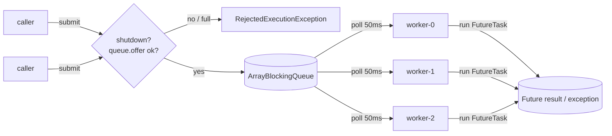
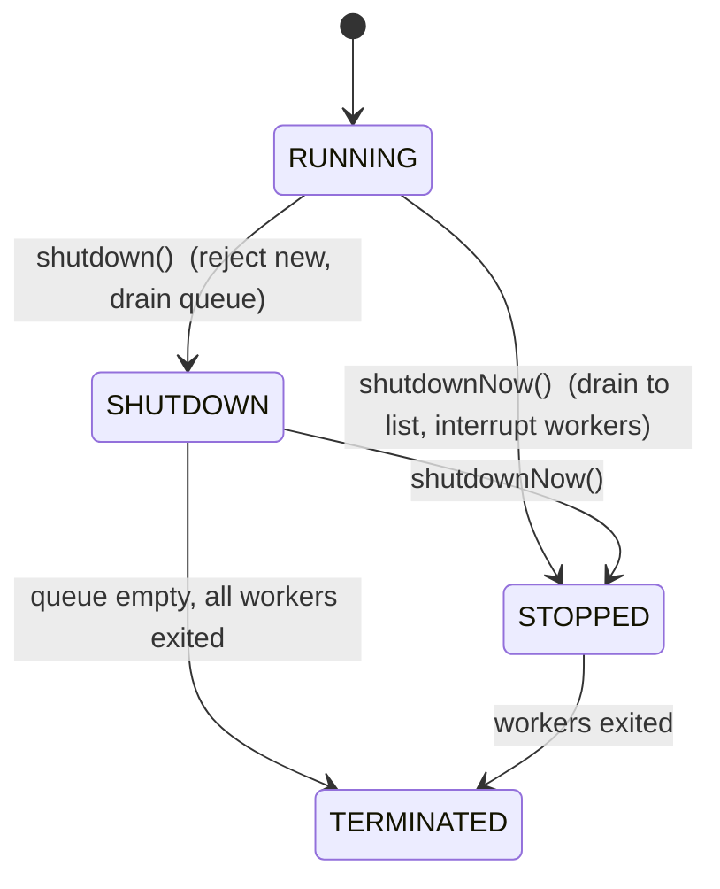
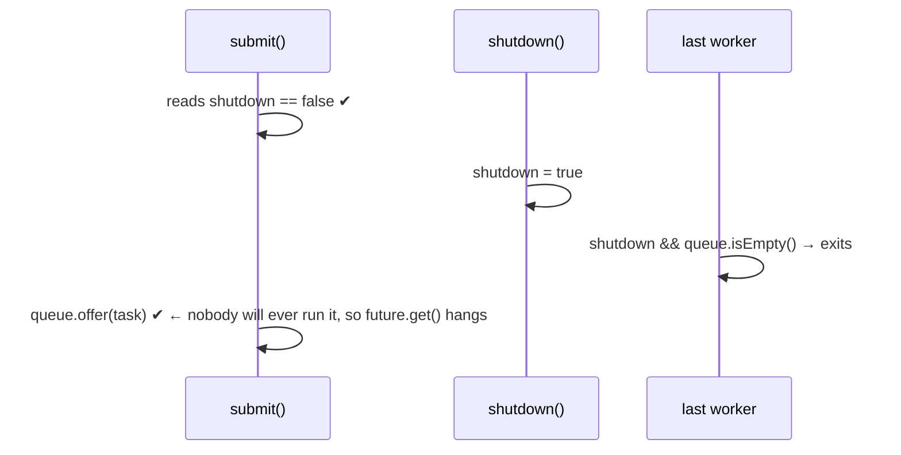

# 7. Build a Thread Pool

<span class="level l3">L3</span> ★★★ · worker loop · `FutureTask` · shutdown race

## Problem

> Implement a fixed-size thread pool with a bounded queue. `submit(Callable)` returns a `Future`. If the queue is full,
> reject. Support `shutdown()` (finish queued work), `shutdownNow()` (interrupt), and `awaitTermination()`.

The interviewer wants to see that you understand what `ThreadPoolExecutor` does: worker lifecycle, result and exception
propagation, rejection, and the subtle **race between shutdown and submit**.

## Architecture





## Code walkthrough

### State and worker creation

```java
--8<-- "examples/interview-coding/SimpleThreadPool.java:fields"
```

* Workers are **platform** threads named `pool-worker-N`. A pool exists to *reuse* expensive threads. (You never pool virtual threads.)
* `shutdown` is `volatile` because workers read it without holding `stateLock`.

### The worker loop

```java
--8<-- "examples/interview-coding/SimpleThreadPool.java:worker"
```

| Code | Why |
|---|---|
| `queue.poll(50, ms)` rather than `take()` | A worker blocked in `take()` would never notice `shutdown`. Polling with a timeout lets it check the flag regularly. The alternative is to put one *poison pill* per worker on shutdown. |
| `catch (InterruptedException) → return` | `shutdownNow()` interrupts workers, and that's the signal to exit immediately. |
| `if (shutdown && queue.isEmpty()) return;` | Graceful exit: finish everything queued first. |
| `try { task.run(); } catch (Throwable t)` | A task exception must **never** kill the worker. (`ThreadPoolExecutor` replaces dead workers instead.) `FutureTask` already captures exceptions, so this guards only raw `Runnable`s. |

### submit, shutdown, termination

```java
--8<-- "examples/interview-coding/SimpleThreadPool.java:submit"
```

| Code | Why |
|---|---|
| `new FutureTask<>(callable)` | `FutureTask` is both a `Runnable` (for the worker) and a `Future` (for the caller). It stores the result **or** the exception, which `get()` rethrows as an `ExecutionException`. |
| `synchronized (stateLock) { check shutdown; offer }` | Makes "is it open? then enqueue" **atomic** with respect to `shutdown()`. See the race below. |
| `queue.offer(task)` → `false` ⇒ reject | The bounded queue gives backpressure. `offer` doesn't block, so holding `stateLock` while calling it is fine. |
| `shutdownNow()`: `drainTo` + `interrupt` | Returns the never-started tasks to the caller, like the JDK does. |
| `awaitTermination` uses `Thread.join(Duration)` | It shares one deadline across all workers (JDK 19+ `join` returns a boolean). |

## The shutdown race (the question that separates seniors)

Without `stateLock`, this interleaving loses a task forever:



With `stateLock`, `shutdown = true` can't happen between the check and the `offer`. So either the task is enqueued
**before** shutdown (and a worker will drain it, because workers only exit when the queue is empty), or the submit is rejected.
`ThreadPoolExecutor` solves the same problem with a single atomic `ctl` word that packs the run state and worker count together.

## Run it

```text
failure captured in Future: java.lang.IllegalStateException: boom
500 tasks ok (sum of squares=41541750), queue-full rejection=true, post-shutdown rejection=true
PASS
```

## Common mistakes

* Workers blocked in `take()` forever: the pool never shuts down.
* Letting a task's exception propagate out of the worker loop: the pool silently shrinks.
* An unbounded queue: OOM under load, and rejection never happens.
* `shutdown` that isn't volatile or synchronized: workers may never see it.

## Follow-up questions

??? question "How does ThreadPoolExecutor grow from core to max size?"
    It adds core threads first, then queues, and only starts extra threads up to `max` when the **queue is full**. Then it rejects. See
    [Executors](../java8-toolkit/executors.md).

??? question "How would you add a CallerRuns policy?"
    When `offer` fails, run `task.run()` on the submitting thread. That naturally slows the producer down.

??? question "Why not just use virtual threads?"
    For IO-bound tasks you would: `Executors.newVirtualThreadPerTaskExecutor()` + a `Semaphore`. A fixed pool remains right for
    **CPU-bound** work, sized to the core count.

??? example "Full source: SimpleThreadPool.java"
    ```java
    --8<-- "examples/interview-coding/SimpleThreadPool.java"
    ```
