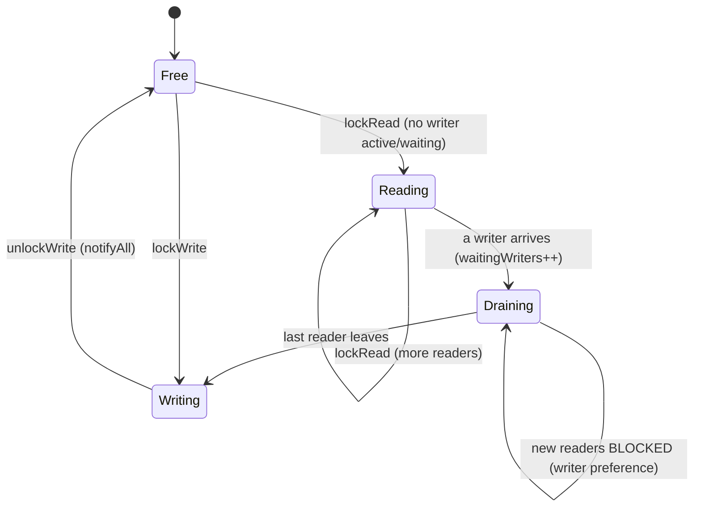
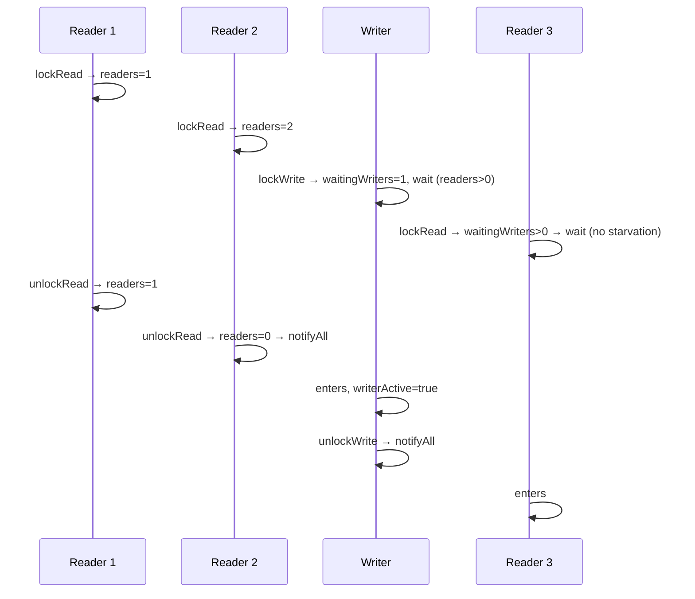
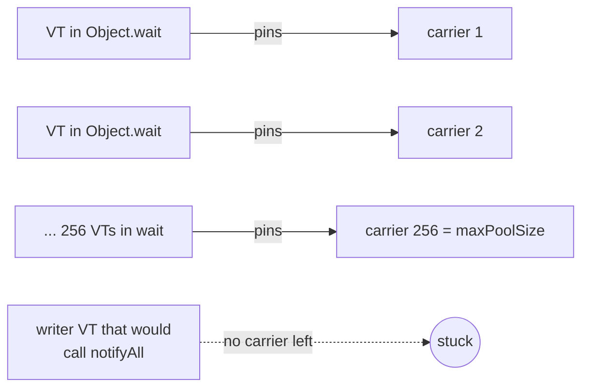

# 8. Read-Write Lock

<span class="level l2">L2</span> ★★☆ · monitor with writer preference

## Problem

> Implement a lock that allows **many concurrent readers** or **one exclusive writer**. Writers must not starve when
> readers keep arriving.

## Key idea: three counters, one invariant

Invariant: `writerActive ⇒ activeReaders == 0`, and at most one writer.

* A **reader** may enter if no writer is active **and no writer is waiting**. The second condition is **writer preference**.
  Without it, a constant stream of readers starves writers forever.
* A **writer** may enter if no writer is active and there are no active readers.





## Code walkthrough

```java
--8<-- "examples/interview-coding/SimpleReadWriteLock.java:core"
```

| Code | Why |
|---|---|
| All four methods `synchronized` | The counters are guarded by `this`. The lock is held only **briefly** inside these methods, not while the caller reads or writes the data. |
| Reader waits while a writer is active **or waiting** | Readers yield to writers that are queued, not only to the active one. That's writer preference. |
| `if (activeReaders == 0) notifyAll();` | Only the **last** reader leaving can unblock a writer, so there's no need to notify earlier. |
| `waitingWriters--` in `finally` | If a waiting writer is **interrupted**, it must still decrement. Otherwise readers would wait forever for a writer that no longer exists. |
| `IllegalMonitorStateException` checks | Unlocking a lock you don't hold is a programming error. Fail loudly. |

## A real lesson: this code hangs with 2,000 virtual threads on JDK 21

The first version of the test used `Executors.newVirtualThreadPerTaskExecutor()` with 2,000 tasks, and it **hung**. The reason:



On JDK 21–23, `Object.wait()` **pins** the virtual thread to its carrier (the scheduler compensates by adding carriers, up to
256). With hundreds of readers parked in `wait()`, every carrier is pinned, and the thread that would call `notifyAll()` never gets
to run. **JEP 491 (JDK 24)** fixes this. On JDK 21 the options are:

* run monitor-based code on **platform threads** (what the test does now, with a pool of 64), or
* build it with `ReentrantLock` + `Condition`, whose `await()` unmounts the virtual thread instead of pinning it.

## Run it

```text
writes=200 violations=0 maxConcurrentReaders=64
PASS
```

The test asserts that no reader ever overlaps a writer, that writers are exclusive, and that readers really do run concurrently (max > 1).

## Follow-up questions

??? question "Can a reader upgrade to a writer?"
    Not safely. Two readers trying to upgrade each wait for the other to leave, and that's a deadlock. `ReentrantReadWriteLock` forbids upgrades but allows
    **downgrading** (acquire read while holding write, then release write).

??? question "Make it reentrant."
    Track the owner thread and a hold count for the writer, and a per-thread read count (a `ThreadLocal` or a map) for readers.

??? question "When is a RW lock slower than a plain lock?"
    When critical sections are tiny: the bookkeeping costs more than the parallelism gains. Consider `StampedLock` optimistic reads, or
    immutable snapshots in an `AtomicReference`.

??? example "Full source: SimpleReadWriteLock.java"
    ```java
    --8<-- "examples/interview-coding/SimpleReadWriteLock.java"
    ```
