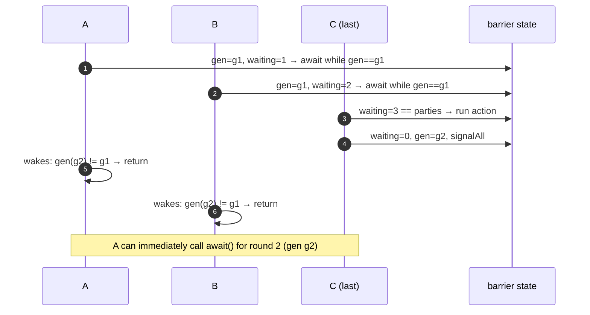
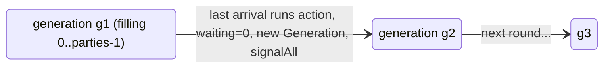

# 9. Implement a Cyclic Barrier

<span class="level l3">L3</span> ★★★ · `ReentrantLock` + `Condition` · generation object

## Problem

> Implement `CyclicBarrier(parties, action)`. `await()` blocks until `parties` threads have called it, then runs `action` once
> and releases them all. The barrier must be **reusable** for the next round.

## Key idea: the generation

The naive version waits with `while (waiting < parties) await();`. That fails because the last thread **resets
`waiting` to 0** for the next round, so the woken threads see `0 < parties` and go back to sleep forever.

The fix is to tag each round with a **generation object**. A waiter remembers *its* generation and waits until the
generation changes. Fast threads that start the *next* round get a new generation, and they can't be confused with the old one.





## Code walkthrough

```java
--8<-- "examples/interview-coding/CustomCyclicBarrier.java:core"
```

| Code | Why |
|---|---|
| `private static final class Generation {}` | An empty class whose **identity** is the round id. A counter (`long round`) works too. |
| `Generation myGeneration = generation;` | Captured under the lock when the thread arrives. |
| `int index = parties - 1 - waiting;` | Arrival index, matching the JDK's contract (the last arrival gets 0). It's handy for "elect one thread to do X". |
| `if (waiting == parties) { action; waiting = 0; generation = new Generation(); signalAll(); }` | The **last** thread trips the barrier. The action runs *before* anyone is released, so it sees the results of all parties (they all held the lock before it). |
| `while (myGeneration == generation) tripped.await();` | The correct wait condition. It handles spurious wake-ups and is immune to the `waiting` reset. |

## Run it

8 parties × 1,000 rounds. The barrier action checks that **all 8** parties finished round *r* before anyone started round *r+1*:

```text
8 parties x 1000 rounds: rounds completed=1000, ordering violations=0
PASS
```

## What the JDK version adds

* **Broken barrier:** if a waiter is interrupted or times out, the generation is marked *broken*, and all waiters get
  `BrokenBarrierException`. Otherwise the others would wait forever for a party that left.
* **Timed** `await(timeout)`.
* `reset()`: break the current generation and start a new one.

??? question "Follow-up: add broken-barrier semantics."
    Add `boolean broken` to `Generation`. In the `catch (InterruptedException)` around `await`, if the generation is unchanged, set
    `broken = true`, `signalAll()`, and rethrow. After waking, if `myGeneration.broken`, throw `BrokenBarrierException`.

??? question "CountDownLatch vs CyclicBarrier vs Phaser?"
    A latch is one-shot, and waiters wait for *events*. A barrier is reusable, and parties wait for *each other*. A Phaser is a reusable barrier with dynamic
    registration and phase numbers (used in [problem 19](19-web-crawler.md)).

??? example "Full source: CustomCyclicBarrier.java"
    ```java
    --8<-- "examples/interview-coding/CustomCyclicBarrier.java"
    ```
