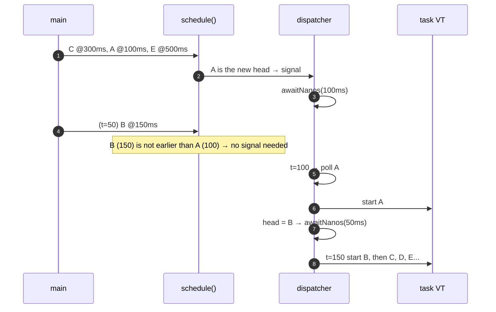

# 10. Delayed Task Scheduler

<span class="level l3">L3</span> ★★★ · `PriorityQueue` · `Condition.awaitNanos`

## Problem

> Implement `schedule(task, delay)`. Tasks must run as close as possible to their due time, in due-time order. A task scheduled
> later with a **shorter** delay must still run first. Don't use `ScheduledExecutorService` or `DelayQueue`.

## Key idea

* A **min-heap** (`PriorityQueue`) ordered by due time gives the next task in O(1), and insertion costs O(log n).
* One **dispatcher** thread sleeps *exactly until the head is due*, using `awaitNanos(head.due - now)`.
* When `schedule()` inserts a task that becomes the **new head**, it signals the dispatcher so it can recompute a shorter sleep.
  This is the important part.
* Due tasks run on **virtual threads**, so a slow task never delays the next one.

```mermaid
flowchart TD
    L[dispatcher loop: lock] --> S{shutdown?}
    S -->|yes| X[exit]
    S -->|no| E{queue empty?}
    E -->|yes| W1[changed.await&#40;&#41;]
    W1 --> S
    E -->|no| D{head due?}
    D -->|no| W2["changed.awaitNanos(head.due - now)"]
    W2 --> S
    D -->|yes| P[poll head, unlock]
    P --> R[start on virtual thread]
    R --> L
```





## Code walkthrough

### Data structures

```java
--8<-- "examples/interview-coding/DelayedTaskScheduler.java:fields"
```

* `Job` is a `record` with `compareTo` by `dueNanos`, then by a **sequence number**, so tasks with equal due times run FIFO
  (a `PriorityQueue` isn't stable by itself).
* `System.nanoTime()`, not `currentTimeMillis()`: it's monotonic and unaffected by wall-clock adjustments.

### schedule()

```java
--8<-- "examples/interview-coding/DelayedTaskScheduler.java:schedule"
```

`if (queue.peek() == job) changed.signal();` means we only wake the dispatcher if the new job is now the **earliest**. Otherwise the
dispatcher's current sleep is already correct.

### The dispatcher

```java
--8<-- "examples/interview-coding/DelayedTaskScheduler.java:dispatch"
```

| Code | Why |
|---|---|
| `changed.await()` when empty | No busy waiting. It sleeps until something is scheduled. |
| `changed.awaitNanos(wait)` | Sleeps until the head is due, **or** until signalled about a new head, **or** spuriously. In every case, loop and recompute. |
| `due = queue.poll(); break;` then unlock | Take the job out **under** the lock, but run it **outside** the lock. |
| `Thread.ofVirtual().start(due.task())` | User code never runs on the dispatcher: a slow or failing task can't delay the others. |

## Run it

```text
execution order: [A@100, B@150, C@300, D@450, E@500] finished after 502 ms
PASS
```

`B` was scheduled 50 ms after `A`, `C`, and `E`, yet it ran in the correct place.

## Follow-up questions

??? question "How does `ScheduledThreadPoolExecutor` / `DelayQueue` do it?"
    The same way: a heap plus a `Condition` with `awaitNanos`. They also add a **leader** thread (the Leader-Follower pattern): only one thread
    waits timed for the head, while the others wait indefinitely. That avoids many threads all waking at the same deadline.

??? question "Add fixed-rate repetition."
    After running, re-insert the job with `due += period`. Use the *previous due time*, not `now`, to avoid drift. Catch exceptions so one failure
    doesn't silently cancel future runs.

??? question "What about millions of timers?"
    A heap costs O(log n) per operation. Hashed or hierarchical **timing wheels** (Netty `HashedWheelTimer`, Kafka) give O(1) inserts at
    some cost in precision.

??? question "Durability?"
    In-memory timers die with the process. Use DB-backed schedulers (Quartz, `SKIP LOCKED` polling) for anything that must survive restarts.

??? example "Full source: DelayedTaskScheduler.java"
    ```java
    --8<-- "examples/interview-coding/DelayedTaskScheduler.java"
    ```
