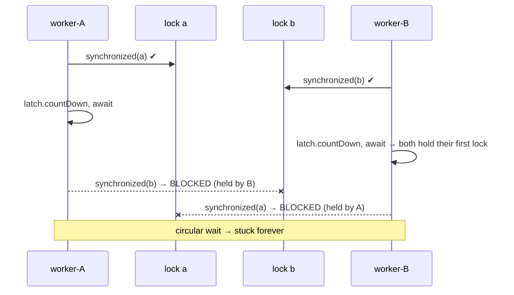
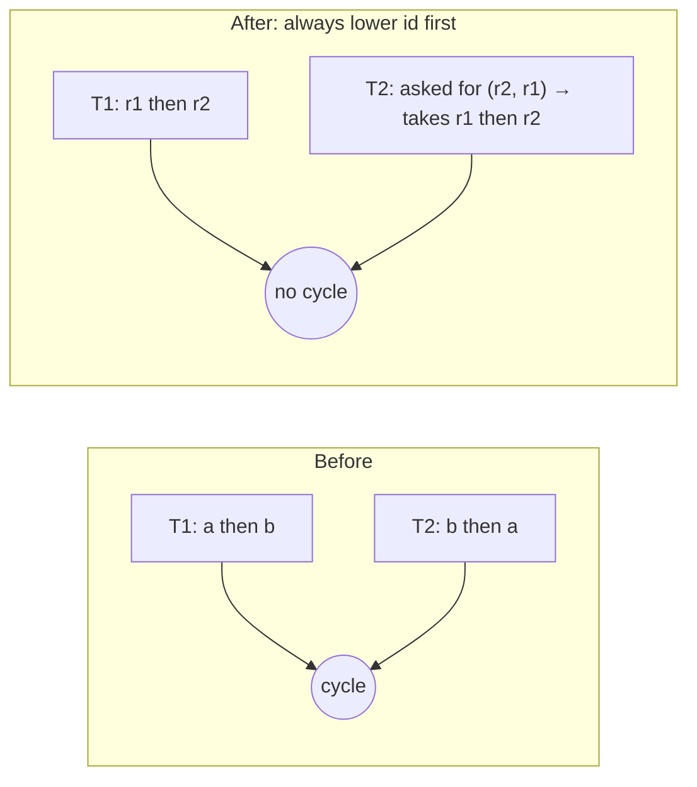

# 11. Deadlock: Create, Detect, Fix

<span class="level l2">L2</span> ★★☆ · `ThreadMXBean` · lock ordering · `tryLock`

## Problem

> 1. Write a program that **always** deadlocks. 2. Detect the deadlock programmatically. 3. Fix it in two different ways.

Interviewers ask "write a deadlock" to see whether you can make it **deterministic** rather than "usually happens". Then they move on to the
Coffman conditions and the fixes.

## The four Coffman conditions

A deadlock needs **all four**. Break any one of them and the deadlock is impossible.

| Condition | Meaning | Broken by |
|---|---|---|
| Mutual exclusion | Locks are exclusive | Lock-free/immutable data |
| **Hold and wait** | Holding A while waiting for B | `tryLock` + release + retry (fix 2) |
| No preemption | Locks can't be taken away | Timeouts / interruptible locks |
| **Circular wait** | A→B and B→A | Global lock ordering (fix 1) |

## 1. Creating a guaranteed deadlock

```java
--8<-- "examples/interview-coding/DeadlockDetectAndFix.java:create"
```



The `CountDownLatch(2)` is the trick that makes it **deterministic**: neither thread tries its second lock until **both** hold their
first one. Without it, one thread might grab both locks before the other starts, and the deadlock wouldn't happen. The threads are
`daemon` so the demo JVM can still exit.

## 2. Detecting it

```java
--8<-- "examples/interview-coding/DeadlockDetectAndFix.java:detect"
```

* `ThreadMXBean.findDeadlockedThreads()` finds cycles across **both** `synchronized` monitors and `java.util.concurrent` locks
  (`findMonitorDeadlockedThreads` covers monitors only).
* `ThreadInfo` tells you who waits for which lock and who owns it. That's the same information `jstack` prints as "Found one Java-level deadlock".
* In production you'd run this in a health check or a scheduled task and alert. The JVM can't *resolve* a deadlock; you restart the process.
* It only sees **platform** threads. For virtual threads, use `jcmd <pid> Thread.dump_to_file -format=json`.

Real output:

```text
1) creating a deadlock...
  DEADLOCK: worker-B is waiting for java.lang.Object@1e683a3e held by worker-A
```

## 3a. Fix: global lock ordering (breaks circular wait)

```java
--8<-- "examples/interview-coding/DeadlockDetectAndFix.java:fix-order"
```



If every thread acquires locks in the same total order, a cycle in the wait-for graph is impossible. Use a **stable,
unique** key for the order (here an `id`). `System.identityHashCode` works but can collide, so a tie-breaker lock is then needed.

## 3b. Fix: `tryLock` with timeout and back-off (breaks hold-and-wait)

```java
--8<-- "examples/interview-coding/DeadlockDetectAndFix.java:fix-trylock"
```

| Code | Why |
|---|---|
| `x.tryLock(10, ms)` | Don't wait forever for the first lock. |
| `y.tryLock(10, ms)` fails → `finally x.unlock()` | **Release what you hold** if you can't get everything. That breaks hold-and-wait. |
| Random `sleep(1..5ms)` back-off | Without randomness, two threads can retry in lockstep forever. That's a **livelock**. |
| Overall deadline | Gives up eventually and reports failure instead of spinning. |

## Run it

```text
2) lock ordering: 2 threads x 100k opposite-order acquisitions
  completed, counter=200000
3) tryLock + backoff: 2 threads x 10k opposite-order acquisitions
  completed, counter=20000
PASS
```

## Follow-up questions

??? question "Ordering vs tryLock: which do you prefer?"
    Ordering: it's simple, it has no retries, and it's deterministic, but it requires knowing every lock up front. `tryLock` handles dynamic lock sets and gives
    timeouts, but costs retries and the risk of livelock. Default to ordering.

??? question "Can a single thread deadlock itself?"
    With non-reentrant locks, yes: re-acquiring a `StampedLock` or a `Semaphore(1)`. It also happens when a thread waits for a task it submitted to a full single-thread
    pool (pool-induced deadlock).

??? question "Can virtual threads deadlock?"
    Yes, with the same lock cycles. On JDK 21–23 there's an extra form, **carrier starvation**: all carriers pinned by VTs waiting on a monitor held by an
    unmounted VT. JEP 491 (JDK 24) fixes that.

??? example "Full source: DeadlockDetectAndFix.java"
    ```java
    --8<-- "examples/interview-coding/DeadlockDetectAndFix.java"
    ```
