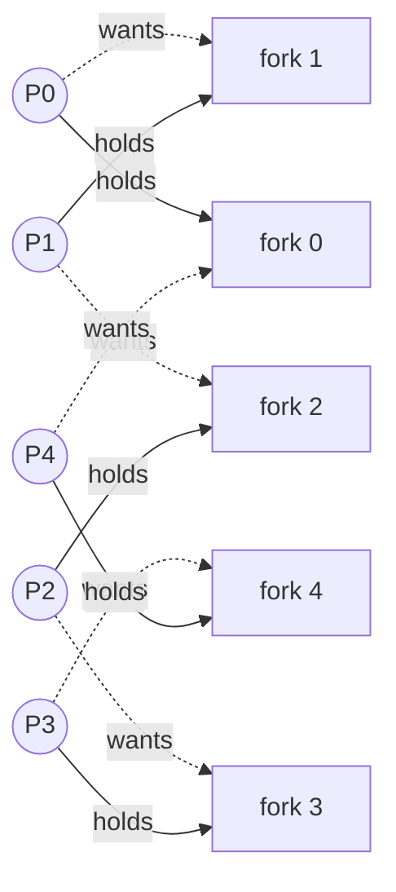
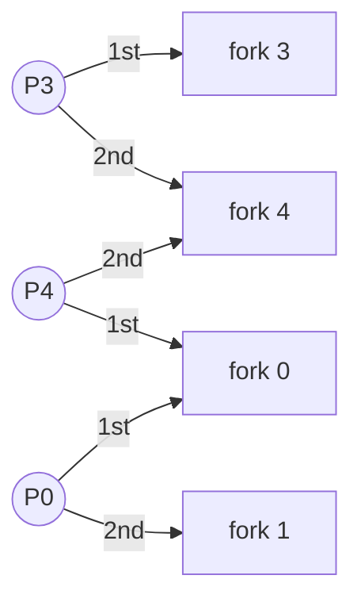
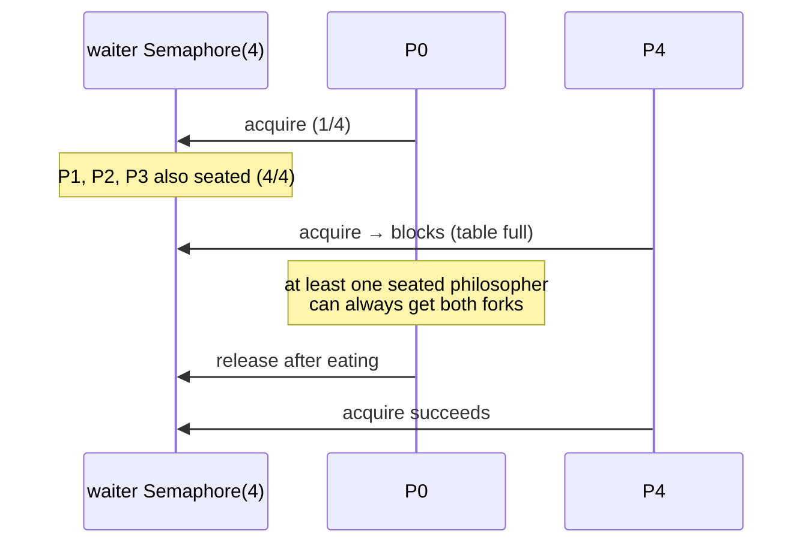

# 12. Dining Philosophers

<span class="level l2">L2</span> ★★☆ · resource ordering · waiter semaphore · LeetCode 1226

## Problem

> Five philosophers sit at a round table with one fork between each pair. To eat, a philosopher needs **both** adjacent forks.
> Design a protocol with no deadlock (everyone stuck) and no starvation (someone never eats).

## Why the naive solution deadlocks

"Pick up the left fork, then the right fork." If all five pick up their left fork at the same moment, each waits for a right fork held by a
neighbour, and the wait-for graph is a cycle.



## Solution 1: resource ordering

```java
--8<-- "examples/interview-coding/DiningPhilosophers.java:ordering"
```

Everyone picks up the **lower-numbered** fork first. Philosophers 0–3 behave as before (left then right), but philosopher 4's
neighbours are forks 4 and 0, so they pick up **fork 0 first**. That single asymmetry breaks the cycle:



P4 and P0 now compete for fork 0 **first**. Whoever loses holds nothing, so fork 4 stays free for P3. There's no cycle, so there's no deadlock.
`new ReentrantLock(true)` (fair) hands each fork out FIFO, which prevents **starvation**.

## Solution 2: the waiter (limit the diners)

```java
--8<-- "examples/interview-coding/DiningPhilosophers.java:waiter"
```

A `Semaphore(N-1)` lets at most four philosophers try to eat at once. By the pigeonhole principle, four philosophers holding
five forks means **at least one** of them has both forks, so the system always makes progress. Inside, the naive left-then-right
order is now safe.



## Run it

```text
resource-order  5 philosophers x 20,000 meals each: all finished, no deadlock
waiter          5 philosophers x 20,000 meals each: all finished, no deadlock
PASS
```

## Comparing the solutions

| | Resource ordering | Waiter (N-1 seats) | `tryLock` both + back-off |
|---|---|---|---|
| Deadlock-free | ✔ | ✔ | ✔ |
| Starvation-free | With fair locks | With a fair semaphore | Probabilistically |
| Extra coordination | None | A global semaphore (a contention point) | Retries |
| General lesson | Global lock order | Limit concurrency | Don't hold and wait |

??? question "What's the real-world version of this problem?"
    Any operation that needs several locks at once: transferring between two accounts ([problem 14](14-bank-transfer.md)), moving
    items between two inventory bins, or updating two DB rows (keep a consistent row-locking order).

??? example "Full source: DiningPhilosophers.java"
    ```java
    --8<-- "examples/interview-coding/DiningPhilosophers.java"
    ```
