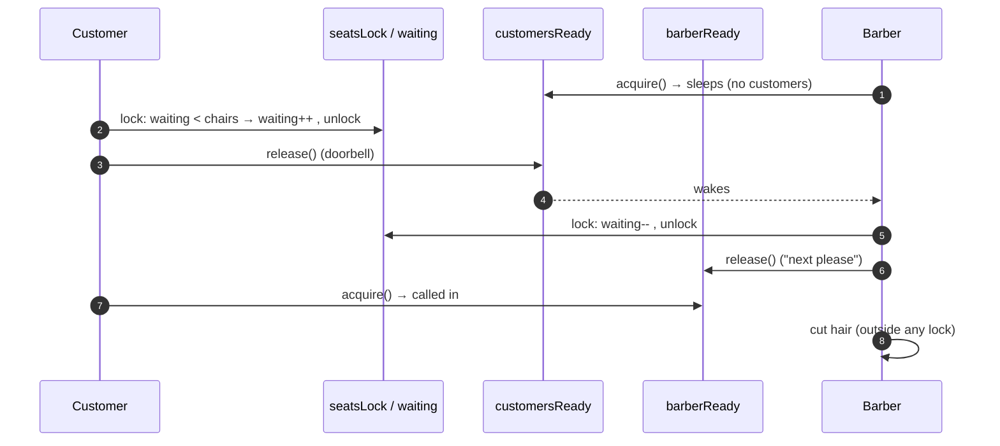
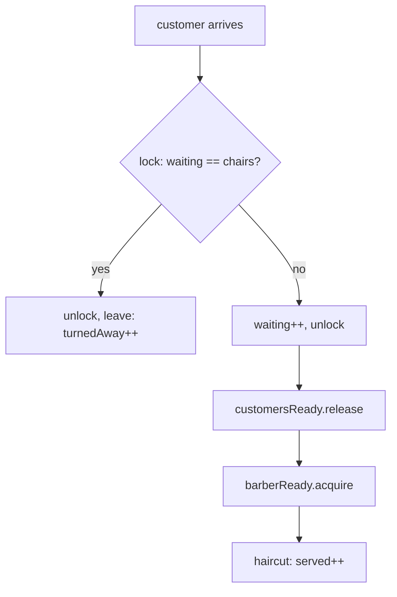

# 13. Sleeping Barber

<span class="level l2">L2</span> ★★☆ · signalling semaphores · Dijkstra 1965

## Problem

> A barbershop has one barber, one barber chair, and N waiting chairs. If there are no customers, the barber sleeps. An arriving customer
> wakes the barber, or sits in a free waiting chair, or **leaves** if all chairs are taken. Avoid races where the barber sleeps
> while a customer waits, or two customers sit in the same chair.

## Key idea: two "doorbells" and one counter

| Shared item | Type | Role |
|---|---|---|
| `waiting` | `int` guarded by `seatsLock` | How many waiting chairs are taken: decides "sit or leave" |
| `customersReady` | `Semaphore(0)` | Customer → barber: "someone is waiting" (the barber sleeps on it) |
| `barberReady` | `Semaphore(0)` | Barber → customer: "next please" |

Semaphores **count** signals, so a `release()` that happens before the matching `acquire()` isn't lost. That's
exactly the race that broke early solutions built on wait/notify.





## Code walkthrough

```java
--8<-- "examples/interview-coding/SleepingBarber.java:core"
```

| Code | Why |
|---|---|
| Customer: check-and-increment `waiting` under `seatsLock` | "Is a chair free? Take it" must be atomic, or two customers take the last chair. |
| Customer: `customersReady.release()` **after** unlocking | Signals don't need the lock. Releasing outside it keeps the critical section tiny. |
| Barber: `customersReady.acquire()` | This is the barber's "sleep". The permit count equals the number of waiting customers, so no wake-up is lost. |
| Barber: `waiting--` then `barberReady.release()` | Frees a waiting chair and calls exactly one customer in. |
| `Thread.sleep(2ms)` outside the lock | The haircut (the work) never holds a lock, so new customers can still check the chairs meanwhile. |
| Barber exits on `InterruptedException` | That's how the shop closes: the main thread interrupts the barber after all customers are done. |

## Run it

300 customers arrive at random intervals, with 5 chairs:

```text
customers=300 served=220 turnedAway=80
PASS
```

The invariant `served + turnedAway == customers` holds, so nobody is lost or double-counted.

??? question "Multiple barbers?"
    Start K barber threads with the same code. The semaphores already handle many-to-many. Each `barberReady.release()` admits one customer.

??? question "Where does this pattern appear in real systems?"
    In a bounded worker pool with a bounded queue and rejection: chairs = queue capacity, barber = worker, leaving = `RejectedExecutionException`.
    It's [problem 7](07-thread-pool.md) in disguise.

??? example "Full source: SleepingBarber.java"
    ```java
    --8<-- "examples/interview-coding/SleepingBarber.java"
    ```
