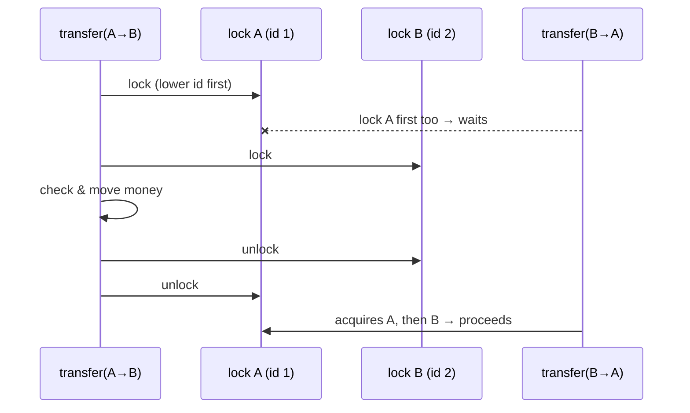
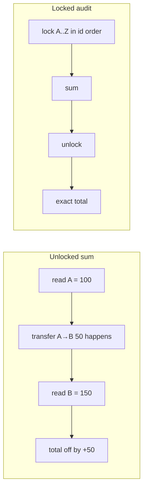

# 14. Bank Transfer

<span class="level l2">L2</span> ★★☆ · ordered locking · consistent snapshot

## Problem

> Implement `transfer(from, to, amount)` for a bank with many accounts and thousands of concurrent transfers.
> Requirements: no lost updates, no negative balances, **no deadlock**, and the total money in the bank never changes,
> even when you audit it while transfers are running.

## Key idea

* A lock per account gives fine-grained concurrency (transfers between unrelated accounts run in parallel).
* A transfer needs **two** locks, so a deadlock is possible (A→B concurrently with B→A). Lock in **id order**.
* "Check balance, then debit" is a check-then-act, so it's safe only while **both** locks are held.
* The audit locks **all** accounts in the same id order to get a consistent snapshot.



## Code walkthrough

### Account

```java
--8<-- "examples/interview-coding/BankTransfer.java:account"
```

The balance is a `long` in **minor units** (paise or cents). Never use `double` for money: `0.1 + 0.2 != 0.3`.

### Transfer

```java
--8<-- "examples/interview-coding/BankTransfer.java:transfer"
```

| Code | Why |
|---|---|
| `amountMinor <= 0` check | Validate input before taking any lock. |
| `if (from == to) return true;` | Avoids locking the same account twice. It would work (the lock is reentrant), but it's pointless. |
| `first = from.id < to.id ? from : to` | **Global lock ordering**, which removes the circular wait. Ids are unique and stable, unlike `identityHashCode`. |
| Balance check **inside** both locks | No other thread can change either balance between the check and the update. |
| Nested `try/finally` | Each lock is released even if the inner code throws, in reverse acquisition order. |

### Audit

```java
--8<-- "examples/interview-coding/BankTransfer.java:audit"
```

Summing balances **without** locks can read A *before* a transfer and B *after* it, which double-counts the money in flight.
Locking every account (in id order, so it can't deadlock with transfers) gives a moment where no transfer is half-done.



## Run it

200,000 concurrent random transfers on virtual threads, with an audit in the middle of the run:

```text
200,000 concurrent transfers: total before=5000000 after=5000000 mid-run audit=5000000, rejected(insufficient)=4400
PASS
```

## Follow-up questions

??? question "The audit blocks all transfers. Can you avoid that?"
    Yes, with **MVCC** or snapshots: keep an append-only ledger (double-entry: every transfer writes −amount and +amount entries in one atomic
    step), then compute balances as of a ledger position. That's how real wallets and DBs work.

??? question "What about across many service instances?"
    In-JVM locks don't help there. Use one DB transaction with `SELECT … FOR UPDATE` on both rows **in id order**, or optimistic `@Version`
    with retries, plus an idempotency key per transfer. See [Distributed Concurrency](../system-design/distributed-concurrency.md).

??? question "Could you use `synchronized` instead of ReentrantLock?"
    Yes: `synchronized (first) { synchronized (second) { … } }`. On JDK 21–23 that's fine because nothing blocks inside (pure memory updates).
    `ReentrantLock` adds `tryLock` if you want timeouts.

??? example "Full source: BankTransfer.java"
    ```java
    --8<-- "examples/interview-coding/BankTransfer.java"
    ```
