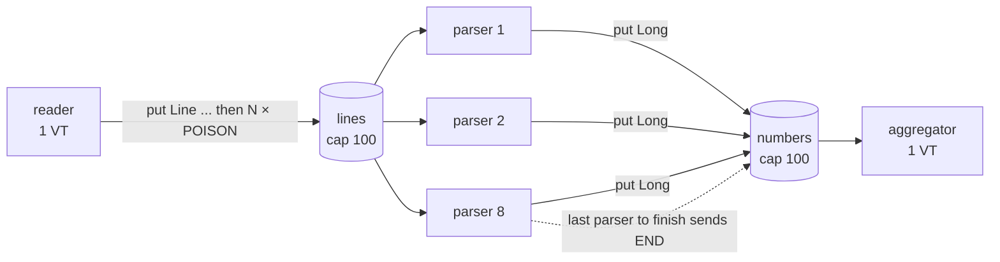
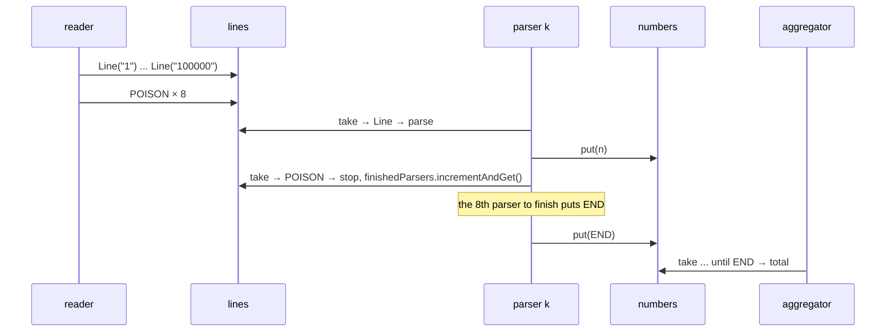

# 15. Producer-Consumer Pipeline with Poison Pills

<span class="level l2">L2</span> ★★☆ · `BlockingQueue` · poison pills · sealed types · virtual threads

## Problem

> Build a three-stage pipeline: a **reader** emits lines, **N parser** threads convert each line to a number, and an
> **aggregator** sums them. Stages must run concurrently, memory must stay bounded, and the pipeline must **shut down cleanly**
> when the input ends.

## Key idea

* **Bounded queues** between the stages. A full queue blocks the upstream `put`, which is *backpressure* with no extra code.
* **Poison pills** for shutdown: a special message that means "no more data". With N consumers you need **N pills**, one per
  consumer, because each consumer stops after swallowing one.
* Fan-in from N parsers to one aggregator: only the **last** parser to finish sends the aggregator's pill.





## Code walkthrough

### Message types

```java
--8<-- "examples/interview-coding/ProducerConsumerPoisonPill.java:types"
```

A **sealed interface** makes "data or poison" explicit and type-safe. Java 21 **record patterns** then deconstruct it:
`if (m instanceof Line(String text))`. Compare that with the Java 8 habit of using a magic `"EOF"` string, which could appear in real data.

### The pipeline

```java
--8<-- "examples/interview-coding/ProducerConsumerPoisonPill.java:pipeline"
```

| Code | Why |
|---|---|
| `new ArrayBlockingQueue<>(100)` | Bounded queues cap memory at roughly 200 in-flight items, whatever the input size. |
| `for (i < parsers) lines.put(POISON)` | One pill **per consumer**. A single pill would stop only one parser, and the others would block in `take()` forever. |
| `if (m instanceof Poison) break;` | The consumer swallows its own pill and doesn't pass it on. (The alternative design re-queues one shared pill.) |
| `if (finishedParsers.incrementAndGet() == parsers) numbers.put(END)` | Fan-in termination: the aggregator must stop only after **every** parser has flushed its numbers. `incrementAndGet` is atomic and returns each value 1..N exactly once, so **exactly one** parser sees N. (Incrementing, then reading a `LongAdder.sum()` separately, could let two parsers both see N.) |
| `try (var ex = newVirtualThreadPerTaskExecutor())` | 10 stage threads, all virtual. Blocking `put`/`take` just parks them. `close()` waits for every stage. |
| `total` as an `AtomicLong` | Written by the aggregator thread, read by the caller after `close()` (which also gives happens-before). |

## Run it

```text
pipeline sum=5000050000 expected=5000050000
PASS
```

## Common mistakes

* One poison pill for N consumers: N-1 consumers hang.
* Unbounded `LinkedBlockingQueue()` without a capacity: a fast reader fills the heap.
* Sending the aggregator's END from **every** parser: the aggregator stops early and loses numbers still in flight.
* Swallowing `InterruptedException` in a consumer loop: the pipeline can't be cancelled.

## Follow-up questions

??? question "How would you cancel the pipeline on error?"
    Have any stage that fails call `executor.shutdownNow()` (which interrupts all stages), or use a `StructuredTaskScope` (fail-fast, cancels the siblings).
    Consumers should treat `InterruptedException` as "stop".

??? question "How do you preserve input order with N parallel parsers?"
    Tag each line with a sequence number, and have the aggregator reorder with a small buffer (a `PriorityQueue` keyed by sequence). Alternatively,
    partition by key so that ordering only matters per key.

??? question "Is this better than parallel streams?"
    For IO-bound stages (DB lookups, HTTP), yes: virtual threads handle blocking cheaply and the queues bound memory. For pure CPU transforms on an
    in-memory collection, `parallelStream()` is simpler.

??? example "Full source: ProducerConsumerPoisonPill.java"
    ```java
    --8<-- "examples/interview-coding/ProducerConsumerPoisonPill.java"
    ```
