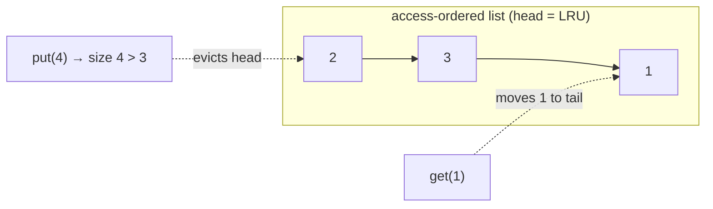
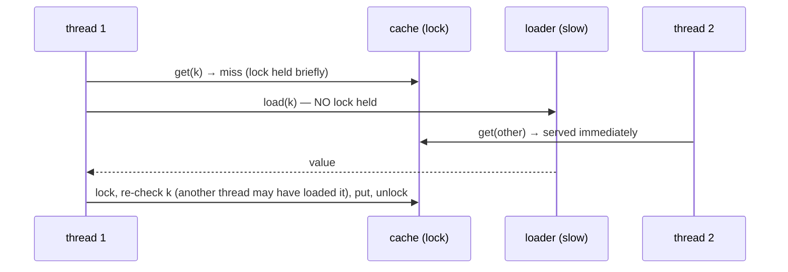

# 16. Thread-safe LRU Cache

<span class="level l2">L2</span> ★★☆ · `LinkedHashMap` access order · `ReentrantLock`

## Problem

> Implement a cache with a fixed capacity that evicts the **least-recently used** entry when full. It must be safe under concurrent
> `get`/`put`, and should offer `getOrLoad(key, loader)` where a slow loader doesn't block other keys.

## Key idea

* `LinkedHashMap(…, accessOrder = true)` keeps entries in **access order**: every `get` moves the entry to the tail. Overriding
  `removeEldestEntry` evicts the head (the LRU entry) on insertion. That gives O(1) for everything.
* `LinkedHashMap` isn't thread-safe, and **`get()` mutates it** (it reorders the list). So reads need the lock too, and a
  `ReadWriteLock` would be **wrong** here.
* In `getOrLoad`, **load outside the lock**, then re-check before inserting.





## Code walkthrough

```java
--8<-- "examples/interview-coding/ConcurrentLruCache.java:core"
```

| Code | Why |
|---|---|
| `new LinkedHashMap<>(16, 0.75f, true)` | The third argument `true` = **access order** (the default is insertion order). |
| `removeEldestEntry → size() > capacity` | Called by `put` after inserting. Returning true evicts the eldest (head = LRU) entry. |
| `get()` takes the lock | Because it **writes** (it reorders the linked list). Two unsynchronized gets could corrupt the list pointers. |
| `getOrLoad`: `get`, then `loader.apply` with no lock | A 200 ms DB load must not freeze every other key. Holding the lock during IO is the classic mistake (and it pins virtual threads on JDK 21–23 if the lock is `synchronized`). |
| Re-check `raced` before `put` | Another thread may have loaded the same key meanwhile, so keep the first value for consistency. Two loads of the same key can still happen. [Problem 18](18-single-flight.md) shows how to make that exactly once. |

## Run it

```text
sequential LRU semantics ok: 2 evicted, 1 kept
50,000 concurrent getOrLoad calls: size=100 (never above capacity 100)
PASS
```

## Scaling beyond one lock

One lock serializes every operation. Options, roughly in the order you'd mention them in an interview:

| Approach | Idea |
|---|---|
| **Striping** | N independent LRU segments chosen by `hash(key) % N`. This gives an approximate global LRU |
| **Read buffers** (Caffeine) | Record accesses in lock-free ring buffers and replay them under the lock in batches, so reads almost never contend |
| **Sampled eviction** (Redis) | No list at all: sample a few keys and evict the oldest |
| **`ConcurrentHashMap` + clock/second-chance** | Approximate LRU with a reference bit per entry |

In production, use **Caffeine**: W-TinyLFU gets a better hit rate than LRU, and it has async loading and stampede protection.

??? question "Why not `Collections.synchronizedMap(new LinkedHashMap(...))`?"
    Single operations would be safe, but compound ones (`getOrLoad`'s check-then-put) wouldn't be, and iteration still needs manual locking.

??? question "How would you add TTL expiry?"
    Store `(value, expiresAt)`. On `get`, treat expired entries as a miss and remove them. Optionally run a background sweeper on a scheduler.

??? example "Full source: ConcurrentLruCache.java"
    ```java
    --8<-- "examples/interview-coding/ConcurrentLruCache.java"
    ```
