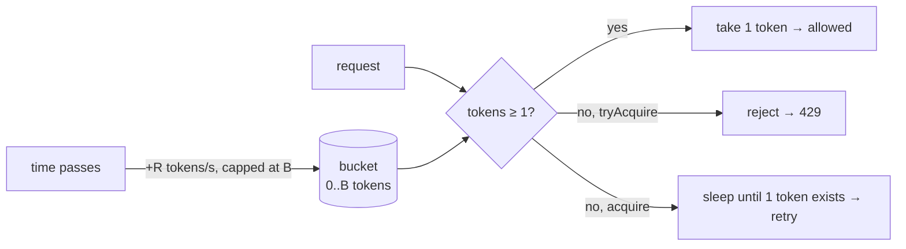
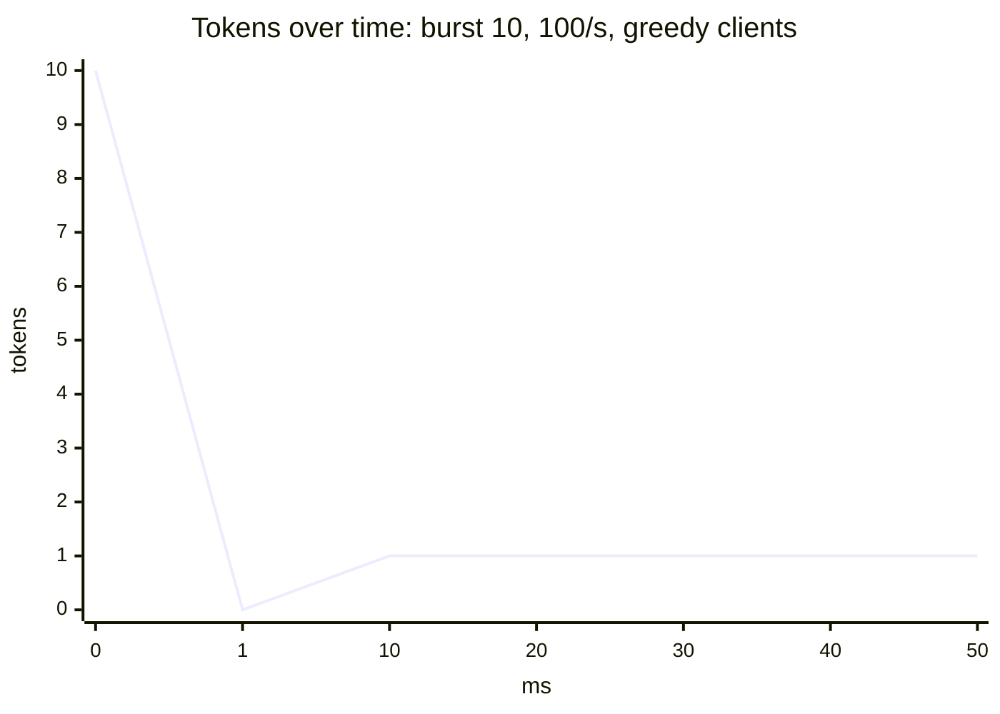

# 17. Token Bucket Rate Limiter

<span class="level l3">L3</span> ★★☆ · lazy refill · sleep outside the lock

## Problem

> Implement a rate limiter that allows on average **R requests per second** with bursts of up to **B**. Provide a non-blocking
> `tryAcquire()` (for an API that returns 429) and a blocking `acquire()` (for a client that must pace itself).

## Key idea: the token bucket

The bucket holds at most **B** tokens and gains **R tokens per second**. Each request takes one token, and an empty bucket means wait or reject.
Instead of a background thread adding tokens, compute them **lazily** from the elapsed time on every call:

```
tokens = min(B, tokens + (now - lastRefill) × R)
```





The bucket starts full, so the first 10 requests pass instantly (the burst). After that, the rate settles at one token every 10 ms.

## Code walkthrough

```java
--8<-- "examples/interview-coding/TokenBucketRateLimiter.java:core"
```

| Code | Why |
|---|---|
| `double tokens` | Fractional tokens accumulate between calls (for example, 0.3 tokens after 3 ms at 100/s). |
| `refill(now)` under the lock | Read-modify-write of `tokens` and `lastRefillNanos` must be atomic. |
| `System.nanoTime()` | Monotonic. `currentTimeMillis()` can jump backwards (NTP), which would mint or burn tokens. |
| `tryAcquire()` never waits | For server-side admission control: reject immediately with `429` + `Retry-After`. |
| `acquire()`: compute `waitNanos`, **unlock**, then sleep | Sleeping while holding the lock would block every other caller, including `tryAcquire`. After waking, loop: another thread may have taken the token. |
| `Thread.sleep(Duration)` | Cheap on a virtual thread. 10,000 clients pacing themselves cost almost nothing. |

## Run it

```text
tryAcquire: 50 greedy clients for 500 ms -> allowed 59 (expected ~60)
acquire: 101 permits at 200/s took 533 ms (expected ~500)
PASS
```

Expected values: 10 (burst) + 0.5 s × 100/s = 60. For the blocking test, 1 initial token plus 100 more at 200/s ≈ 500 ms.

## Algorithm comparison (the follow-up you'll get)

| Algorithm | Bursts | Memory | Accuracy |
|---|---|---|---|
| **Token bucket** | Allows up to B | O(1) | Good |
| Leaky bucket | Smooths to a constant rate | O(1) or a queue | Good |
| Fixed window counter | 2× burst at window edges | O(1) | Poor at edges |
| Sliding window log | None | O(requests) | Exact |
| Sliding window counter | Small | O(1) | Approximate, good |

??? question "Distributed rate limiting across 20 pods?"
    A local bucket per pod with `R/20` is simple but inaccurate when traffic is uneven. For accuracy, use a Redis Lua script that does refill+take atomically
    per key (one round trip), with fail-open or fail-closed decided per endpoint.

??? question "Per-user limits?"
    Use `ConcurrentHashMap<UserId, TokenBucket>` with `computeIfAbsent`. Evict idle buckets with Caffeine's `expireAfterAccess`, or the map grows forever.

??? question "Can you make it lock-free?"
    Yes: pack `(tokens, timestamp)` into an immutable object in an `AtomicReference` and CAS-loop the refill+take. It's worth it only under heavy contention.

??? example "Full source: TokenBucketRateLimiter.java"
    ```java
    --8<-- "examples/interview-coding/TokenBucketRateLimiter.java"
    ```
