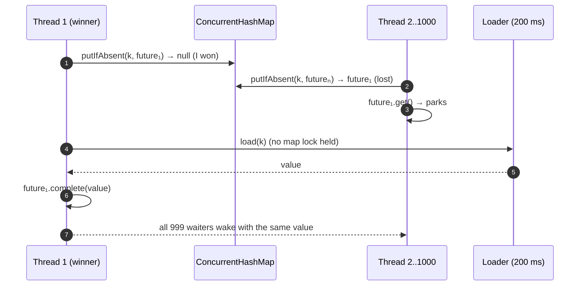

# 18. Single-Flight Cache (Request Coalescing)

<span class="level l3">L3</span> ★★★ · `ConcurrentHashMap.putIfAbsent` · `CompletableFuture`

## Problem

> A popular product's cache entry expires, and 1,000 requests arrive at the same moment. Without care, all 1,000 hit the database (a
> **cache stampede** or *thundering herd*). Make sure the expensive load runs **once per key**, and every concurrent caller gets
> that same result. Failures must not be cached.

## Key idea: cache the *future*, not the value

Put a `CompletableFuture<V>` into the map **before** loading. `putIfAbsent` is atomic, so exactly one thread wins and loads.
Everyone else finds the winner's future and waits on it.

```mermaid
flowchart TD
    G["get(key)"] --> P{"putIfAbsent(key, myFuture)"}
    P -->|returned existing| WAIT["existing.get() — wait for winner"]
    P -->|null: I'm the winner| LOAD[loader.apply&#40;key&#41;]
    LOAD -->|ok| C[myFuture.complete&#40;v&#41;]
    LOAD -->|throws| F["map.remove(key, myFuture)<br/>myFuture.completeExceptionally(e)"]
```





## Code walkthrough

```java
--8<-- "examples/interview-coding/SingleFlightCache.java:core"
```

| Code | Why |
|---|---|
| `new CompletableFuture<>()` before loading | A placeholder that other threads can wait on immediately. |
| `cache.putIfAbsent(key, mine)` | **Atomic** claim. Exactly one thread gets `null` back. |
| Losers: `existing.get()` | They park (cheaply, on virtual threads) until the winner completes the future. `complete` happens-before `get` returns. |
| Winner loads **outside** any lock | Unlike `computeIfAbsent(key, k -> load(k))`, which runs the loader **while holding the map's bin lock**. That blocks unrelated keys in the same bin, and a recursive load throws `IllegalStateException`. |
| On failure: `cache.remove(key, mine)` | Don't cache the failure, so the next caller can retry. The 2-arg `remove` only removes **our** future, never a newer one. |
| `mine.completeExceptionally(e)` | Callers already waiting must not hang: they get the same exception. |

## Run it

```text
1,000 concurrent gets on 3 keys: loader calls=3, correct=1000, took 220 ms (one 200 ms load per key, in parallel)
failed load not cached: retry succeeded
PASS
```

Without coalescing, that would be 1,000 database calls instead of 3.

## Common mistakes

* `computeIfAbsent(key, k -> slowLoad(k))` on a `ConcurrentHashMap`: the slow IO runs inside the bin lock.
* Caching exceptional futures forever: one DB hiccup poisons the key permanently.
* `Map<K,V>` plus `synchronized` on the whole load: correct, but it serializes **all** keys.

## Follow-up questions

??? question "How do you add expiry?"
    Store `(future, loadedAt)`, and on access treat old entries as missing (`remove(key, old)` then retry). Or use Caffeine's
    `AsyncLoadingCache`, which implements exactly this pattern plus `refreshAfterWrite` (serving stale data while one thread refreshes).

??? question "What if a waiter has a shorter deadline than the load?"
    Use `existing.get(timeout)` or `orTimeout` on a *copy*. Never cancel the shared future, because that would fail everyone else too.

??? question "Where else is this pattern used?"
    Go's `singleflight` package, CDN request collapsing, DataLoader batching in GraphQL, and JVM class loading (the per-class-name lock).

??? example "Full source: SingleFlightCache.java"
    ```java
    --8<-- "examples/interview-coding/SingleFlightCache.java"
    ```
