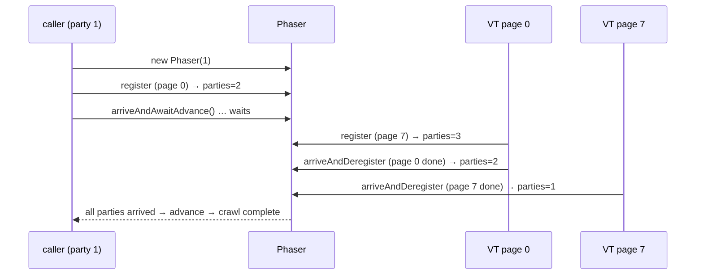

# 19. Concurrent Web Crawler

<span class="level l3">L3</span> ★★★ · virtual threads · `Phaser` · `Semaphore` · concurrent set · LeetCode 1242

## Problem

> Given a start URL and a `fetch(url) → links` function (slow, blocking), crawl every page on the **same host**. Fetch
> concurrently, never fetch a page twice, limit the total number of in-flight requests (and the number per host), and return
> when the crawl is **complete**.

The hard parts are **knowing when you're done** (new work is discovered while you run) and doing **dedup atomically**.

## Architecture

```mermaid
flowchart LR
    S[start URL] --> SUB{visited.add&#40;url&#41;?}
    SUB -->|false: already seen| DROP[skip]
    SUB -->|true| REG[phaser.register&#40;&#41;]
    REG --> VT[new virtual thread]
    VT --> G{{global Semaphore 64}}
    G --> H{{per-host Semaphore}}
    H --> F[fetch&#40;url&#41; — blocking IO]
    F --> LINKS[for each same-host link → submit]
    LINKS --> SUB
    F --> DONE[phaser.arriveAndDeregister&#40;&#41;]
```





## Code walkthrough

```java
--8<-- "examples/interview-coding/ConcurrentWebCrawler.java:core"
```

| Code | Why |
|---|---|
| `ConcurrentHashMap.newKeySet()` + `visited.add(url)` | `add` returns `true` for exactly one thread, so it's an atomic **claim**. "`contains` then `add`" would be a race that fetches pages twice. |
| `new Phaser(1)` | Party #1 is the caller. Each in-flight page is one more party. |
| `pending.register()` **before** `ex.submit(...)` | Crucial ordering. If the task were submitted first, it could finish and deregister before being registered, and the phase could advance early, so you'd return with work still running. |
| `arriveAndDeregister()` in `finally` | Every page arrives exactly once, even when fetch throws. Without the `finally`, a failure would hang the crawl. |
| `arriveAndAwaitAdvance()` by the caller | Returns when **all** registered parties have arrived: the dynamic version of `CountDownLatch`, which doesn't need to know the count up front. |
| Global then per-host `Semaphore` | The global limit protects us (sockets, memory). The per-host limit is *politeness* toward each site. Release in reverse order in `finally`. |
| One virtual thread per page | Fetching is blocking IO, so a VT parks for free. 2,000 pages means 2,000 cheap threads, with the concurrency limited by the semaphore. |

!!! note "Phaser limit"
    A `Phaser` supports up to 65,535 registered parties at once. For bigger crawls use a tiered phaser tree, or an `AtomicInteger`
    in-flight counter + `CountDownLatch(1)` released when the counter reaches zero.

## Run it

```text
crawled 1952 pages in 361 ms (sequential would be ~19520 ms), peak in-flight=64 (limit 64)
PASS
```

The test computes the expected reachable set with a plain sequential DFS and checks that the crawler found exactly that set,
without exceeding the in-flight limit.

## Java 8 version: what was harder

* A fixed `ThreadPoolExecutor(64)` had to be both the concurrency limit **and** the thread budget.
* Completion detection needed an `AtomicInteger pending` + `CountDownLatch`, or a `CompletableFuture` graph.
* Blocking fetches inside a 64-thread pool limited throughput to `64 / latency`. That's the same here, but here the semaphore can be
  raised to 1,000 without 1,000 OS threads.

??? question "How would you add a depth limit or URL priority?"
    Carry `depth` with each URL and skip when it's above the limit. For priority, put URLs into a `PriorityBlockingQueue` frontier consumed by N worker VTs
    instead of spawning a VT per URL.

??? question "Distributed crawl?"
    Partition URLs by host hash across workers (which keeps politeness local), keep a shared seen-set (a Bloom filter + store), and use a durable frontier
    (Kafka or a DB) with checkpointing.

??? example "Full source: ConcurrentWebCrawler.java"
    ```java
    --8<-- "examples/interview-coding/ConcurrentWebCrawler.java"
    ```
