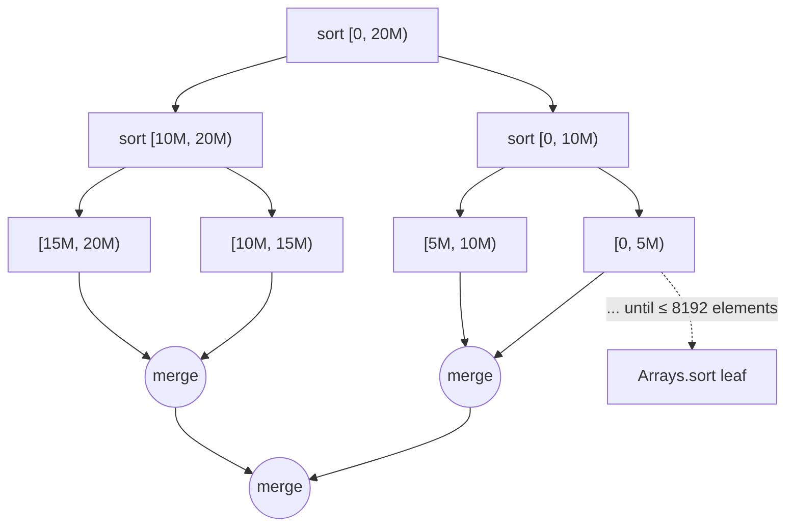
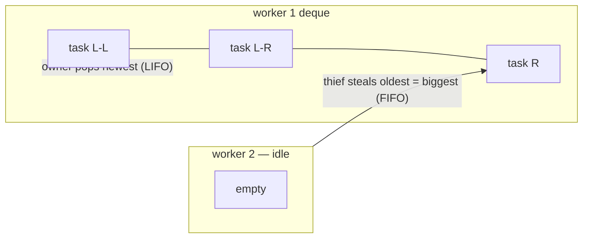

# 20. Parallel Merge Sort (Fork/Join)

<span class="level l2">L2</span> ★★☆ · `RecursiveAction` · work stealing

## Problem

> Sort a large `int[]` using all CPU cores. Explain how the work is split and how threads balance the load.

This is the canonical **CPU-bound** problem, the opposite of the IO-bound problems where virtual threads shine. The right tool
is the **Fork/Join** framework (platform threads ≈ cores, work stealing).

## Key idea: divide and conquer



### Work stealing



Each worker pushes subtasks onto its own deque and works on the newest one (cache-friendly). Idle workers **steal the oldest task**
from another worker, which is the biggest chunk, so a single steal hands over a lot of work.

## Code walkthrough

```java
--8<-- "examples/interview-coding/ParallelMergeSort.java:core"
```

| Code | Why |
|---|---|
| `extends RecursiveAction` | A Fork/Join task with no result (it sorts in place). Use `RecursiveTask<T>` for a result, such as a sum. |
| `SEQUENTIAL_THRESHOLD = 8_192` | Below this size, task overhead beats the parallel gain. The value is tuned empirically; 1k–10k elements is typical. |
| `int[] tmp` shared | One scratch buffer allocated once. Tasks touch **disjoint ranges**, so there's no data race and no locking. |
| `(lo + hi) >>> 1` | Unsigned shift avoids overflow when `lo + hi > Integer.MAX_VALUE`. That's a famous bug in `Arrays.binarySearch`, fixed in 2006. |
| `invokeAll(left, right)` | Forks one half and computes the other in the current thread, then joins both. Better than `left.fork(); right.fork(); join both`, which wastes the current thread. |
| `merge(mid)` after `invokeAll` | `join` gives happens-before: both halves' writes are visible here. |
| `tmp[i] <= tmp[j]` | `<=` keeps equal elements in their original order, so the sort is **stable**. |

## Run it

```text
20M ints on 4 cores: sequential merge sort 3149 ms, fork/join 1332 ms (2.4x)
PASS
```

The speed-up is less than the 4× core count because the final merges are sequential (Amdahl's law), memory bandwidth is limited, and there's JIT warm-up.
In real code, `Arrays.parallelSort(a)` does all of this for you.

## Follow-up questions

??? question "Why not virtual threads here?"
    The work is pure CPU. There are only 4 cores, so 4 carriers. Virtual threads add scheduling overhead and no parallelism, and they aren't preempted, so long CPU
    tasks would starve other VTs.

??? question "How would you parallelize the merge itself?"
    Split the larger half at its median, binary-search that value in the other half, and merge the two resulting pairs in parallel. That's O(log² n) span.

??? question "Parallel streams vs Fork/Join?"
    `parallelStream()` runs on the same common `ForkJoinPool` with spliterators doing the splitting. Use it for map/filter/reduce. Write a
    `RecursiveTask` when the decomposition is custom.

??? example "Full source: ParallelMergeSort.java"
    ```java
    --8<-- "examples/interview-coding/ParallelMergeSort.java"
    ```
