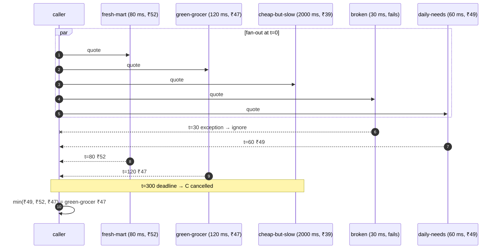
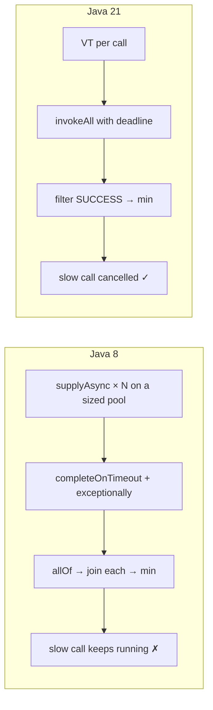

# 21. Best-Price Fan-out with a Deadline

<span class="level l3">L3</span> ★★☆ · `CompletableFuture` (Java 8) vs virtual threads + `invokeAll` (Java 21)

## Problem

> Ask N vendors for a price **in parallel**. Return the cheapest quote that arrives within **300 ms**. Ignore vendors that fail or are
> too slow. The total response time must be about 300 ms, regardless of how slow the slowest vendor is.

This is the most "real" interview question here: it's every price comparison, search aggregator, and BFF.

## Key idea



## Java 8: CompletableFuture

```java
--8<-- "examples/interview-coding/BestPriceFanOut.java:java8"
```

| Code | Why |
|---|---|
| `supplyAsync(..., pool)` | Always pass your own executor. The default common pool is meant for CPU work, and blocking calls starve it. |
| Wrap the result in `Optional` | Turns "no quote" into a value, so failures and timeouts become `Optional.empty()` instead of exceptions. |
| `.completeOnTimeout(Optional.empty(), 300ms)` | Java 9+. After 300 ms the future completes with *empty*. **But the vendor call keeps running** and keeps a pool thread busy. |
| `.exceptionally(ex -> Optional.empty())` | A failed vendor doesn't fail the whole result. |
| `allOf(...).thenApply(... join ...)` | `allOf` returns `CompletableFuture<Void>`, so you collect the results yourself. `join()` can't block there because everything is already complete. |

## Java 21: virtual threads + `invokeAll`

```java
--8<-- "examples/interview-coding/BestPriceFanOut.java:java21"
```

| Code | Why |
|---|---|
| `newVirtualThreadPerTaskExecutor()` | One cheap thread per vendor call. Plain blocking code, no callbacks. |
| `invokeAll(calls, 300, ms)` | Returns when all tasks finish **or** the deadline passes. Unfinished tasks are **cancelled** (interrupted), so the slow vendor's thread actually stops. |
| `f.state() == SUCCESS` | `Future.State` (Java 19+) cleanly separates SUCCESS / FAILED / CANCELLED. |
| `resultNow()` | Java 19+: get the result of a completed future without checked exceptions. |
| try-with-resources | `close()` guarantees no vendor call outlives the method. |

## Side by side



| | Java 8 CF | Java 21 VT |
|---|---|---|
| Lines (core logic) | ~15 | ~8 |
| Slow vendor after the deadline | Still running, holding a pool thread | Interrupted and cancelled |
| Failure handling | `exceptionally` per stage | `Future.State` filter |
| Thread budget | The pool size caps the number of concurrent vendor calls | Unlimited (add a `Semaphore` if vendors need it) |
| Stack traces | ForkJoinPool / CF internals | Your code |

## Run it

```text
Java 8 : Quote[vendor=green-grocer, priceMinor=4700] in 312 ms
Java 21: Quote[vendor=green-grocer, priceMinor=4700] in 303 ms
PASS
```

The cheapest vendor (₹39) missed the deadline, and the ₹10 one failed. Both versions correctly pick ₹47 in about 300 ms.

## Follow-up questions

??? question "Return early if all vendors answer before the deadline?"
    Both versions already do: `allOf` and `invokeAll` complete as soon as every task is done.

??? question "Return the first quote under ₹40 immediately?"
    Use an `ExecutorCompletionService` and take results as they complete, stopping at the first one that qualifies, then `shutdownNow()`. With structured
    concurrency (Java 25), write a custom `Joiner` whose `onComplete` returns `true` to cancel the scope.

??? question "And with structured concurrency?"
    `StructuredTaskScope.open(Joiner.awaitAll(), cf -> cf.withTimeout(deadline))`, fork each vendor, `join()`, then collect the subtasks in state
    `SUCCESS`. See [Structured Concurrency](../modern/structured-concurrency.md).

??? example "Full source: BestPriceFanOut.java"
    ```java
    --8<-- "examples/interview-coding/BestPriceFanOut.java"
    ```
