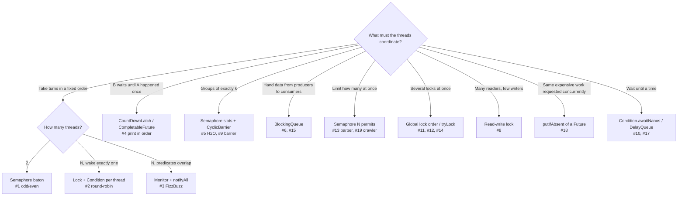

# Coding Interview: 21 Multithreading Problems, Explained

Every problem on this tab has a **runnable, self-checking solution** in
[`examples/interview-coding`](https://github.com/khiruashish/java-multithreading-playbook/tree/main/examples/interview-coding).
The code shown on each page is **included from those files**, so what you read is exactly what was compiled and tested
(JDK 21, `./run-all.sh` → 21 × PASS).

Each page follows the same structure:

1. **Problem**: the statement as an interviewer would give it.
2. **Key idea & diagrams**: the shape of the solution before any code (sequence, state, or flow diagram).
3. **Code walkthrough**: the solution in small pieces, each followed by a line-by-line explanation.
4. **Why it's correct**: the invariant or happens-before argument that interviewers probe.
5. **Run it**: the command and real output.
6. **Common mistakes** and **follow-up questions**, with answers.

## Problem map

| # | Problem | Core primitive(s) | Level | Difficulty |
|---|---|---|---|---|
| 1 | [Odd/Even Printer](01-odd-even.md) | `wait/notifyAll`, `Semaphore` baton | <span class="level l1">L1</span> | ★☆☆ |
| 2 | [Round-Robin N Threads](02-round-robin.md) | `ReentrantLock` + one `Condition` per thread | <span class="level l2">L2</span> | ★★☆ |
| 3 | [Multithreaded FizzBuzz](03-fizzbuzz.md) | Generic turn-taking monitor | <span class="level l1">L1</span> | ★★☆ |
| 4 | [Print in Order](04-print-in-order.md) | `CountDownLatch`, `CompletableFuture` | <span class="level l1">L1</span> | ★☆☆ |
| 5 | [Building H2O](05-h2o.md) | `Semaphore` + `CyclicBarrier` | <span class="level l2">L2</span> | ★★★ |
| 6 | [Bounded Blocking Queue](06-bounded-blocking-queue.md) | `Lock` + two `Condition`s, circular buffer | <span class="level l2">L2</span> | ★★☆ |
| 7 | [Thread Pool](07-thread-pool.md) | Worker loop, `FutureTask`, shutdown race | <span class="level l3">L3</span> | ★★★ |
| 8 | [Read-Write Lock](08-read-write-lock.md) | Monitor with writer preference | <span class="level l2">L2</span> | ★★☆ |
| 9 | [Cyclic Barrier](09-cyclic-barrier.md) | Generation object, `Condition` | <span class="level l3">L3</span> | ★★★ |
| 10 | [Delayed Task Scheduler](10-delayed-scheduler.md) | `PriorityQueue` + `awaitNanos` | <span class="level l3">L3</span> | ★★★ |
| 11 | [Deadlock: Create, Detect, Fix](11-deadlock.md) | `ThreadMXBean`, lock ordering, `tryLock` | <span class="level l2">L2</span> | ★★☆ |
| 12 | [Dining Philosophers](12-dining-philosophers.md) | Resource ordering, waiter semaphore | <span class="level l2">L2</span> | ★★☆ |
| 13 | [Sleeping Barber](13-sleeping-barber.md) | Signalling semaphores | <span class="level l2">L2</span> | ★★☆ |
| 14 | [Bank Transfer](14-bank-transfer.md) | Ordered locking, consistent audit | <span class="level l2">L2</span> | ★★☆ |
| 15 | [Producer-Consumer Pipeline](15-pipeline.md) | `BlockingQueue`, poison pills, sealed types | <span class="level l2">L2</span> | ★★☆ |
| 16 | [Thread-safe LRU Cache](16-lru-cache.md) | `LinkedHashMap` access order + lock | <span class="level l2">L2</span> | ★★☆ |
| 17 | [Token Bucket Rate Limiter](17-rate-limiter.md) | Lazy refill, sleep outside lock | <span class="level l3">L3</span> | ★★☆ |
| 18 | [Single-Flight Cache](18-single-flight.md) | `ConcurrentHashMap` + `CompletableFuture` | <span class="level l3">L3</span> | ★★★ |
| 19 | [Concurrent Web Crawler](19-web-crawler.md) | VTs, `Phaser`, semaphores, concurrent set | <span class="level l3">L3</span> | ★★★ |
| 20 | [Parallel Merge Sort](20-merge-sort.md) | Fork/Join `RecursiveAction` | <span class="level l2">L2</span> | ★★☆ |
| 21 | [Best-Price Fan-out](21-best-price-fanout.md) | `CompletableFuture` vs VT `invokeAll` | <span class="level l3">L3</span> | ★★☆ |

## Choosing the primitive: the interviewer's hidden question

Most problems are really asking *"do you know which coordination tool fits?"*



## A five-step script for any concurrency coding question

1. **Restate the invariant** out loud: "at most 2 H per molecule", "total money is constant", "output is strictly ordered".
2. **Name the shared state and who guards it**: write `// guarded by lock` next to every mutable field.
3. **Pick the primitive** with the map above, and say why the alternatives are worse.
4. **Write the waiting loop correctly**: `while (!condition) await();`, never `if`. Handle `InterruptedException`.
5. **Prove it**: happens-before edges, no lost wake-ups, no deadlock (lock order), and how it shuts down.
   Then mention how you'd **test it**: hammer it with 1,000+ virtual threads and assert the invariant, as every solution here does.

## Run everything

```bash
cd examples/interview-coding
./run-all.sh                     # JDK 21+: 21 x PASS
java BoundedBlockingQueue.java   # or run any single problem
```
