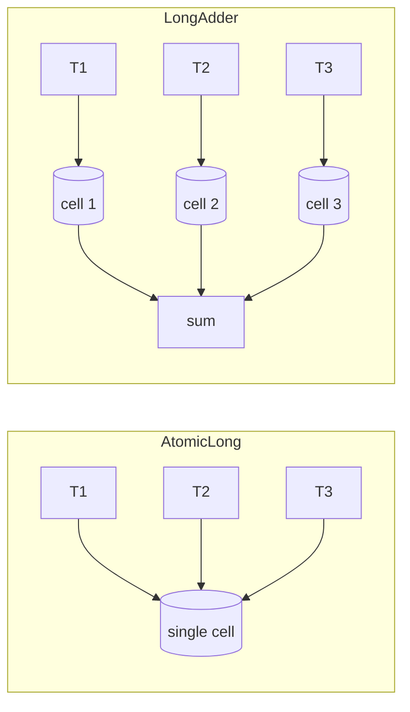

# Atomics, CAS & VarHandle

<span class="level l2">L2</span> <span class="level l3">L3</span>

## Compare-And-Swap (CAS)

A single CPU instruction (`LOCK CMPXCHG` on x86, `LDXR/STXR` or `CAS` on ARM) that does this atomically:
*"if memory == expected, set it to newValue and report success"*. It is the basis of every lock-free algorithm.

```java
AtomicLong seq = new AtomicLong();
long next = seq.incrementAndGet();                       // CAS loop inside
seq.updateAndGet(v -> Math.max(v, observed));            // functional update (Java 8)
seq.accumulateAndGet(5, Long::sum);
```

## The atomic family

| Class | Use |
|---|---|
| `AtomicInteger/Long/Boolean` | Single counters and flags |
| `AtomicReference<V>` | Swap immutable snapshots (copy-on-write state) |
| `AtomicStampedReference` | Solves the **ABA** problem with a version stamp |
| `AtomicIntegerArray` / `AtomicLongArray` | Per-slot atomics |
| `AtomicXxxFieldUpdater` | CAS on a `volatile` field without allocating a wrapper per object (memory-efficient) |
| `LongAdder` / `LongAccumulator` (8) | High-contention counters: per-cell striping, then `sum()` |

## `AtomicLong` vs `LongAdder`



* `AtomicLong`: exact value on every read. CAS failures spike under contention.
* `LongAdder`: writes scale with core count. `sum()` is not an atomic snapshot. Use it for metrics, not for IDs.

## Immutable snapshot pattern with `AtomicReference`

```java
record RoutingTable(Map<String, URI> routes) {}

private final AtomicReference<RoutingTable> table =
        new AtomicReference<>(new RoutingTable(Map.of()));

void addRoute(String key, URI uri) {
    table.updateAndGet(old -> {
        var copy = new HashMap<>(old.routes());
        copy.put(key, uri);
        return new RoutingTable(Map.copyOf(copy));
    });
}
URI lookup(String key) { return table.get().routes().get(key); }   // lock-free reads
```

!!! note "`updateAndGet` may call your function more than once"
    Keep the function pure. Don't log, send emails, or call IO inside it.

## `VarHandle` (Java 9+): the supported `Unsafe`

```java
class Node {
    volatile Node next;
    private static final VarHandle NEXT;
    static {
        try {
            NEXT = MethodHandles.lookup().findVarHandle(Node.class, "next", Node.class);
        } catch (ReflectiveOperationException e) { throw new ExceptionInInitializerError(e); }
    }
    boolean casNext(Node expect, Node update) { return NEXT.compareAndSet(this, expect, update); }
    void lazySetNext(Node n) { NEXT.setRelease(this, n); }     // release store (cheaper than volatile)
}
```

Access modes: `get/set` (plain), `getOpaque/setOpaque`, `getAcquire/setRelease`, `getVolatile/setVolatile`,
`compareAndSet`, `compareAndExchange`, `weakCompareAndSet*` (may fail spuriously, which makes it cheaper in loops),
`getAndAdd`, `getAndBitwiseOr`, and so on. Fences: `VarHandle.acquireFence()`, `releaseFence()`, `fullFence()`.

## ABA problem

Thread 1 reads A. Thread 2 changes A→B→A. Thread 1's CAS(A→C) succeeds even though the state changed underneath it. This
matters for pointer-based lock-free stacks that reuse nodes. Fixes: `AtomicStampedReference`, or never reuse nodes
(the GC makes this mostly safe in Java).
