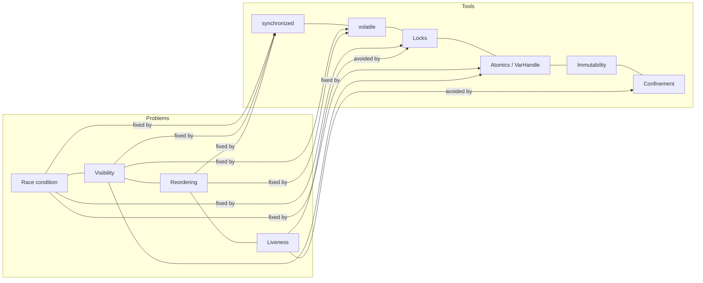

# Foundations

L1 L2

Everything else in this playbook, including virtual threads, builds on these six ideas:

1. **Thread**: an independent path of execution that shares heap memory with other threads.
2. **Race condition**: the result depends on how threads interleave.
3. **Visibility**: one thread's writes are not automatically seen by another thread (JMM).
4. **Atomicity**: a compound action (`check-then-act`, `read-modify-write`) must look indivisible.
5. **Ordering**: compilers and CPUs reorder instructions unless a *happens-before* edge forbids it.
6. **Liveness**: correct code can still get stuck (deadlock), spin uselessly (livelock), or never run (starvation).

