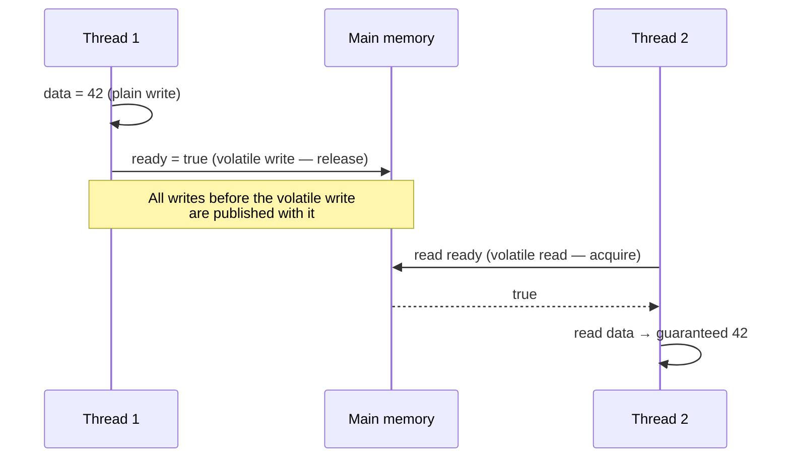

# Java Memory Model (JMM)

<span class="level l2">L2</span> <span class="level l3">L3</span>

The JMM (JSR-133, Java 5; JLS §17) defines **which values a read may observe**. Without it, the compiler (JIT),
the CPU (store buffers, out-of-order execution), and caches are all free to reorder or delay writes.

## The visibility bug everyone hits once

```java
class Worker {
    private boolean running = true;           // BUG: not volatile
    void stop() { running = false; }
    void loop() { while (running) { /* busy */ } } // JIT may hoist the read → infinite loop
}
```

Fix: `private volatile boolean running = true;`. Alternatively, use an `AtomicBoolean` or check
`Thread.interrupted()`.

## Happens-before rules (memorize these)

If action A *happens-before* B, then A's effects are visible to B and A is ordered before B.

| Rule | Edge |
|---|---|
| Program order | Each action in a thread → every later action in that thread |
| Monitor lock | `unlock(m)` → every subsequent `lock(m)` |
| Volatile | Write to `v` → every subsequent read of `v` |
| Thread start | `t.start()` → every action in `t` |
| Thread join | Every action in `t` → return from `t.join()` |
| Interrupt | `t.interrupt()` → `t` detects the interrupt |
| Finalizer | Constructor end → `finalize()` start |
| `final` fields | Constructor end (with no `this` escape) → any thread that sees the reference sees initialized finals |
| j.u.c. | Put into `BlockingQueue` → take; `submit` → task runs; task completes → `Future.get` returns; `countDown` → `await` returns |
| Transitivity | A → B and B → C ⇒ A → C |



This is called **safe publication through a volatile flag**. It is the same mechanism `ConcurrentHashMap.put/get`,
`BlockingQueue`, and `CompletableFuture.complete/join` give you for free.

## Safe publication idioms

1. Initialize from a static initializer (`static final Foo FOO = new Foo();`).
2. Store the reference in a `volatile` field or an `AtomicReference`.
3. Store it in a `final` field of a properly constructed object.
4. Store it in a field guarded by a lock.
5. Put it into a thread-safe collection.

## Double-checked locking: then and now

=== "Java 5–8 (correct, verbose)"

    ```java
    class Config {
        private static volatile Config instance;      // volatile is mandatory
        static Config get() {
            Config local = instance;
            if (local == null) {
                synchronized (Config.class) {
                    local = instance;
                    if (local == null) instance = local = load();
                }
            }
            return local;
        }
    }
    ```

=== "Holder idiom (best for static singletons)"

    ```java
    class Config {
        private static class Holder { static final Config INSTANCE = load(); }
        static Config get() { return Holder.INSTANCE; }   // class init is lazy and thread-safe
    }
    ```

=== "Java 25 StableValue (preview, JEP 502)"

    ```java
    class Config {
        private static final StableValue<Config> INSTANCE = StableValue.of();
        static Config get() { return INSTANCE.orElseSet(Config::load); } // at-most-once, JIT treats as constant
    }
    ```

## `volatile` is NOT atomicity

`volatile int x; x++;` is still a read-modify-write race. `volatile` gives visibility and ordering, never
mutual exclusion. Use `AtomicInteger` or a lock instead.

## Memory ordering modes (VarHandle, Java 9+)

| Mode | Guarantees | Use |
|---|---|---|
| Plain | None across threads | Thread-confined data |
| Opaque | Coherence per variable, no reordering with itself | Progress flags, statistics |
| Acquire/Release | One-way ordering fences | Producer/consumer handoff (cheaper than volatile on ARM) |
| Volatile | Sequential consistency | Default when in doubt |

## Word tearing and `long/double`

Non-volatile `long` and `double` writes may be split into two 32-bit writes on some JVMs (JLS §17.7). Declare them
`volatile` or use atomics when sharing them. In practice 64-bit HotSpot doesn't tear, but the spec allows it.
