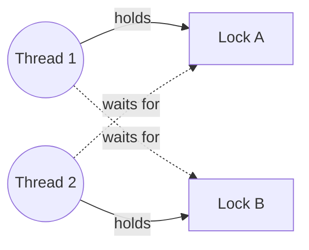

# Liveness Hazards

<span class="level l2">L2</span> <span class="level l3">L3</span>

| Hazard | Symptom | Classic cause | Fix |
|---|---|---|---|
| **Deadlock** | Threads stuck forever, CPU ~0% | Lock-ordering cycle | Global lock order, `tryLock` with timeout, single lock |
| **Livelock** | CPU high, no progress | Threads politely back off in lockstep | Randomized backoff |
| **Starvation** | Some threads never run | Unfair locks, priority, greedy readers | Fair locks, bounded queues |
| **Thread-pool deadlock** | Pool full of tasks waiting on tasks queued behind them | Nested `submit().get()` on the same bounded pool | Separate pools, or virtual threads |
| **Carrier starvation** (VT) | VTs runnable but not running | Pinned VTs (JDK 21–23) or CPU-bound VTs that never yield | JEP 491 (JDK 24), move CPU work to a platform pool |
| **Lost wakeup** | Waiter sleeps forever | `notify` before `wait`, or `if` instead of `while` | Condition loop, `BlockingQueue` |

## Deadlock: anatomy



The four Coffman conditions must **all** hold: mutual exclusion, hold-and-wait, no preemption, circular wait. Break any
one of them and deadlock is impossible. Lock ordering breaks *circular wait*. `tryLock` breaks *hold-and-wait*.

```java
// Detect programmatically (monitoring endpoint / health check)
ThreadMXBean mx = ManagementFactory.getThreadMXBean();
long[] ids = mx.findDeadlockedThreads();     // covers monitors AND ownable synchronizers
if (ids != null) {
    for (ThreadInfo ti : mx.getThreadInfo(ids, true, true)) log.error("DEADLOCK\n{}", ti);
}
```

!!! note "Virtual threads and deadlock detection"
    `ThreadMXBean` only reports **platform** threads. For virtual threads, use
    `jcmd <pid> Thread.dump_to_file -format=json`, which lists every VT with its stack, and look for
    VTs parked on locks owned by each other.

## Thread-pool-induced deadlock (very common in Java 8 code)

```java
ExecutorService pool = Executors.newFixedThreadPool(2);
Future<String> outer = pool.submit(() -> {
    Future<String> inner = pool.submit(() -> "inner");  // queued behind the outer tasks
    return inner.get();                                 // all 2 threads wait here → deadlock
});
```

This kind of deadlock happens with `CompletableFuture.join()` on the common pool and with parallel streams calling
blocking code. **Virtual threads remove this class of bug**, because there is no fixed thread count to exhaust.

## Livelock example and fix

```java
// Two threads each try to acquire both locks, release on failure, and retry immediately → may loop forever
while (true) {
    if (a.tryLock()) {
        try {
            if (b.tryLock()) { try { work(); return; } finally { b.unlock(); } }
        } finally { a.unlock(); }
    }
    Thread.sleep(ThreadLocalRandom.current().nextInt(1, 10)); // randomized backoff breaks the symmetry
}
```
