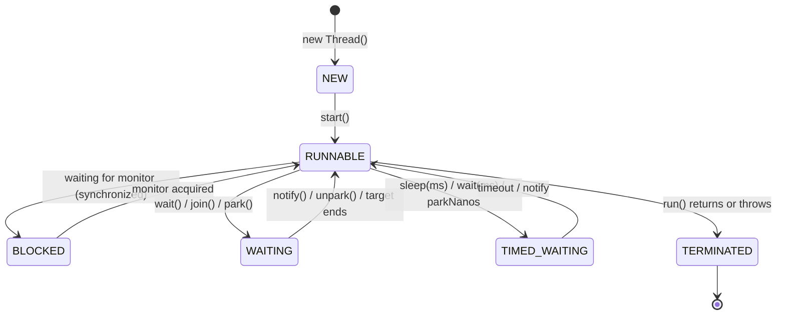

# Threads & Lifecycle

<span class="level l1">L1</span>

## Process vs thread

| | Process | Platform thread | Virtual thread (21+) |
|---|---|---|---|
| Memory | Own address space | Shares heap; own stack (~1 MB reserved by default, `-Xss`) | Shares heap; stack is a heap object that grows as needed (bytes to KB) |
| Scheduled by | OS | OS kernel | JVM (`ForkJoinPool` of carriers) |
| Creation cost | ms | ~50–100 µs, plus a syscall | ~1 µs, no syscall |
| Practical max per JVM | – | Thousands | Millions |
| Context switch | Expensive | ~1–10 µs (kernel) | Cheap (stack copy in user space) |

## Creating threads: then and now

=== "Java 8"

    ```java
    // 1. Subclass (avoid: it couples the task to the thread)
    class Worker extends Thread {
        @Override public void run() { System.out.println("hi from " + getName()); }
    }
    new Worker().start();

    // 2. Runnable (preferred)
    Thread t = new Thread(() -> System.out.println("hi"), "worker-1");
    t.setDaemon(false);
    t.start();
    t.join();

    // 3. Callable + executor when you need a result
    ExecutorService pool = Executors.newFixedThreadPool(4);
    try {
        Future<Integer> f = pool.submit(() -> 42);
        System.out.println(f.get());
    } finally {
        pool.shutdown();
    }
    ```

=== "Java 21+"

    ```java
    // Builder API covers platform AND virtual threads uniformly
    Thread platform = Thread.ofPlatform().name("cpu-", 0).daemon(false).start(() -> work());
    Thread virtual  = Thread.ofVirtual().name("io-", 0).start(() -> work());
    Thread quick    = Thread.startVirtualThread(() -> work());

    // Unstarted thread + factory for frameworks
    ThreadFactory factory = Thread.ofVirtual().name("req-", 0).factory();

    // Executor is AutoCloseable (Java 19+): close() waits for tasks
    try (ExecutorService ex = Executors.newVirtualThreadPerTaskExecutor()) {
        Future<Integer> f = ex.submit(() -> 42);
        System.out.println(f.get());
    } // implicit shutdown + awaitTermination
    ```

**Benefit:** a single builder API for both thread kinds, no `finally { shutdown(); }` boilerplate, and virtual threads
cost almost nothing to create.

## Lifecycle



!!! note "RUNNABLE ≠ running"
    `RUNNABLE` means *eligible* to run. The thread may be on a CPU or waiting for one. A thread blocked in
    a socket read also shows as `RUNNABLE` in Java, because the JVM can't see kernel waits. For a virtual
    thread blocked on a socket, the VT is unmounted and shows as `WAITING`, and no carrier is blocked.

## Interruption: the cooperative cancellation protocol

```java
Thread worker = Thread.ofVirtual().start(() -> {
    while (!Thread.currentThread().isInterrupted()) {
        try {
            var job = queue.take();           // blocking call: throws InterruptedException
            process(job);
        } catch (InterruptedException e) {
            Thread.currentThread().interrupt(); // restore the flag, then exit
            return;
        }
    }
});
worker.interrupt();   // request cancellation
```

Rules:

* Never swallow `InterruptedException`. Restore the flag or rethrow it.
* `Thread.stop()` is gone (it throws `UnsupportedOperationException` since Java 20). Cancellation is always cooperative.
* `Future.cancel(true)` interrupts the thread running the task. `StructuredTaskScope` interrupts sibling subtasks
  for you.

## Daemon vs user threads

The JVM exits when only daemon threads remain. **Virtual threads are always daemon threads**, so a `main` method that
starts virtual threads and returns lets the JVM exit immediately. Call `join()` on them, or close an executor.

## Uncaught exceptions

```java
Thread.setDefaultUncaughtExceptionHandler((t, e) ->
        log.error("Thread {} died", t.getName(), e));
// With executors: exceptions from submit() are captured in the Future. Call get() or you will never see them.
// execute() lets them reach the handler.
```

## Example: the classic race condition

```java
class Counter { int value; void inc() { value++; } } // read → add → write: 3 steps

var c = new Counter();
try (var ex = Executors.newVirtualThreadPerTaskExecutor()) {
    for (int i = 0; i < 10_000; i++) ex.submit(c::inc);
}
System.out.println(c.value); // often < 10000: lost updates
```

Three ways to fix it: `synchronized void inc()`, `AtomicInteger.incrementAndGet()`, or `LongAdder.increment()`.
See [Atomics](atomics.md) for when each is right.
