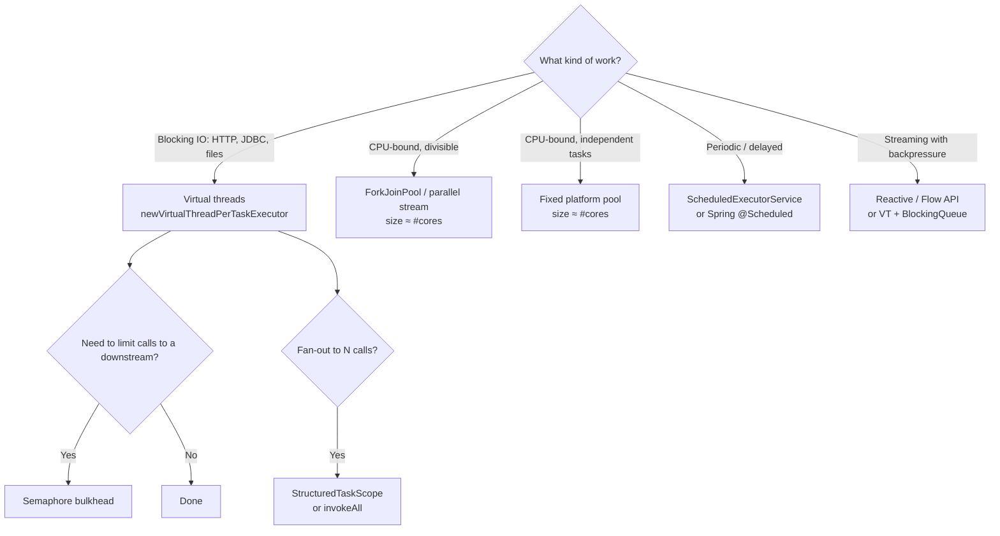

# One-Page Cheat Sheet

## Decision tree: which tool?



## Sharing state: choose in this order

1. **Don't share.** Use confinement or immutable records.
2. **Use a thread-safe class** (`ConcurrentHashMap`, `LongAdder`, `BlockingQueue`).
3. **Use atomics** for single-variable state.
4. **Use `synchronized`** for simple compound state (pinning-free from Java 24).
5. **Use `ReentrantLock` / `StampedLock`** when you need `tryLock`, timeouts, fairness, interruptible waits, or optimistic reads.

## Ten rules

1. Never pool virtual threads. Create one per task.
2. Limit **resources** (connections, rate) with semaphores or pools of *resources*, not pools of threads.
3. Always set **timeouts** on IO. A virtual thread that blocks forever is still a leak.
4. On Java 21–23, do not block (IO or `sleep`) inside `synchronized` on a hot path. Use `ReentrantLock`.
5. Don't cache expensive objects in `ThreadLocal` when running on virtual threads. There are millions of threads, so you get millions of copies.
6. Keep CPU-heavy work on a bounded platform pool. Virtual threads don't make CPU faster.
7. Prefer `try (var executor = ...)` so executors are always closed.
8. Handle `InterruptedException`: restore the flag with `Thread.currentThread().interrupt()` or propagate it.
9. Name your threads (`Thread.ofVirtual().name("order-", 0)`). Thread dumps are unreadable otherwise.
10. Measure with JFR (`jdk.VirtualThreadPinned`, `jdk.VirtualThreadSubmitFailed`) before and after.

## Key JVM flags

| Flag | Purpose |
|---|---|
| `-Djdk.virtualThreadScheduler.parallelism=N` | Number of carrier threads (default: #cores) |
| `-Djdk.virtualThreadScheduler.maxPoolSize=N` | Max carriers when compensating for pinning (default 256) |
| `-Djdk.tracePinnedThreads=full` | Print stack when a VT pins (**JDK 21–23 only**, removed in 24) |
| `-XX:+UseZGC` (`-XX:+ZGenerational` on 21) | Low-pause GC, a good fit for many VT stacks |
| `--enable-preview` | Required for structured concurrency (all versions), scoped values (21–24) |
| `jcmd <pid> Thread.dump_to_file -format=json out.json` | Thread dump that includes virtual threads |
| `jcmd <pid> JFR.start duration=60s filename=rec.jfr` | Start a flight recording |

## Spring Boot (3.2+ / 4.x)

```yaml
spring:
  threads:
    virtual:
      enabled: true      # Tomcat/Jetty request threads, @Async, @Scheduled, Kafka/Rabbit listeners
  main:
    keep-alive: true     # virtual threads are daemon threads; keep the JVM alive for schedulers
```
