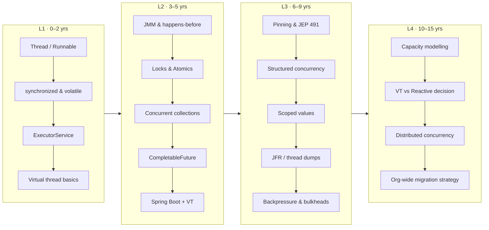

# Learning Path: 0 → 15 Years

Concurrency skill grows in four distinct stages. Each stage changes **what question you ask**.

| Level | Experience | The question you ask | Must master |
|---|---|---|---|
| L1 | 0–2 yrs | "How do I run this in the background safely?" | Thread lifecycle, `synchronized`, `volatile`, `ExecutorService`, race conditions, virtual-thread basics |
| L2 | 3–5 yrs | "Which tool fits this problem?" | JMM/happens-before, locks, atomics, concurrent collections, `CompletableFuture`, pool sizing, VT migration |
| L3 | 6–9 yrs | "Why is production slow or stuck?" | Thread dumps, JFR, pinning, contention profiling, structured concurrency, backpressure, JMH |
| L4 | 10–15 yrs | "What concurrency model should the *platform* use?" | Capacity math (Little's Law), VT vs reactive trade-offs, distributed concurrency, failure isolation, org-wide migration |

## Week-by-week plan (12 weeks, ~5 hrs/week)

| Week | Read | Do |
|---|---|---|
| 1 | [Threads & Lifecycle](../foundations/threads-basics.md) | Write a counter with 2 threads, observe lost updates, fix it 3 ways |
| 2 | [Java Memory Model](../foundations/java-memory-model.md) | Reproduce the "stop flag never seen" bug; fix with `volatile` |
| 3 | [synchronized](../foundations/synchronization.md), [Locks](../foundations/locks.md) | Bounded buffer with `wait/notify`, then with `Condition` |
| 4 | [Atomics](../foundations/atomics.md), [Liveness](../foundations/liveness.md) | Create a deadlock, find it in `jstack`, fix with lock ordering |
| 5 | [Executors](../java8-toolkit/executors.md), [Pool sizing](../java8-toolkit/pool-sizing.md) | Build a custom `ThreadPoolExecutor` with metrics and rejection handling |
| 6 | [CompletableFuture](../java8-toolkit/completable-future.md) | Async fan-out to 3 fake services with timeouts and fallbacks |
| 7 | [VT L1–L3](../virtual-threads/01-basics.md) | Start 1M virtual threads; observe pinning with JFR on JDK 21 vs 24 |
| 8 | [VT L4–L5](../virtual-threads/04-examples.md) | Rewrite week-6 fan-out with VTs; add a semaphore bulkhead |
| 9 | [Structured concurrency](../modern/structured-concurrency.md), [Scoped values](../modern/scoped-values.md) | Same fan-out with `StructuredTaskScope`; propagate a request id |
| 10 | [Production tab](../production/index.md) | Run `examples/spring-boot-vt`, load test it with VT on and off |
| 11 | [Debugging](../advanced/debugging.md), [Benchmarking](../performance/benchmarking.md) | JMH benchmark platform vs VT; take and read a JSON thread dump |
| 12 | [System design](../system-design/index.md), [Interview](../interview/index.md) | Do 2 mock system-design rounds out loud |

## Skill checklist

- [ ] I can explain why `count++` is not atomic.
- [ ] I can explain *happens-before* without saying "it flushes the cache".
- [ ] I know when to choose `ReentrantLock` over `synchronized`, and why that choice changed in Java 24.
- [ ] I can size a platform thread pool for CPU-bound and IO-bound work.
- [ ] I know why you **never pool** virtual threads.
- [ ] I can find a pinned virtual thread with JFR.
- [ ] I can limit concurrency to a downstream with a `Semaphore` instead of pool size.
- [ ] I can explain structured concurrency's cancellation semantics.
- [ ] I can say when reactive is still the better choice than virtual threads.
- [ ] I can apply Little's Law to size connection pools, threads, and rate limits.
