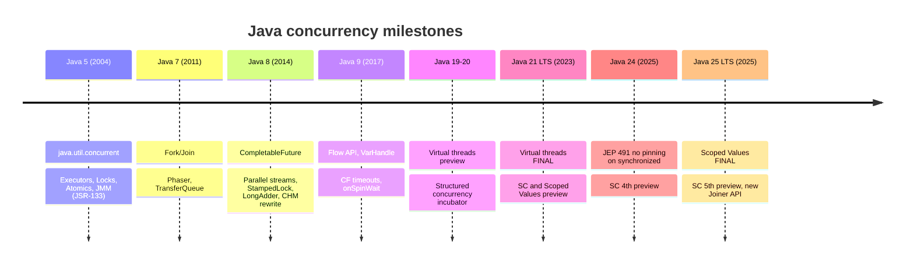

# Java Multithreading & Concurrency Playbook

A single, sequential playbook that takes you from **"what is a thread?"** to **"design the concurrency model
for a 50k-RPS platform"**, covering every concurrency API from **Java 8** through **Java 21 (LTS)**,
**Java 24**, and the current LTS **Java 25**. Virtual threads get the deepest treatment.

!!! tip "How to read this playbook"
    Every page is tagged with an experience level. Read top-to-bottom the first time; come back to
    individual pages as reference later.

    <span class="level l1">L1 · 0–2 yrs</span>
    <span class="level l2">L2 · 3–5 yrs</span>
    <span class="level l3">L3 · 6–9 yrs</span>
    <span class="level l4">L4 · 10–15 yrs</span>

## What is in each tab

| Tab | What you get | Primary level |
|---|---|---|
| **Home** | Learning path, Java 8 → 25 feature timeline, one-page cheat sheet | All |
| **Foundations** | Threads, lifecycle, Java Memory Model, `synchronized`, locks, atomics, deadlock/livelock/starvation | L1–L2 |
| **Java 8 Toolkit** | Executors, pool sizing, `CompletableFuture`, Fork/Join, concurrent collections, synchronizers, `ThreadLocal` | L2–L3 |
| **Virtual Threads** | Nine progressive levels: basics → internals → pinning → 25 examples → patterns → migration → pitfalls → observability → architect | L1–L4 |
| **Modern Java** | Structured concurrency, scoped values, virtual threads vs reactive, Flow API | L3–L4 |
| **Spring Boot** | Spring Boot 3.2+/4.x code you can paste: config, fan-out aggregator, `@Async`, Kafka, JDBC, resilience, context, metrics, tests, shutdown | L2–L4 |
| **System Design** | Sequence diagrams, scheduling diagrams, case studies, distributed concurrency | L3–L4 |
| **Performance** | How much time, memory, and money Java 21/24 saves over Java 8, plus JMH and jcstress | L3–L4 |
| **Advanced** | Lock-free algorithms, thread dumps, a pattern catalogue, and a gallery of real bugs | L3–L4 |
| **Tools** | jcmd/jstack, JSON thread dumps + jq, JFR & `jfr view`, async-profiler, JMH, jcstress, Lincheck, Awaitility, SpotBugs, Error Prone, Actuator/Prometheus, load testing, and libraries, with real output | L2–L4 |
| **Coding Interview** | 21 classic multithreading coding problems (odd/even, H2O, blocking queue, thread pool, barrier, scheduler, deadlock, philosophers, LRU, rate limiter, crawler, …) with runnable tested solutions, diagrams, and line-by-line walkthroughs | L1–L4 |
| **Interview** | 200+ questions with answers, grouped by level, plus coding problems and system design rounds | All |

## The one-paragraph summary

Java 8 gave us **composable asynchrony** (`CompletableFuture`, parallel streams, `StampedLock`, `LongAdder`),
but every blocking call still burned an expensive **platform (OS) thread**. As a result, high-throughput services
moved to **reactive** code (WebFlux, RxJava), which scales but is hard to write, debug, and profile.
**Java 21** made **virtual threads** final (JEP 444). They are cheap, JVM-scheduled threads, so plain blocking code now
scales like reactive code. **Java 24** (JEP 491) removed the biggest caveat: `synchronized` no longer
**pins** a virtual thread to its carrier. **Structured concurrency** (preview) and **scoped values** (final in
Java 25) finish the picture with safe fan-out and an immutable, inheritable replacement for `ThreadLocal`.



## Quick start

```bash
pip install mkdocs-material
mkdocs serve        # http://127.0.0.1:8000
```

Runnable examples live in [`examples/`](https://github.com/khiruashish/java-multithreading-playbook/tree/main/examples):

* `examples/plain-java`: single-file programs you run with `java File.java` on JDK 21+.
* `examples/tools-lab`: a broken target service to practise diagnostics on, plus JMH, jcstress, and testing/static-analysis projects.
* `examples/interview-coding`: 21 self-checking interview solutions (`./run-all.sh`).
* `examples/spring-boot-vt`: a complete Spring Boot service with virtual threads, a fan-out aggregator,
  bulkheads, scoped request context, metrics, and tests.
