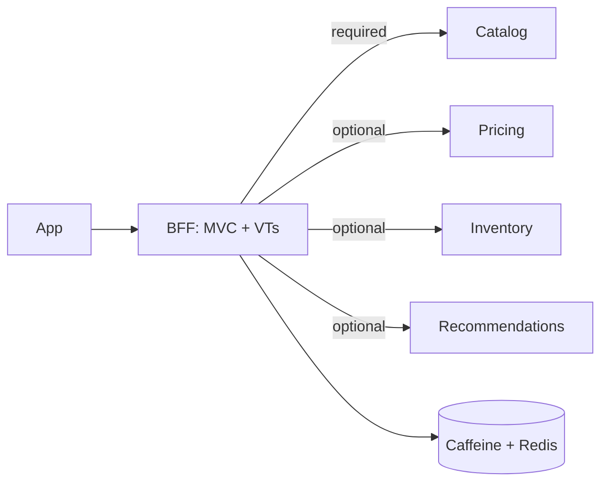
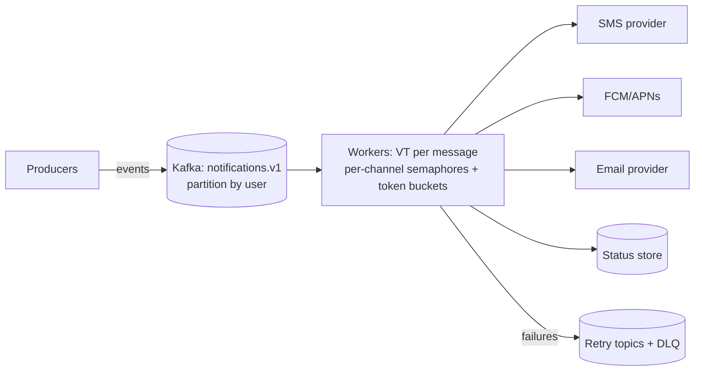
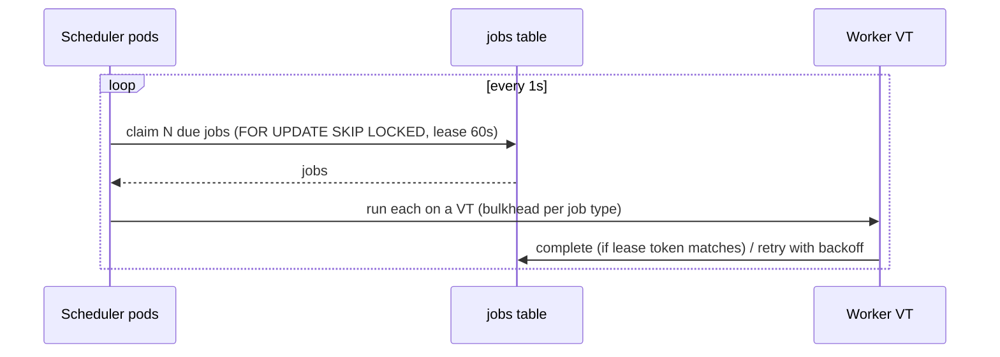

# System Design Rounds (Concurrency-heavy)

Each prompt includes the clarifying questions to ask, a model design, a diagram, and the concurrency talking points
interviewers listen for.

## 1. Product page aggregator (BFF)

**Ask:** QPS? Latency SLO? Which parts are optional? Personalization?

**Talking points:** fan-out with a deadline (structured scope), required vs optional parts with fallbacks and a `degraded` flag, a bulkhead per
dependency, a cache with stampede protection, hedging the recommendations call, and capacity via Little's Law. See the
[Fan-out service](../production/fan-out-service.md).

## 2. Notification platform

**Ask:** Volume (50M/day ≈ 600/s average, 10k/s peak)? Channels? Priority? Delivery guarantees? Provider quotas?

**Talking points:** per-provider quotas as token buckets plus semaphores, retry topics with backoff, idempotency (a message id with a unique
constraint), priority via separate topics, per-user ordering through partitioning, lag-based autoscaling, and VTs keeping the provider IO cheap.

## 3. Flash sale / inventory reservation

See [Case Study 2](../system-design/case-studies.md#case-2-flash-sale-inventory-contention). **Key points:** an atomic decrement in
Redis or a conditional SQL update, a waiting room with admission control, no hot-row `FOR UPDATE` convoys, async order creation, and a reservation TTL
with compensation.

## 4. Distributed rate limiter

**Ask:** Per user, per API key, or global? Accuracy vs latency? Limit scale (100 rps or 100k rps)?

| Option | Pros | Cons |
|---|---|---|
| Local token bucket per pod | No network hop | Inaccurate (limit ÷ pods) |
| Redis + Lua sliding window | Accurate, atomic | A network hop. Redis becomes a hot spot |
| Local buckets + periodic sync | Fast, approximately accurate | Complexity |

**Talking points:** Lua for atomicity, key sharding, failing open vs closed, `Retry-After` headers, and in-process limiting with VTs (sleeping is
cheap, but don't let waiters pile up unbounded).

## 5. Job scheduler

**Ask:** Cron vs one-off? Exactly-once? Duration? Multi-tenant?

**Talking points:** leases with fencing tokens, idempotent handlers, heartbeats for long jobs, a dead-letter table, and per-type
concurrency limits.

## 6. Chat / real-time messaging

**Talking points:** WebSocket connection handling (Netty/reactive, or VT-per-connection read/write loops), per-conversation ordering
(partition by conversation), fan-out to online members over pub/sub, backpressure for slow clients (bounded outbound queue, then
drop or disconnect), presence with TTL heartbeats, and connection-aware deploys.

## 7. Payment processing service

**Talking points:** idempotency keys, a state machine (`CREATED → AUTHORIZED → CAPTURED / FAILED`) with optimistic locking,
the outbox, provider timeouts with reconciliation (an unknown outcome is not a failure), bulkhead and circuit breaker per provider, and no retries on
non-idempotent calls without a key.

## 8. Web crawler

**Talking points:** a frontier queue (priority + politeness), per-host semaphores and crawl delay, a global concurrency limit, dedup (Bloom filter
plus a store), VT per fetch, robots.txt caching, and checkpointing for restart. See example 21 in
[Worked Examples](../virtual-threads/04-examples.md#21-rate-limited-crawler-permits-per-host-limits).
