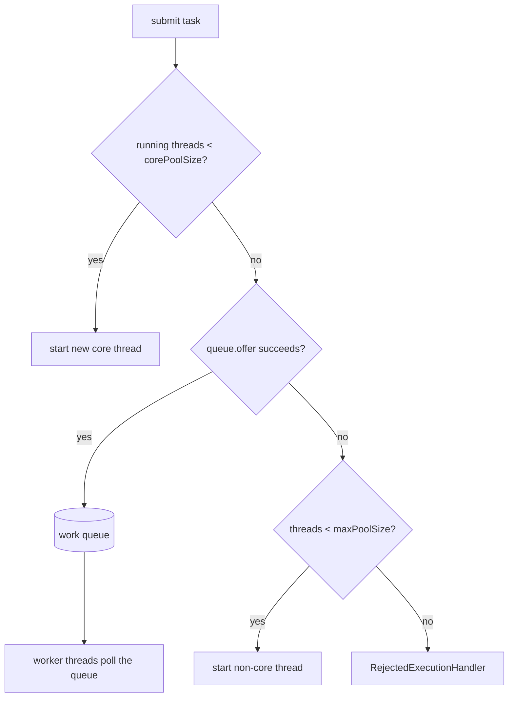

# Executor Framework

<span class="level l2">L2</span>

## Anatomy of `ThreadPoolExecutor`



!!! warning "The #1 misconception"
    The pool grows beyond `corePoolSize` **only when the queue is full**. With an unbounded `LinkedBlockingQueue`
    (which `newFixedThreadPool` uses), `maximumPoolSize` is **never used**, and the queue can grow until you hit
    an `OutOfMemoryError`.

## Production-grade platform pool (Java 8 style, still valid for CPU work)

```java
public final class Pools {
    public static ThreadPoolExecutor cpuPool(String name) {
        int cores = Runtime.getRuntime().availableProcessors();
        ThreadFactory tf = new ThreadFactory() {
            private final AtomicInteger n = new AtomicInteger();
            @Override public Thread newThread(Runnable r) {
                Thread t = new Thread(r, name + "-" + n.incrementAndGet());
                t.setUncaughtExceptionHandler((th, e) -> log.error("uncaught in {}", th.getName(), e));
                return t;
            }
        };
        ThreadPoolExecutor ex = new ThreadPoolExecutor(
                cores, cores,                                 // fixed size for CPU work
                60, TimeUnit.SECONDS,
                new ArrayBlockingQueue<>(1_000),              // BOUNDED queue = backpressure
                tf,
                new ThreadPoolExecutor.CallerRunsPolicy());   // slow the producer down instead of dropping
        ex.allowCoreThreadTimeOut(false);
        ex.prestartAllCoreThreads();
        return ex;
    }
}
```

The same pool on Java 21+ is shorter:

```java
ThreadFactory tf = Thread.ofPlatform().name("cpu-", 0)
        .uncaughtExceptionHandler((t, e) -> log.error("uncaught in {}", t.getName(), e))
        .factory();
```

## Rejection policies

| Policy | Behaviour | Use when |
|---|---|---|
| `AbortPolicy` (default) | Throws `RejectedExecutionException` | Caller can return 503 / retry |
| `CallerRunsPolicy` | Runs the task on the submitting thread | Natural backpressure for internal producers |
| `DiscardPolicy` | Silently drops | Best-effort telemetry only |
| `DiscardOldestPolicy` | Drops the head of the queue | Latest value matters (e.g., UI refresh) |

## `Executors` factory methods: what they really do

| Factory | Core / max | Queue | Risk |
|---|---|---|---|
| `newFixedThreadPool(n)` | n / n | Unbounded `LinkedBlockingQueue` | Unbounded queue → OOM |
| `newCachedThreadPool()` | 0 / ∞ | `SynchronousQueue` | Unbounded threads → OOM / thrashing |
| `newSingleThreadExecutor()` | 1 / 1 | Unbounded | Queue growth |
| `newScheduledThreadPool(n)` | n / ∞ | `DelayedWorkQueue` | – |
| `newWorkStealingPool()` (8) | `ForkJoinPool` | Per-worker deques | Async mode, not for blocking work |
| **`newVirtualThreadPerTaskExecutor()`** (21) | One new VT per task | None | Unbounded concurrency. Add semaphores for downstreams |
| `newThreadPerTaskExecutor(factory)` (21) | One thread per task | None | Same, with a custom factory (e.g., named VTs) |

## Lifecycle: then and now

=== "Java 8"

    ```java
    ExecutorService ex = Executors.newFixedThreadPool(10);
    try {
        List<Future<Result>> fs = ex.invokeAll(tasks, 5, TimeUnit.SECONDS);
        for (Future<Result> f : fs) {
            try { handle(f.get()); }
            catch (CancellationException | ExecutionException e) { log.warn("task failed", e); }
        }
    } finally {
        ex.shutdown();
        if (!ex.awaitTermination(30, TimeUnit.SECONDS)) ex.shutdownNow();
    }
    ```

=== "Java 21+"

    ```java
    try (var ex = Executors.newVirtualThreadPerTaskExecutor()) {
        List<Future<Result>> fs = ex.invokeAll(tasks, 5, TimeUnit.SECONDS);
        for (Future<Result> f : fs) {
            switch (f.state()) {                          // Future.State (Java 19)
                case SUCCESS   -> handle(f.resultNow());
                case FAILED    -> log.warn("task failed", f.exceptionNow());
                case CANCELLED -> log.warn("task timed out");
                case RUNNING   -> throw new AssertionError("invokeAll waits for completion");
            }
        }
    } // close() = shutdown + awaitTermination
    ```

**Benefits:** about 40% less code, an exhaustive `switch` over `Future.State`, and no checked-exception juggling.

## Scheduling

```java
ScheduledExecutorService ses = Executors.newScheduledThreadPool(1, Thread.ofPlatform().name("sched-", 0).factory());
ses.scheduleAtFixedRate(this::refreshCache, 0, 30, TimeUnit.SECONDS);   // fixed RATE: may run late but never overlaps
ses.scheduleWithFixedDelay(this::poll, 0, 5, TimeUnit.SECONDS);         // fixed DELAY between end and next start
```

!!! danger "An exception kills a periodic task silently"
    If the `Runnable` throws, every later run is suppressed. Wrap the body in `try/catch(Throwable)`.

**Pattern with VTs:** keep the scheduler tiny (one platform thread) and have each tick hand the real (blocking) work to a
virtual thread, so a slow tick never delays the next one:
`ses.scheduleAtFixedRate(() -> Thread.startVirtualThread(this::refreshCache), 0, 30, SECONDS);`
