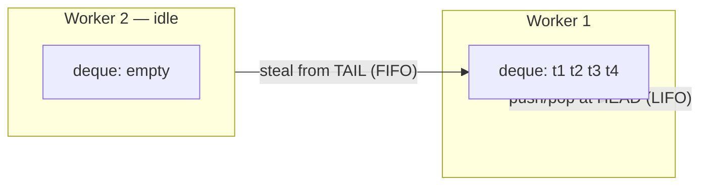

# Fork/Join & Parallel Streams

<span class="level l2">L2</span> <span class="level l3">L3</span>

## Work stealing



Each worker owns a deque. It pushes and pops its own tasks at the head (cache-friendly), and idle workers steal large,
old tasks from the tail. **This same pool type is the default scheduler for virtual threads**, running in FIFO
async mode.

## RecursiveTask

```java
class SumTask extends RecursiveTask<Long> {
    private static final int THRESHOLD = 10_000;
    private final long[] a; private final int lo, hi;
    SumTask(long[] a, int lo, int hi) { this.a = a; this.lo = lo; this.hi = hi; }

    @Override protected Long compute() {
        if (hi - lo <= THRESHOLD) {
            long s = 0; for (int i = lo; i < hi; i++) s += a[i]; return s;
        }
        int mid = (lo + hi) >>> 1;
        SumTask left = new SumTask(a, lo, mid);
        left.fork();                                   // push to own deque
        long right = new SumTask(a, mid, hi).compute(); // compute right half directly
        return right + left.join();                    // join may help by running other tasks
    }
}
long total = ForkJoinPool.commonPool().invoke(new SumTask(data, 0, data.length));
```

## Parallel streams

```java
long primes = LongStream.rangeClosed(2, 5_000_000).parallel().filter(Primes::isPrime).count();
```

Rules for parallel streams:

| Do | Don't |
|---|---|
| CPU-heavy, stateless, large N (>10k elements × non-trivial work) | Blocking IO (HTTP, JDBC) inside `map` |
| Splittable sources: arrays, `ArrayList`, `IntStream.range` | `LinkedList`, `Stream.iterate`, IO-backed streams |
| Associative reductions (`sum`, `reduce` with identity) | Shared mutable accumulators (`list.add` inside `forEach`) |
| Measure with JMH | Assume it's faster. It often isn't for N < 10k |

Run parallel streams in a custom pool to isolate them from the common pool:

```java
ForkJoinPool pool = new ForkJoinPool(4);
try {
    long n = pool.submit(() -> list.parallelStream().filter(this::expensive).count()).get();
} finally { pool.shutdown(); }
```

## `ManagedBlocker`: telling Fork/Join you're about to block

If you must block inside a FJ task, `ForkJoinPool.managedBlock(blocker)` lets the pool spawn a compensating thread.
The JDK itself uses this mechanism to compensate for **pinned virtual threads** on JDK 21–23 (up to `maxPoolSize`, default 256).

## Java 21+: CPU work vs IO work

```java
// IO fan-out → virtual threads
try (var ex = Executors.newVirtualThreadPerTaskExecutor()) { ... }

// CPU crunch → parallel stream / FJ (platform threads = #cores)
var scores = candidates.parallelStream().map(this::score).toList();
```

Virtual threads give **no** speed-up for CPU-bound work, because there are still only `Ncpu` carriers.
