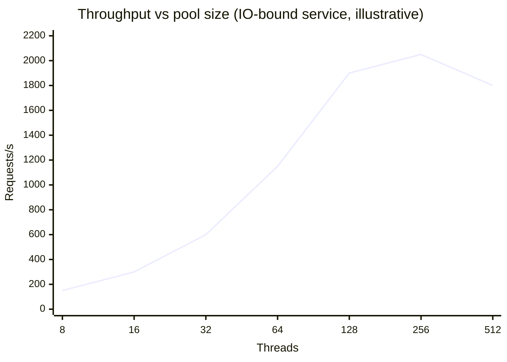

# Thread Pool Sizing

<span class="level l2">L2</span> <span class="level l3">L3</span>

## Formulas

**CPU-bound:** `threads ≈ Ncpu` (or `Ncpu + 1` to cover the occasional page fault).

**Mixed / IO-bound (Goetz, *JCIP*):**

```
threads = Ncpu × Utarget × (1 + W/C)
```

where `W/C` is the ratio of wait time to compute time.

*Example:* 8 cores, target 80% CPU, each request waits 95 ms on IO and computes 5 ms → `8 × 0.8 × (1 + 19) = 128` threads.

## Little's Law (the formula an L4 engineer reaches for first)

```
L = λ × W
concurrency in system = arrival rate × time in system
```

*Example:* 2,000 req/s, p99 latency 250 ms → **500 requests in flight**. On Java 8 that means 500 platform threads
(~500 MB of reserved stack, plus context-switch overhead). With virtual threads, 500 VTs cost a few MB.

Little's Law sizes *every* resource:

| Resource | Formula | Example |
|---|---|---|
| Request threads | λ × request latency | 2000 × 0.25 s = 500 |
| DB connections | λ_db × query time | 2000 × 0.010 s = 20 (+ headroom → 30) |
| Downstream permits | λ_down × downstream latency | 2000 × 0.08 s = 160 |

!!! tip "Virtual threads change which number you tune"
    With platform threads you tuned **thread count**, and that indirectly limited DB connections, sockets, and memory.
    With virtual threads, the thread count is effectively unlimited, so you must tune the **resources directly**:
    HikariCP `maximumPoolSize`, `Semaphore` permits per downstream, and rate limiters.
    See [Resilience](../production/resilience.md).

## Measuring instead of guessing

1. Expose `ThreadPoolExecutor` metrics: `getActiveCount`, `getQueue().size()`, `getCompletedTaskCount`
   (Micrometer's `ExecutorServiceMetrics` does this).
2. Load test, then increase the size until throughput plateaus or p99 latency rises.
3. The right size lands at the knee of the throughput/latency curve.



Past the knee, context switching, lock contention, and GC pressure make throughput *drop*. Virtual threads move
the knee far to the right for IO-bound work, but CPU-bound work still has the same knee.
