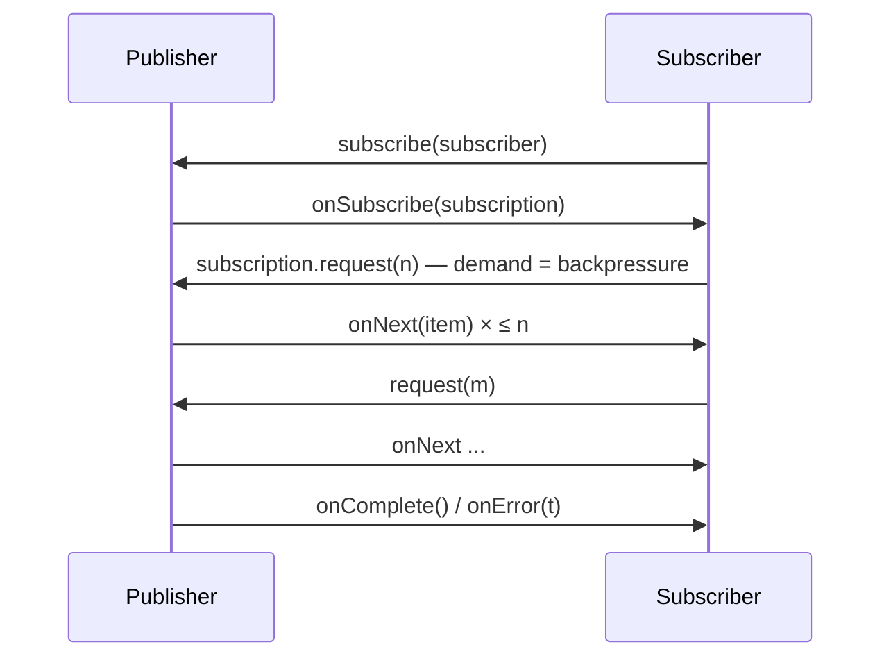

# Flow API & Reactive Streams (Java 9+)

<span class="level l3">L3</span>

`java.util.concurrent.Flow` contains the four Reactive Streams interfaces, so libraries (Reactor, RxJava, Akka, the
JDK `HttpClient`) can interoperate:



## SubmissionPublisher example

```java
try (var publisher = new SubmissionPublisher<String>(
        Executors.newVirtualThreadPerTaskExecutor(), 256)) {    // per-subscriber buffer = 256

    publisher.subscribe(new Flow.Subscriber<>() {
        private Flow.Subscription sub;
        public void onSubscribe(Flow.Subscription s) { sub = s; s.request(10); }
        public void onNext(String item)              { process(item); sub.request(1); }
        public void onError(Throwable t)             { log.error("stream failed", t); }
        public void onComplete()                     { log.info("done"); }
    });

    for (String line : lines) publisher.submit(line);   // blocks when the buffer is full → backpressure
}
```

With virtual threads, a blocking `submit()` is cheap, which makes `SubmissionPublisher` a convenient in-process
backpressured pipeline that needs no external library.
