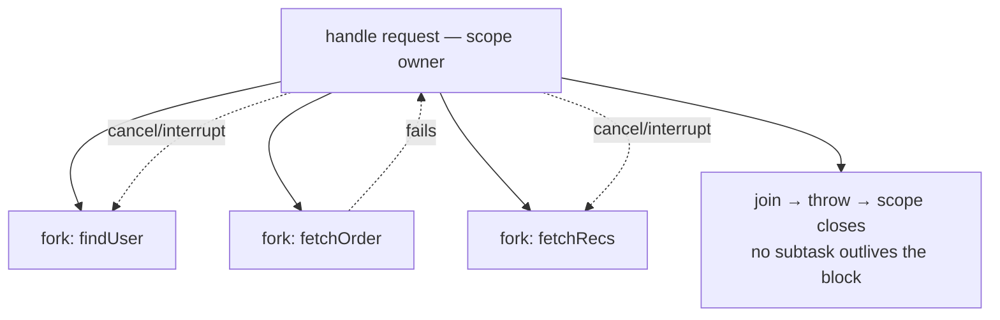

# Structured Concurrency

<span class="level l3">L3</span> <span class="level l4">L4</span>

## The problem with unstructured concurrency

```java
Future<User> u = executor.submit(() -> findUser(id));
Future<Order> o = executor.submit(() -> fetchOrder(id));
User user = u.get();     // if this throws...
Order order = o.get();   // ...fetchOrder keeps running: a LEAKED task
```

* If `findUser` fails, `fetchOrder` keeps running and wastes resources.
* If the caller thread is interrupted, the subtasks don't find out.
* A thread dump shows no relationship between the request and its subtasks.

## The structured version

**Structured concurrency** says that subtasks started in a block must finish **before the block exits**, just as a method call
returns before its caller continues. Errors and cancellation flow along that parent–child tree.



## API: Java 21–24 (JEP 453 / 462 / 480 / 499)

```java
Response handle(long id) throws ExecutionException, InterruptedException {
    try (var scope = new StructuredTaskScope.ShutdownOnFailure()) {
        Subtask<User>  user  = scope.fork(() -> findUser(id));
        Subtask<Order> order = scope.fork(() -> fetchOrder(id));

        scope.join()              // wait for both, or for the first failure
             .throwIfFailed();    // rethrows as ExecutionException

        return new Response(user.get(), order.get());
    }   // close(): guarantees every subtask is finished
}
```

Built-in policies (21–24):

| Class | Shuts down when | Use |
|---|---|---|
| `ShutdownOnFailure` | First subtask **fails** | All results required ("invoke all") |
| `ShutdownOnSuccess<T>` | First subtask **succeeds** | Redundant calls ("invoke any"), `scope.result()` |
| Custom subclass | Your `handleComplete` override | Quorum, "first N", collect all successes |

```java
// First successful wins (21–24)
try (var scope = new StructuredTaskScope.ShutdownOnSuccess<Quote>()) {
    scope.fork(() -> vendorA.quote(item));
    scope.fork(() -> vendorB.quote(item));
    scope.fork(() -> vendorC.quote(item));
    scope.joinUntil(Instant.now().plusMillis(400));
    return scope.result();             // losers are interrupted
}
```

## API: Java 25 (JEP 505, fifth preview) — reshaped

```java
// All must succeed (the default joiner)
try (var scope = StructuredTaskScope.open()) {
    Subtask<User>  user  = scope.fork(() -> findUser(id));
    Subtask<Order> order = scope.fork(() -> fetchOrder(id));
    scope.join();                                  // throws StructuredTaskScope.FailedException
    return new Response(user.get(), order.get());
}

// First success wins
try (var scope = StructuredTaskScope.open(Joiner.<Quote>anySuccessfulResultOrThrow())) {
    vendors.forEach(v -> scope.fork(() -> v.quote(item)));
    return scope.join();                           // join() returns the winning result
}

// Collect every result as a stream of subtasks (throws on the first failure)
try (var scope = StructuredTaskScope.open(Joiner.<Price>allSuccessfulOrThrow())) {
    stores.forEach(s -> scope.fork(() -> s.price(sku)));
    List<Price> prices = scope.join().map(Subtask::get).toList();
}

// Timeout via configuration
try (var scope = StructuredTaskScope.open(Joiner.awaitAllSuccessfulOrThrow(),
        cf -> cf.withTimeout(Duration.ofMillis(500)).withName("checkout-fanout"))) { ... }
```

| 21–24 | 25 |
|---|---|
| `new ShutdownOnFailure()` | `open()` / `open(Joiner.awaitAllSuccessfulOrThrow())` |
| `new ShutdownOnSuccess<T>()` | `open(Joiner.anySuccessfulResultOrThrow())` |
| `joinUntil(Instant)` | `open(joiner, cf -> cf.withTimeout(d))` |
| `throwIfFailed()` | `join()` throws `FailedException` |
| Subclass + `handleComplete` | Implement `Joiner<T,R>` (`onFork`, `onComplete`, `result`) |

## Custom policy: quorum (Java 25 Joiner)

```java
/** Succeeds when `quorum` subtasks succeed; cancels the rest. */
final class QuorumJoiner<T> implements StructuredTaskScope.Joiner<T, List<T>> {
    private final int quorum;
    private final Queue<T> ok = new ConcurrentLinkedQueue<>();
    private final AtomicInteger okCount = new AtomicInteger();
    QuorumJoiner(int quorum) { this.quorum = quorum; }

    @Override public boolean onComplete(Subtask<? extends T> st) {
        if (st.state() == Subtask.State.SUCCESS) {
            ok.add(st.get());
            return okCount.incrementAndGet() >= quorum;   // true → cancel the scope
        }
        return false;
    }
    @Override public List<T> result() {
        if (okCount.get() < quorum) throw new IllegalStateException("quorum not reached");
        return List.copyOf(ok).subList(0, quorum);
    }
}
// usage: List<Ack> acks = StructuredTaskScope.open(new QuorumJoiner<Ack>(2)) ... scope.join();
```

## Production advice: isolate the preview API

```java
/** Stable internal facade. Only this class changes when the JDK API changes. */
public final class FanOut {
    public static <A, B, R> R both(Callable<A> a, Callable<B> b, BiFunction<A, B, R> combine, Duration timeout)
            throws Exception {
        try (var ex = Executors.newVirtualThreadPerTaskExecutor()) {   // non-preview fallback
            Future<A> fa = ex.submit(a);
            Future<B> fb = ex.submit(b);
            try {
                long deadline = System.nanoTime() + timeout.toNanos();
                A ra = fa.get(Math.max(0, deadline - System.nanoTime()), TimeUnit.NANOSECONDS);
                B rb = fb.get(Math.max(0, deadline - System.nanoTime()), TimeUnit.NANOSECONDS);
                return combine.apply(ra, rb);
            } catch (ExecutionException | TimeoutException | InterruptedException e) {
                fa.cancel(true); fb.cancel(true);                      // emulate structured cancellation
                throw e;
            }
        }
    }
}
```

When structured concurrency becomes final, swap the body of this class and leave the callers untouched.

## Benefits vs Java 8 `CompletableFuture`

| Concern | CompletableFuture | StructuredTaskScope |
|---|---|---|
| Cancel siblings on failure | Manual | Automatic |
| Leaked tasks | Easy to leak | Impossible past `close()` |
| Thread dump shows the tree | No | Yes (JSON dump containers) |
| Scoped value inheritance | No | Yes, automatic and free |
| Code style | Callback chains | Sequential |
| Stack traces | Pool frames | Real call site |
