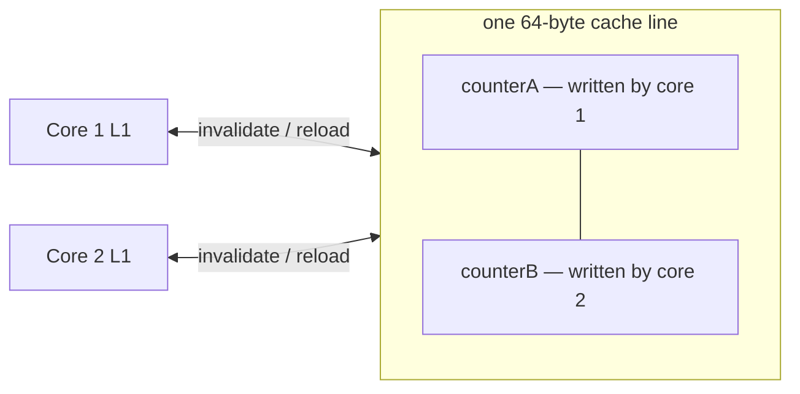

# False Sharing & Hardware

<span class="level l3">L3</span> <span class="level l4">L4</span>

## Cache lines

CPUs move memory in **64-byte cache lines**. If two threads write to *different* variables on the *same* line,
the line ping-pongs between cores (MESI invalidations). This is **false sharing**.



## Fixes

```java
// 1. Padding (manual, fragile: the JVM may reorder fields)
class PaddedCounter { long p1,p2,p3,p4,p5,p6,p7; volatile long value; long q1,q2,q3,q4,q5,q6,q7; }

// 2. @Contended (JDK-internal; needs -XX:-RestrictContended for user classes)
@jdk.internal.vm.annotation.Contended volatile long value;

// 3. Best: use JDK classes that already handle it
LongAdder adder = new LongAdder();     // Cells are @Contended internally
```

`ConcurrentHashMap`'s counter cells, `Exchanger`, `ForkJoinPool` work queues, and `Thread`'s random seeds all use
`@Contended` internally.

## Other hardware effects

| Effect | Impact | Mitigation |
|---|---|---|
| CAS contention | Throughput collapses as cores increase | Striping (`LongAdder`), sharding, batching |
| NUMA | Remote memory access is ~1.5–2× slower | `-XX:+UseNUMA` (Parallel/G1), pin pods to a socket |
| Hyper-threading | 2 HW threads ≠ 2 cores for CPU-bound work | Size CPU pools to physical cores when it matters |
| Memory barriers | `volatile` writes cost store-load fences (x86 `lock add`) | Acquire/release modes via `VarHandle` |
| Container CPU throttling (CFS quota) | Latency spikes when the quota is exhausted | Right-size CPU limits, or drop limits and keep requests |
