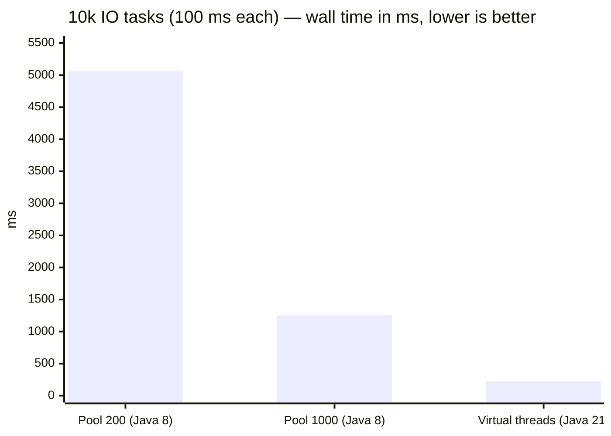

# Time & Cost Savings: Java 8 → 21/24

<span class="level l3">L3</span> <span class="level l4">L4</span>

This page answers "**how much do we actually save?**" in four currencies: **wall-clock time**, **hardware**,
**developer time**, and **incident time**. The first table uses numbers **measured** with this repo's examples. The rest are
models you can plug your own numbers into.

## 1. Measured in this repo (JDK 21, 4 vCPU container)

| Scenario (example file) | Java 8 approach | Java 21 approach | Speed-up |
|---|---|---|---|
| 10,000 tasks × 100 ms IO (`PlatformVsVirtualBenchmark`) | Fixed pool 200: **5,061 ms** | VT per task: **224 ms** | **22×** |
| Same, oversized pool 1000 | **1,261 ms** (1000 OS threads) | **224 ms** | 5.6× |
| 2,000 requests × 3-way fan-out (`FanOutComparison`) | 200 request threads + CF on 200-thread IO pool: **2,695 ms** | VT per request & subtask: **184 ms** | **14.6×** |
| 1,000,000 × 1 s sleeps (`MillionThreads`) | Pool 200: **≈ 83 min** (computed) | **9.6 s** | ~500× |
| Blocking in `synchronized`, 2 carriers (`PinningDemo`) | n/a | JDK 21: **1,014 ms** (pinned) vs `ReentrantLock` **102 ms** | JDK 24 makes both ≈ 100 ms |



!!! info "Why such big numbers?"
    These are IO-bound workloads, and IO-bound is exactly what VTs fix. The win is **throughput under concurrency**: the
    platform pool caps concurrency at its size (`time ≈ tasks / pool × latency`), while VTs let all tasks wait at once.
    **CPU-bound** work gets **no** speed-up.

## 2. Throughput model for a real service

```
max_rps(platform) = threads / avg_latency          (thread-bound)
max_rps(virtual)  = min(cores × util / cpu_per_req,   (CPU-bound)
                        db_pool / db_time_per_req,     (pool-bound)
                        downstream limits)
```

**Example A (CPU-heavy):** an API with 200 Tomcat threads, avg latency 250 ms (240 ms IO, **10 ms CPU**), on 4 cores at 70% target utilization:

| | Java 8 (200 threads) | Java 21 (VTs) |
|---|---|---|
| Thread-bound limit | 200 / 0.25 = 800 rps | none |
| CPU-bound limit | 4 × 0.7 / 0.010 = **280 rps** | **280 rps** |
| **Result** | 280 rps | 280 rps (no gain) |

The CPU limit (280) is below the thread limit (800), so VTs don't help. **Example B (IO-heavy aggregator):** 250 ms latency, **2 ms CPU**:

| | Java 8 | Java 21 |
|---|---|---|
| Thread-bound | **800 rps** | – |
| CPU-bound | 1,400 rps | **1,400 rps** |
| **Result** | 800 rps | **1,400 rps (+75%)** with the same pods |

**Rule of thumb:** VT gain ≈ `min(CPU limit, other limits) / thread limit`. It's largest for services with a **low CPU
per request and a high latency**: aggregators, BFFs, gateways, and notification senders.

## 3. Hardware and cost

| Item | Java 8 (platform threads) | Java 21 (VTs) |
|---|---|---|
| Memory per waiting request | ~0.5–1 MB stack reservation + thread structures | ~1–10 KB of heap stack chunks |
| 5,000 concurrent requests | 2.5–5 GB of stacks; impractical | ~50 MB |
| Context switch | Kernel, ~1–10 µs | User-mode mount/unmount, ~100s of ns |
| Pods for 10k concurrent slow requests (aggregator, illustrative) | ~25 pods × 400 threads | ~6–8 pods (CPU-bound) |

**Example cost model** (illustrative, plug in your own prices): 25 → 8 pods at ~$70/pod-month (2 vCPU / 4 GB) is
about **$1,190 per month per service**. Across 20 IO-heavy services, that's on the order of **$285k per year**. Measure your own
services before quoting numbers to finance.

## 4. Developer time (code size and complexity)

Measured on the paired examples in this playbook:

| Task | Java 8 LOC | Java 21 LOC | Saving |
|---|---|---|---|
| 3-way fan-out with fallbacks (`FanOutComparison`) | 14 | 7 | 50% |
| Fan-out service (`fan-out-service.md`) | ~30 + pool config | ~15 | ~50% |
| Executor lifecycle (`invokeAll` + shutdown) | 14 | 10 | ~30% |
| Retry with backoff | Scheduled executor + CF: ~25 | Loop + sleep: 10 | 60% |
| `@Async` executor config | 12 lines of Java | 1–3 properties | ~80% |
| Request context cleanup | try/finally per entry point | `ScopedValue.where().run()` | No leak class of bugs |

The bigger win is **non-LOC**: sequential stack traces, debugger stepping, normal profilers, and no reactive learning
curve. Teams moving from WebFlux to MVC + VTs commonly report faster onboarding and fewer "lost context" or
"swallowed error" bugs.

## 5. Incident time

| Failure class | Java 8 frequency | Java 21+ |
|---|---|---|
| Thread pool exhaustion cascades | Common | Gone. Replaced by explicit bulkheads |
| Pool-induced deadlock (nested `submit().get()`) | Occasional | Gone |
| ThreadLocal leaks across requests | Occasional | Rare (`ScopedValue`, bounded lifetime) |
| Lost async exceptions | Common with CF | Rare (sequential code, structured scopes) |
| Pinning | n/a | Possible on 21–23, mostly gone on 24+ |

## 6. Famous APIs: Java 8 vs 21/24 at a glance

| API | Java 8 | Java 21/24/25 | What you save |
|---|---|---|---|
| `ExecutorService` | Manual shutdown | `AutoCloseable` (19) | Boilerplate, leaked pools |
| `Future` | `get()` + checked exceptions | `state()`, `resultNow()`, `exceptionNow()` (19) | Error-handling code |
| `CompletableFuture` | No timeouts | `orTimeout`, `completeOnTimeout` (9), `exceptionallyCompose` (12) | Scheduler plumbing |
| `Thread` | `new Thread()` | `Thread.ofVirtual()/ofPlatform()` builders (21) | Factories, naming code |
| Fan-out | `allOf` + chains | `StructuredTaskScope` (preview) | Cancellation logic |
| Context | `ThreadLocal` | `ScopedValue` (final 25) | Leak bugs, inheritance cost |
| `synchronized` | Pins VTs (21–23) | VT-friendly (24) | Rewrites to `ReentrantLock` |
| Lazy init | DCL + volatile | `StableValue` (25 preview) | Subtle JMM bugs |
| `HttpClient` | Apache/OkHttp | JDK `HttpClient` (11), VT-friendly | A dependency |
| GC | Parallel/CMS | Generational ZGC (21/23) | Pause time with many stacks |
