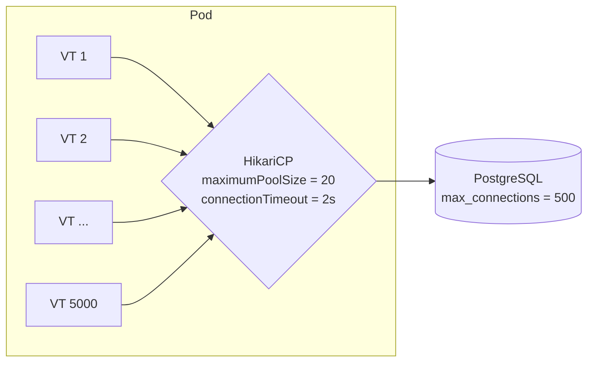

# Database & Connection Pools

<span class="level l2">L2</span> <span class="level l3">L3</span>

## The connection pool is now your real concurrency limit



## Sizing (Little's Law)

```
connections_per_pod = peak_rps_per_pod × avg_db_time_per_request × safety(1.2–1.5)
Σ (pods × connections_per_pod) + admin/headroom ≤ DB max_connections
```

*Example:* 400 rps/pod × 12 ms DB time = 4.8 → **pool 8–10**. With 30 pods that's about 300 connections. A PostgreSQL
instance often performs best at roughly `cores × 2–4` active connections, so put **PgBouncer** (transaction pooling) in
front of it if the pod count is high.

!!! warning "Don't grow the pool because 'VTs can handle it'"
    Bigger pools make the **database** slower: context switching, lock contention, and memory. Keep pools small, and let
    VTs queue cheaply on `getConnection()`.

## HikariCP configuration

```yaml
spring:
  datasource:
    hikari:
      maximum-pool-size: 10
      minimum-idle: 10              # fixed-size pool: no churn
      connection-timeout: 2000      # VTs waiting longer fail fast → 503 instead of piling up
      max-lifetime: 1800000
      leak-detection-threshold: 20000
  jpa:
    open-in-view: false             # don't hold a connection for the whole request
```

Use HikariCP **5.1+**. Earlier versions used `synchronized` in places that could pin on JDK 21.

## Transactions are thread-bound

`@Transactional` binds the connection to the **current thread** (with `ThreadLocal`). So:

* Work forked to another VT inside a `@Transactional` method is **not** in the transaction.
* Don't fan out DB writes inside one transaction. Fan out reads **before** opening the transaction, then write sequentially.

```java
public OrderReceipt place(PlaceOrder cmd) throws Exception {
    // 1. Parallel reads, no TX, each uses its own pooled connection
    Cart cart; Address addr; Quote quote;
    try (var ex = Executors.newVirtualThreadPerTaskExecutor()) {
        var c = ex.submit(() -> carts.load(cmd.cartId()));
        var a = ex.submit(() -> addresses.load(cmd.addressId()));
        cart = c.get(); addr = a.get();
        quote = pricing.quote(cart, addr);
    }
    // 2. Short write transaction
    return tx.execute(status -> orders.save(Order.from(cart, addr, quote)));
}
```

## Long-running queries

Set `statement_timeout` on the DB side, and `queryTimeout` / `jakarta.persistence.query.timeout` on the client side. A VT
blocked on a 10-minute report query holds a connection for 10 minutes. Route reports to a **separate pool** (and a read
replica) so they can't starve OLTP.

## JDBC vs R2DBC in the VT era

| | JDBC on VTs | R2DBC |
|---|---|---|
| Throughput | Bounded by the pool, which is the same bound for both | Same |
| Programming model | Plain / JPA / jOOQ / MyBatis | Reactive only |
| Transactions | `@Transactional` | Reactive transactions |
| Ecosystem | Everything | Limited |
| Recommendation | **Default** | Only inside an existing reactive stack |
