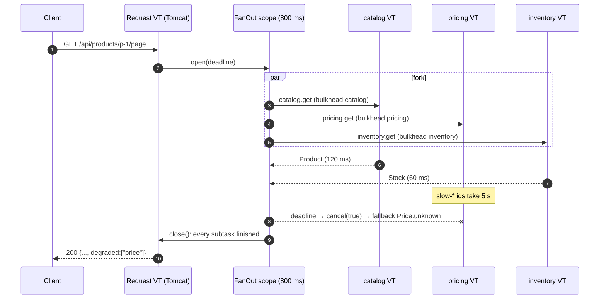

# Fan-out Aggregator Service

<span class="level l2">L2</span> <span class="level l3">L3</span>

The most common microservice concurrency problem is: **"build one response from N downstream calls, fast, and
degrade gracefully."**

## Requirements

* Catalog is **required**. If it fails, the request fails, and the other calls are cancelled.
* Price and stock are **optional**. On failure or timeout, use a default and flag the response as `degraded`.
* All calls run in parallel, under **one deadline** (800 ms).
* No subtask may outlive the request.
* Each downstream is protected by its own **bulkhead**.

## Sequence



## Java 8 version (for contrast)

```java
@Service
public class ProductPageServiceJava8 {
    private final ExecutorService io = new ThreadPoolExecutor(64, 64, 0, SECONDS,
            new ArrayBlockingQueue<>(1000), new ThreadPoolExecutor.CallerRunsPolicy());

    public ProductPage page(String id) {
        CompletableFuture<Product> product = CompletableFuture.supplyAsync(() -> catalog.get(id), io);
        CompletableFuture<Price> price = CompletableFuture.supplyAsync(() -> pricing.get(id), io)
                .completeOnTimeout(Price.unknown(id), 800, MILLISECONDS)
                .exceptionally(ex -> Price.unknown(id));
        CompletableFuture<Stock> stock = CompletableFuture.supplyAsync(() -> inventory.get(id), io)
                .completeOnTimeout(Stock.unknown(id), 800, MILLISECONDS)
                .exceptionally(ex -> Stock.unknown(id));
        try {
            return product.thenCombine(price, Pair::new)
                          .thenCombine(stock, (pp, s) -> new ProductPage(pp.a(), pp.b(), s, List.of(), ""))
                          .get(800, MILLISECONDS);
        } catch (TimeoutException e) {
            throw new DeadlineExceededException("catalog");    // BUT pricing/inventory keep running: leak
        } catch (ExecutionException e) {
            throw new RuntimeException(e.getCause());           // stack trace points into ForkJoinPool
        } catch (InterruptedException e) {
            Thread.currentThread().interrupt(); throw new RuntimeException(e);
        }
        // Also: completeOnTimeout does NOT cancel the underlying call; the IO thread stays busy.
        // Also: we can't tell which parts degraded without extra flags.
        // Also: 64 OS threads cap the whole service at 64 concurrent downstream calls.
    }
}
```

## Java 21 version: the service

```java title="ProductPageService.java"
--8<-- "examples/spring-boot-vt/src/main/java/com/playbook/vt/application/ProductPageService.java"
```

## The `FanOut` facade (structured concurrency without preview)

```java title="FanOut.java"
--8<-- "examples/spring-boot-vt/src/main/java/com/playbook/vt/concurrency/FanOut.java"
```

### Same service with `StructuredTaskScope` (Java 25 preview)

```java
public ProductPage page(String id) throws InterruptedException {
    try (var scope = StructuredTaskScope.open(Joiner.awaitAll(),
            cf -> cf.withTimeout(props.fanOutTimeout()))) {
        var product = scope.fork(() -> catalog.get(id));
        var price   = scope.fork(() -> pricing.get(id));
        var stock   = scope.fork(() -> inventory.get(id));
        try {
            scope.join();
        } catch (StructuredTaskScope.TimeoutException e) {
            // unfinished subtasks were cancelled; fall through and inspect their state
        }
        if (product.state() != Subtask.State.SUCCESS) throw new DeadlineExceededException("catalog");
        var degraded = new ArrayList<String>();
        Price pr = price.state() == Subtask.State.SUCCESS ? price.get() : fallback(degraded, "price", Price.unknown(id));
        Stock st = stock.state() == Subtask.State.SUCCESS ? stock.get() : fallback(degraded, "stock", Stock.unknown(id));
        return new ProductPage(product.get(), pr, st, List.copyOf(degraded), Thread.currentThread().toString());
    }
}
```

## Error mapping (RFC 9457)

```java title="ErrorHandling.java"
--8<-- "examples/spring-boot-vt/src/main/java/com/playbook/vt/api/ErrorHandling.java"
```

## What the Java 21 version gains

| Concern | Java 8 version | Java 21 version |
|---|---|---|
| Lines of business logic | ~30 | ~15 |
| Sibling cancellation | None | Automatic (`cancel(true)` → interrupt) |
| Leaked work after timeout | Yes | No: `close()` waits |
| Max concurrent downstream calls | 64 (pool) for **all** dependencies together | Per-dependency bulkheads (200/100/100) |
| Stack traces | ForkJoinPool frames | Your call site |
| Request context in subtasks | Manual | `RequestContext.propagate` (or automatic with ScopedValue + SC) |
| Tested behaviours | – | Parallelism, cancellation, deadline, degradation (`FanOutTest`) |
