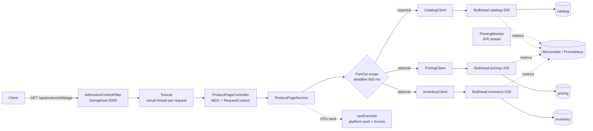

# Production Code: Java 21/24/25 in Spring Boot

L2 → L4

Every snippet on this tab is **included directly from a compiling, tested project**:
[`examples/spring-boot-vt`](https://github.com/khiruashish/java-multithreading-playbook/tree/main/examples/spring-boot-vt)
(Spring Boot **4.1.2**, Java **21** baseline, runs unchanged on 24/25). `mvn verify` runs 14 tests, including a
300-concurrent-request overload test.

## Architecture of the sample service

## Pages

| Page | What it covers |
|---|---|
| [Enabling Virtual Threads](spring-boot-setup.md) | One property, and what it switches. Tomcat/Jetty, `@Async`, `@Scheduled`, messaging. Version matrix |
| [Fan-out Aggregator](fan-out-service.md) | Required vs optional subtasks, shared deadline, sibling cancellation. Java 8 vs 21 |
| [Async, Scheduling & Messaging](async-scheduling-messaging.md) | `@Async`, `@Scheduled`, Kafka/RabbitMQ listeners, `TaskDecorator` |
| [Database & Connection Pools](database.md) | HikariCP sizing with Little's Law, transactions, JPA on VTs |
| [Resilience](resilience.md) | Admission control, bulkheads, timeouts, Resilience4j, hedging |
| [Request Context](request-context.md) | ThreadLocal → ScopedValue, MDC, tracing propagation |
| [Observability](observability.md) | Pinning monitor, metrics, dashboards, alerts |
| [Testing](testing.md) | Unit tests for concurrency primitives, overload tests, jcstress |
| [Graceful Shutdown & Ops](shutdown-ops.md) | SIGTERM, K8s probes, container CPU, JVM flags |
| [Complete Sample Project](sample-project.md) | File tree, run instructions, load-test recipe |
