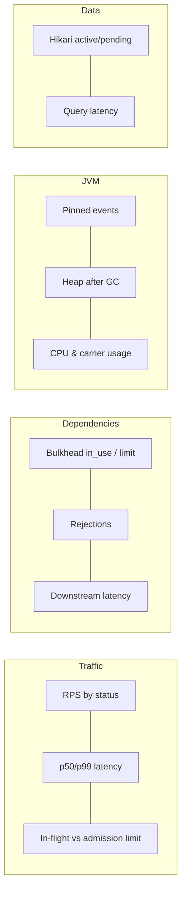

# Observability in Production

<span class="level l3">L3</span> <span class="level l4">L4</span>

## In-process pinning monitor (JFR streaming → Micrometer)

```java title="PinningMonitor.java"
--8<-- "examples/spring-boot-vt/src/main/java/com/playbook/vt/concurrency/PinningMonitor.java"
```

## Metrics the sample exports

| Metric | Type | Meaning |
|---|---|---|
| `bulkhead.in_use{name}` | Gauge | Permits currently held |
| `bulkhead.rejected{name}` | Counter | Fast failures (503) |
| `bulkhead.wait{name}` | Timer | Time spent waiting for a permit |
| `jvm.virtual_threads.pinned` | Counter | JFR pinned events above 10 ms |
| `executor.*{name=cpu}` | Various | CPU pool queue, active, completed |
| `http.server.requests` | Timer | Latency and status per endpoint (Spring) |
| `hikaricp.connections.pending` | Gauge | VTs waiting for a DB connection |

## Alerts

```yaml
# Prometheus rules (illustrative)
- alert: VirtualThreadPinning
  expr: increase(jvm_virtual_threads_pinned_total[5m]) > 0
  for: 10m
  labels: { severity: warning }
- alert: BulkheadSaturated
  expr: rate(bulkhead_rejected_total[5m]) > 1
  labels: { severity: page }
- alert: DbPoolStarvation
  expr: hikaricp_connections_pending > 0
  for: 5m
```

## Dashboard layout



## Thread dumps in Kubernetes

```bash
kubectl exec <pod> -- jcmd 1 Thread.dump_to_file -format=json /tmp/td.json
kubectl cp <pod>:/tmp/td.json ./td.json
jq '[.threadDump.threadContainers[].threads[] | .stack[0:5] | join(" <- ")] | group_by(.) | map({count: length, stack: .[0]}) | sort_by(-.count) | .[0:10]' td.json
```

The `jq` query groups identical top-of-stack frames, which is the fastest way to see what 50,000 VTs are waiting on.
