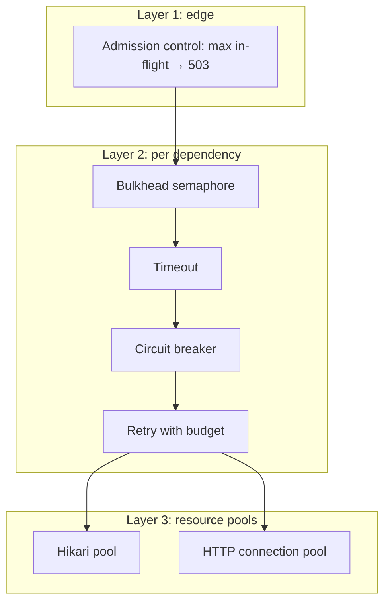

# Resilience: Admission Control, Bulkheads, Timeouts

<span class="level l3">L3</span> <span class="level l4">L4</span>

**Virtual threads remove the accidental bulkhead that the thread pool used to be.** This page adds back the
limits you need, explicitly and per resource.



## Admission control filter

```java title="AdmissionControlFilter.java"
--8<-- "examples/spring-boot-vt/src/main/java/com/playbook/vt/concurrency/AdmissionControlFilter.java"
```

## Bulkhead with metrics

```java title="Bulkhead.java"
--8<-- "examples/spring-boot-vt/src/main/java/com/playbook/vt/concurrency/Bulkhead.java"
```

```java title="BulkheadRegistry.java"
--8<-- "examples/spring-boot-vt/src/main/java/com/playbook/vt/concurrency/BulkheadRegistry.java"
```

## Using Resilience4j instead

```yaml
resilience4j:
  bulkhead:            # SEMAPHORE bulkhead: VT-friendly
    instances:
      payments: { max-concurrent-calls: 50, max-wait-duration: 50ms }
  timelimiter:
    instances:
      payments: { timeout-duration: 800ms, cancel-running-future: true }
  circuitbreaker:
    instances:
      payments: { sliding-window-size: 50, failure-rate-threshold: 50, wait-duration-in-open-state: 10s }
```

```java
@Bulkhead(name = "payments")                        // type = SEMAPHORE (default). Avoid THREADPOOL with VTs
@CircuitBreaker(name = "payments", fallbackMethod = "queued")
public PaymentResult charge(Payment p) { return paymentsClient.charge(p); }
```

## Timeouts: every layer, every call

| Layer | Setting |
|---|---|
| HTTP connect | `HttpClient.connectTimeout` |
| HTTP response | `JdkClientHttpRequestFactory.setReadTimeout` / `HttpRequest.timeout` |
| DB pool wait | Hikari `connectionTimeout` |
| DB query | `statement_timeout` / JPA query timeout |
| Fan-out | `FanOut.open(deadline)` / SC `withTimeout` |
| Whole request | Deadline propagated from the edge (`X-Request-Deadline` header) |

## Retry budgets

Retries multiply load during an outage. Limit them with **deadline budgets** (example 17 in
[Worked Examples](../virtual-threads/04-examples.md)) and with a global retry ratio (for example, retries ≤ 10% of requests).
Sleeping between retries is free on a VT, but the load you add to the downstream isn't.

## Overload test result (from the sample)

The integration test fires 300 concurrent page requests at a 4-vCPU container, where the self-hosted downstreams
compete for the same CPU. The pass criteria are **no 500s, no hang**: every response is a 200, a 503 (shed by a bulkhead or
admission control), or a 504 (deadline). That's graceful degradation, and it's exactly what the limits are for.
