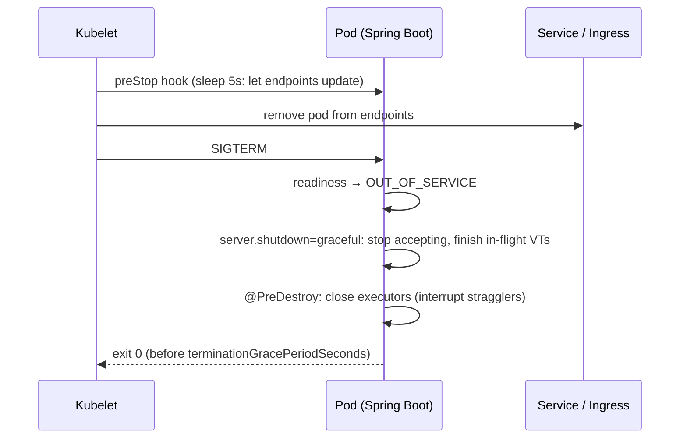

# Graceful Shutdown & Operations

<span class="level l3">L3</span> <span class="level l4">L4</span>

## Shutdown sequence in Kubernetes



```yaml
server.shutdown: graceful
spring.lifecycle.timeout-per-shutdown-phase: 25s
```

```yaml
# deployment.yaml
terminationGracePeriodSeconds: 35
lifecycle:
  preStop:
    exec: { command: ["sh", "-c", "sleep 5"] }
```

Executors you create yourself must be closed. The sample registers `cpuExecutor` with `destroyMethod = "close"`, and
`FanOut` scopes are closed per request by try-with-resources.

## Container CPU and the VT scheduler

* `availableProcessors()` follows the cgroup CPU **limit**, so a pod limited to `cpu: 2` gets **2 carriers**.
* Fractional limits round up (`1.5` → 2).
* Very low limits (≤ 1 CPU) mean one carrier. A single CPU-heavy request then blocks all VTs. Give VT services
  at least 2 CPUs, or set `-Djdk.virtualThreadScheduler.parallelism`.

## Recommended JVM flags (Java 21/25 service)

```bash
JAVA_TOOL_OPTIONS="
  -XX:MaxRAMPercentage=75
  -XX:+UseZGC                          # add -XX:+ZGenerational on JDK 21; generational is the default from 23
  -XX:+ExitOnOutOfMemoryError
  -XX:StartFlightRecording=disk=true,maxage=1h,maxsize=200m,dumponexit=true,filename=/tmp/app.jfr
  -Djdk.virtualThreadScheduler.parallelism=<cpu limit, only if you need to override>
"
```

G1 is also fine. ZGC shines when the heap is large and there are many VT stack chunks.

## Runbook: "the service is slow"

| Check | Command / metric | If… |
|---|---|---|
| Is it pinning? | `jfr print --events jdk.VirtualThreadPinned` | Events present on JDK 21–23 → fix `synchronized`+IO |
| Is a pool exhausted? | `hikaricp_connections_pending`, `bulkhead_in_use` | At the limit → the downstream is slow, or the limit is too low |
| What are VTs waiting on? | JSON thread dump + `jq` grouping | Thousands parked in one frame → that's the bottleneck |
| CPU saturated? | Pod CPU, `executor_active{name=cpu}` | CPU work on VTs, or under-provisioned pods |
| GC? | GC pause / heap after GC | Rising heap → stuck VTs (missing timeouts) |
