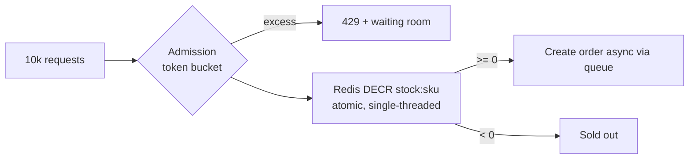

# Case Studies

<span class="level l3">L3</span> <span class="level l4">L4</span>

## Case 1: grocery checkout API (fan-out + saga)

**Requirements:** p99 < 400 ms, 2k rps peak, 5 downstreams, no double charging.

| Decision | Choice | Why |
|---|---|---|
| Concurrency model | MVC + virtual threads | Blocking JDBC/JPA, readable saga code |
| Parallel reads | Fan-out scope with an 800 ms deadline | Cart, address, and quote in parallel |
| Payments | Bulkhead 50 + timeout 2 s + idempotency key | Isolate the slowest, riskiest dependency |
| Writes | One short TX + transactional outbox | Atomic state + event, no dual writes |
| Inventory | Reservation with TTL + compensation | Saga instead of distributed TX |

Capacity: 2,000 rps × 0.3 s = 600 in-flight VTs (trivial). DB: 2,000 × 3 queries × 4 ms = 24 connections across pods.

## Case 2: flash sale (inventory contention)

10,000 users try to buy 100 units within seconds.



* **Don't** do `SELECT ... FOR UPDATE` on one hot row from 10k VTs. Lock convoys form, and the pool exhausts.
* **Do** use an atomic counter (`Redis DECR` or `UPDATE stock SET qty = qty - 1 WHERE sku=? AND qty > 0`, then check the row count).
* In-JVM: `AtomicInteger` with a CAS loop for a single-node demo. It doesn't work across pods.

## Case 3: ordered parallel event processing

Process Kafka events in parallel while keeping **per-key order**. This is the hardened version of example 22.

```java
/**
 * Per-key ordering, cross-key parallelism. All lane state is mutated ONLY inside ConcurrentHashMap.compute,
 * which is atomic per key, so "is a drainer running?" and "remove the idle lane" can never race.
 */
public final class KeyedLanes<K, E> implements AutoCloseable {
    private static final class Lane<E> {
        final ArrayDeque<E> queue = new ArrayDeque<>();
        boolean running;
    }

    private final ConcurrentHashMap<K, Lane<E>> lanes = new ConcurrentHashMap<>();
    private final ExecutorService vts = Executors.newVirtualThreadPerTaskExecutor();
    private final Consumer<E> handler;

    public KeyedLanes(Consumer<E> handler) { this.handler = handler; }

    public void submit(K key, E event) {
        var startDrainer = new boolean[1];
        lanes.compute(key, (k, lane) -> {
            if (lane == null) lane = new Lane<>();
            lane.queue.add(event);
            if (!lane.running) { lane.running = true; startDrainer[0] = true; }
            return lane;
        });
        if (startDrainer[0]) vts.submit(() -> drain(key));
    }

    private void drain(K key) {
        while (true) {
            var next = new ArrayList<E>(1);
            lanes.compute(key, (k, lane) -> {
                E e = lane.queue.poll();
                if (e == null) return null;    // idle: remove the lane atomically; next submit starts a new drainer
                next.add(e);
                return lane;
            });
            if (next.isEmpty()) return;
            handler.accept(next.get(0));       // blocking work OUTSIDE the map's bin lock
        }
    }

    @Override public void close() { vts.close(); }
}
```

!!! note "Why this is race-free"
    The lane's queue and `running` flag are only touched inside `compute` for that key, which `ConcurrentHashMap`
    executes atomically per key (and with a happens-before edge between calls). A drainer that finds the queue empty
    removes the lane **in the same atomic step**, so a concurrent `submit` either sees the old lane (and its event is
    drained) or creates a fresh lane and starts a new drainer. The handler runs outside `compute`, because blocking
    inside it would block other keys in the same bin. For Kafka, track completed offsets per partition and commit only
    the highest **contiguous** one.

## Case 4: notification blast (1M push messages)

| Java 8 | Java 21 |
|---|---|
| Batch into chunks of 500, fixed pool of 100, CompletableFuture per chunk | One VT per message, `Semaphore(2000)` for the provider's rate limit, `TokenBucket` for per-second quotas |
| ~300 lines with batching logic | ~40 lines |
| Throughput limited by pool size × latency | Limited only by the provider's quota |

```java
Semaphore inFlight = new Semaphore(2_000);
TokenBucket perSecond = new TokenBucket(5_000, 5_000);
try (var ex = Executors.newVirtualThreadPerTaskExecutor()) {
    for (Device d : devices) {
        perSecond.acquire();
        inFlight.acquire();
        ex.submit(() -> { try { push.send(d, msg); } finally { inFlight.release(); } });
    }
}
```

## Case 5: web crawler

The rate-limited crawler from example 21, plus a `ConcurrentHashMap.newKeySet()` for visited URLs, a depth limit, and a
`Phaser` (or simply executor close) to detect completion. VTs make one-thread-per-fetch natural, and per-host semaphores
keep it polite.
