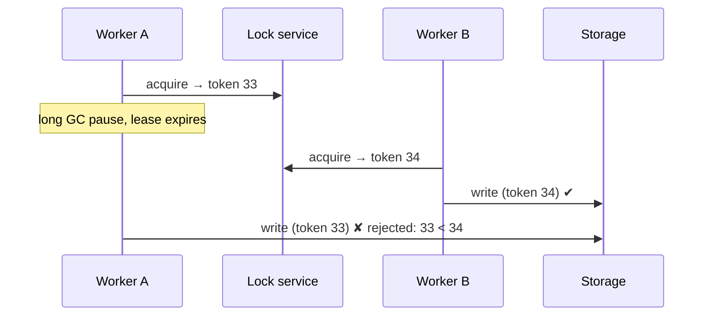
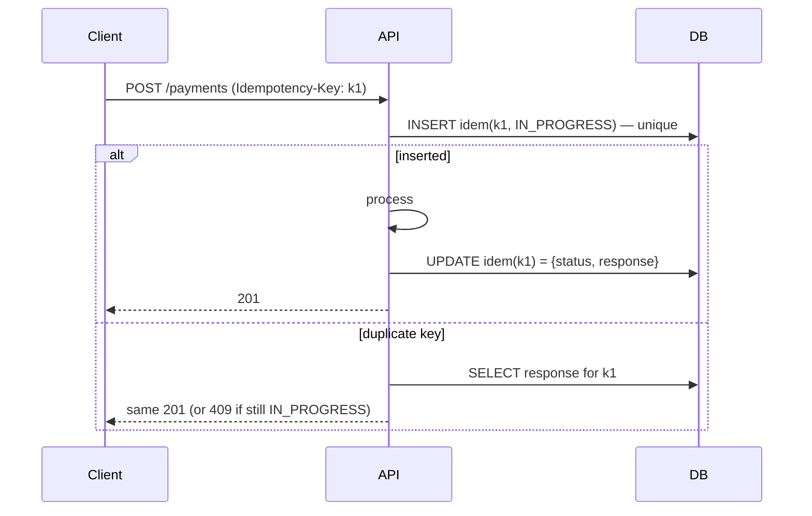

# Distributed Concurrency

<span class="level l4">L4</span>

In-JVM locks stop protecting you the moment there are two pods. Senior interviews almost always move here.

## The toolbox

| Problem | Tool | Notes |
|---|---|---|
| Lost update on a row | **Optimistic locking** (`@Version`) | Retry on `OptimisticLockException`. The best default |
| Hot row, must serialize | **Pessimistic lock** (`SELECT ... FOR UPDATE`, `SKIP LOCKED` for queues) | Keep the TX tiny |
| Exactly one worker does a job | **Lease / distributed lock** (DB advisory lock, Redis `SET NX PX`, ZooKeeper, etcd) | Needs **fencing tokens** |
| Duplicate requests / retries | **Idempotency keys** | Store key → result. Unique constraint |
| State change + event atomically | **Transactional outbox** + CDC (Debezium) | Avoids dual writes |
| Multi-service transaction | **Saga** (orchestrated or choreographed) + compensation | No 2PC |
| Ordering | Kafka partition key | Per-key order only |
| Counters at scale | Redis `INCR` / sharded counters / CRDTs | Accept eventual consistency |

## Optimistic locking

```java
@Entity
class Wallet {
    @Id Long id;
    long balanceMinor;
    @Version long version;          // UPDATE ... SET balance=?, version=version+1 WHERE id=? AND version=?
}

@Retryable(retryFor = ObjectOptimisticLockingFailureException.class, maxAttempts = 3)
@Transactional
public void debit(long walletId, long amountMinor) {
    Wallet w = repo.findById(walletId).orElseThrow();
    if (w.balanceMinor < amountMinor) throw new InsufficientFunds();
    w.balanceMinor -= amountMinor;
}
```

## Distributed locks need fencing tokens



Without the token check in storage, A's stale write corrupts data. **Redis `SET NX` alone is not safe** for correctness-critical
work. Use it only for efficiency, such as avoiding duplicate work.

## Idempotency key flow



## Job queues on PostgreSQL with `SKIP LOCKED`

```sql
WITH next AS (
  SELECT id FROM jobs
  WHERE status = 'READY' AND run_at <= now()
  ORDER BY run_at
  LIMIT 10
  FOR UPDATE SKIP LOCKED
)
UPDATE jobs SET status = 'RUNNING', locked_by = :worker, locked_at = now()
WHERE id IN (SELECT id FROM next)
RETURNING *;
```

Each pod polls the queue, and each claimed job runs on its own VT. Multiple pods never claim the same row.
