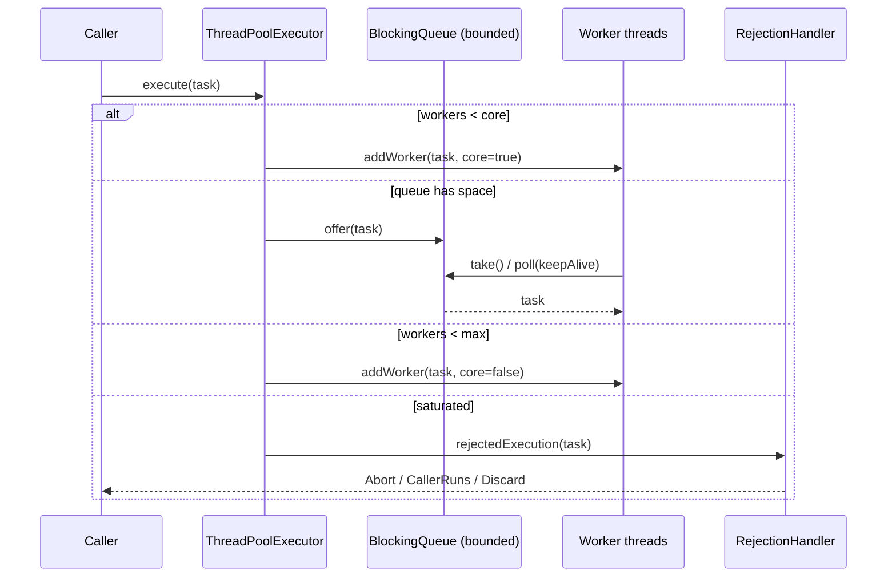
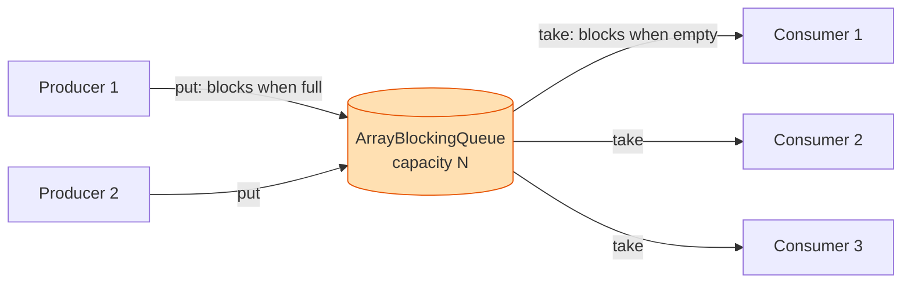
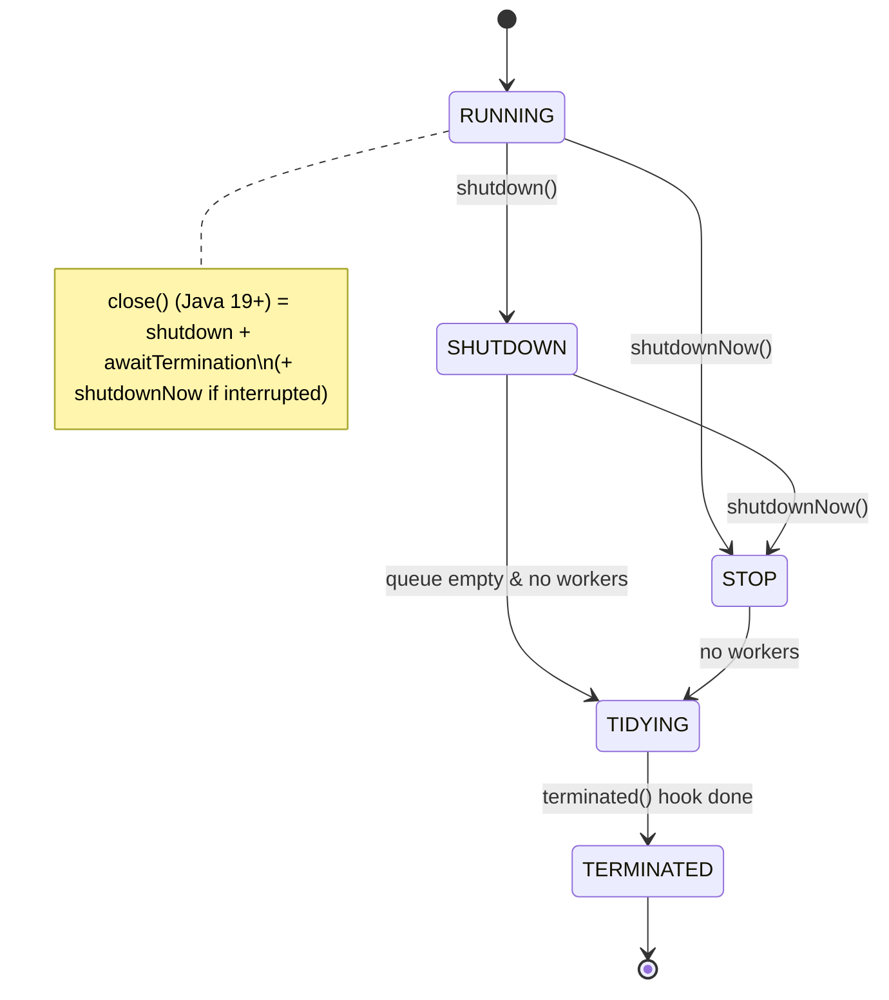
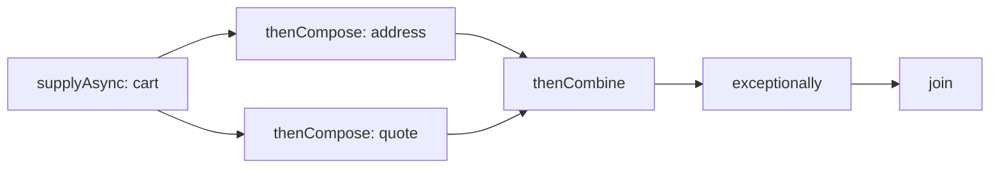
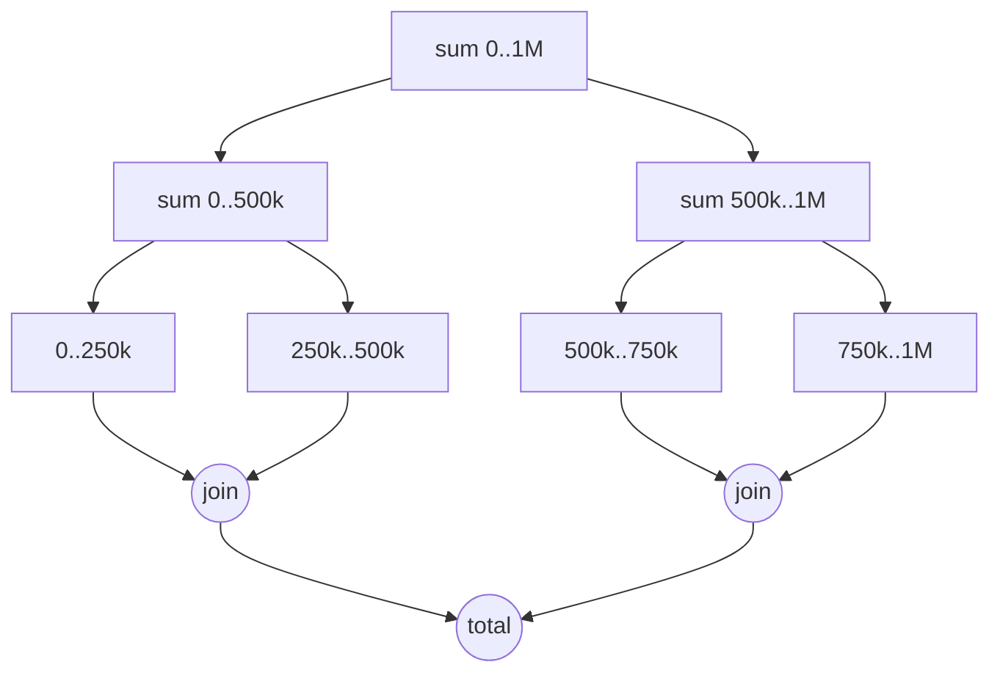
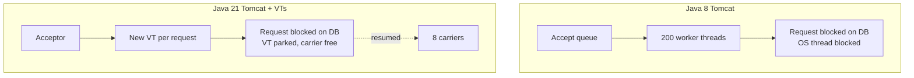

# Thread & Executor Diagrams

## ThreadPoolExecutor task submission

## Producer–consumer with a bounded buffer

## Executor lifecycle states

## CompletableFuture dependency graph

## Fork/Join recursive decomposition

## Thread-per-request: platform vs virtual

