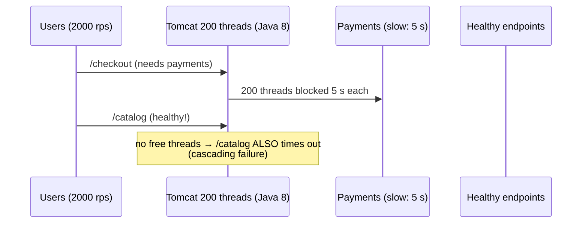
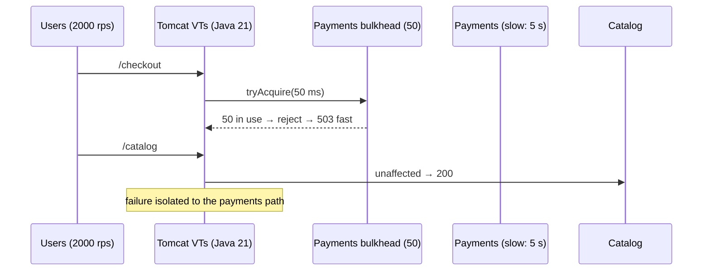
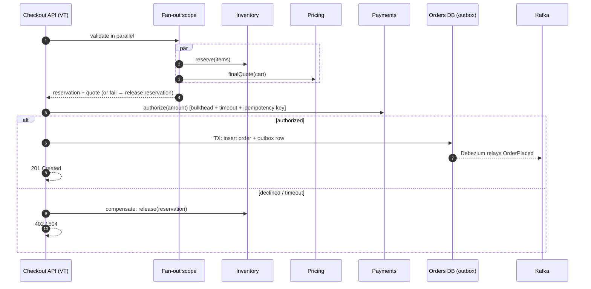
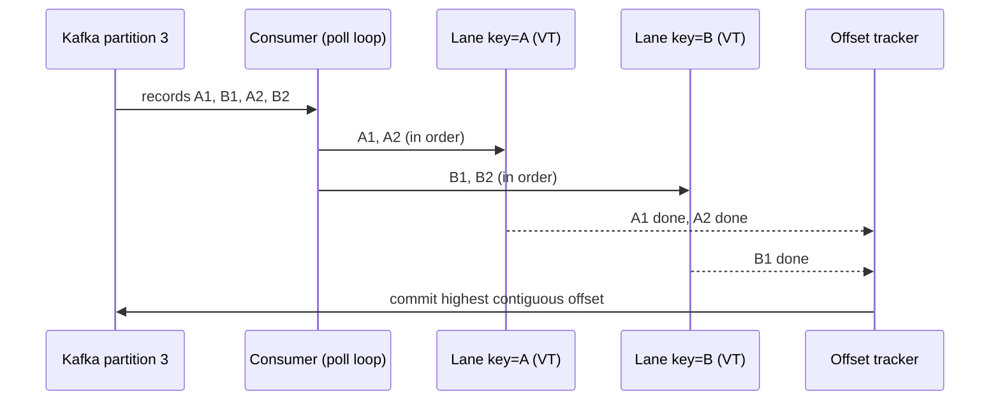
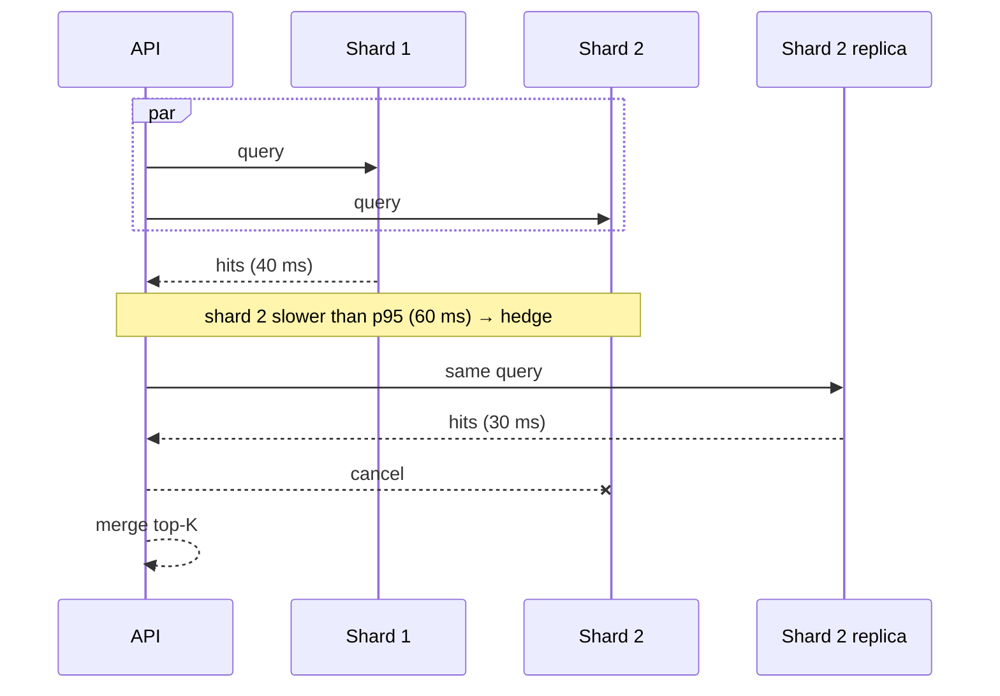

# Request Flow Sequences

## Thread-per-request under a slow downstream: Java 8 vs Java 21

## Checkout saga with parallel validation

## Asynchronous messaging consumer with per-key ordering

## Scatter-gather search with hedging

