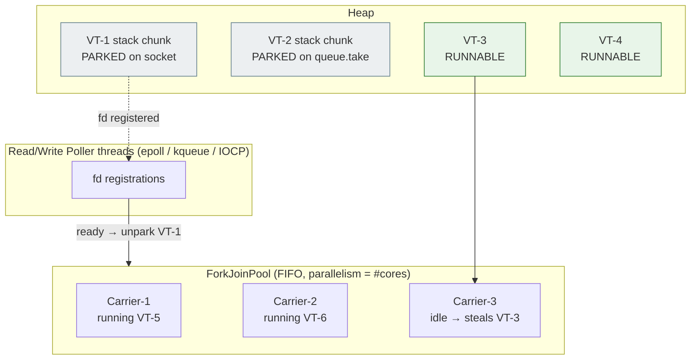
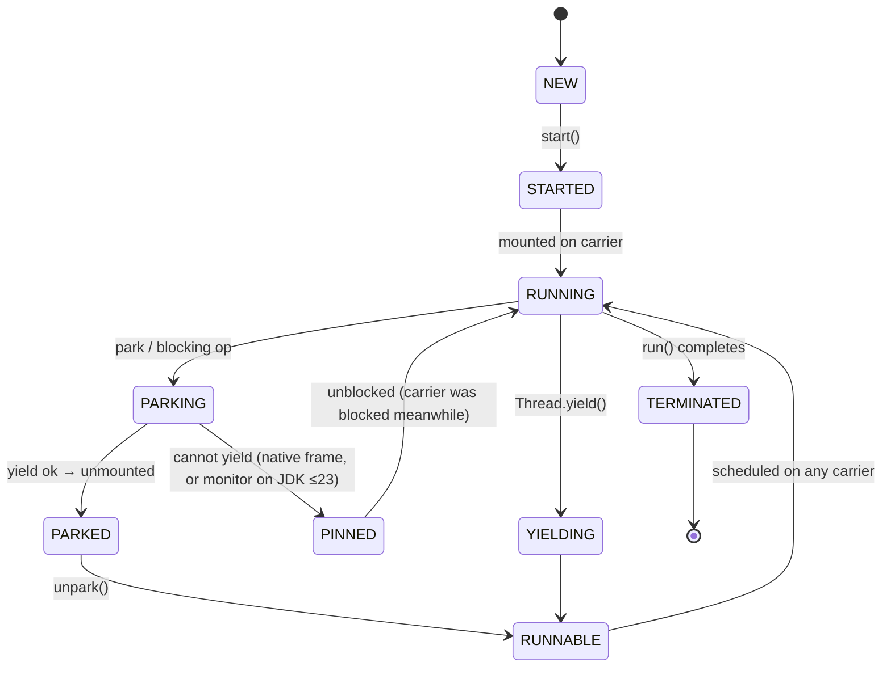
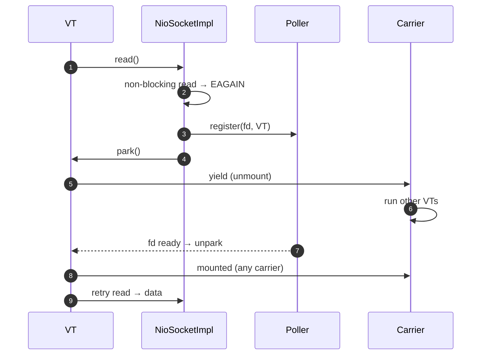
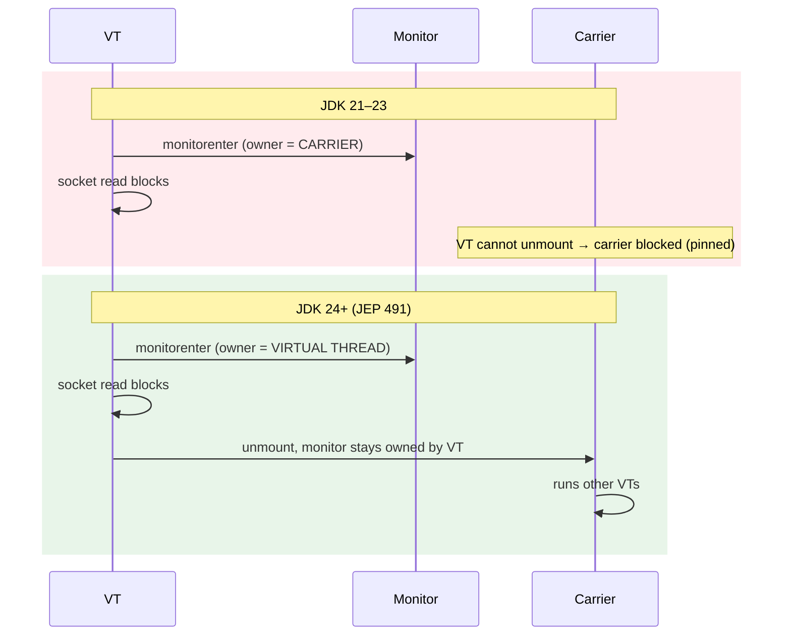
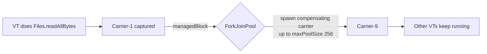

# Virtual Thread Scheduling Diagrams

## Carrier pool and run queues

## State machine of a virtual thread

## Blocking socket read without pinning

## JDK 21 vs JDK 24: blocking inside `synchronized`

## Compensation for capturing operations (file IO, `Object.wait` on 21)

