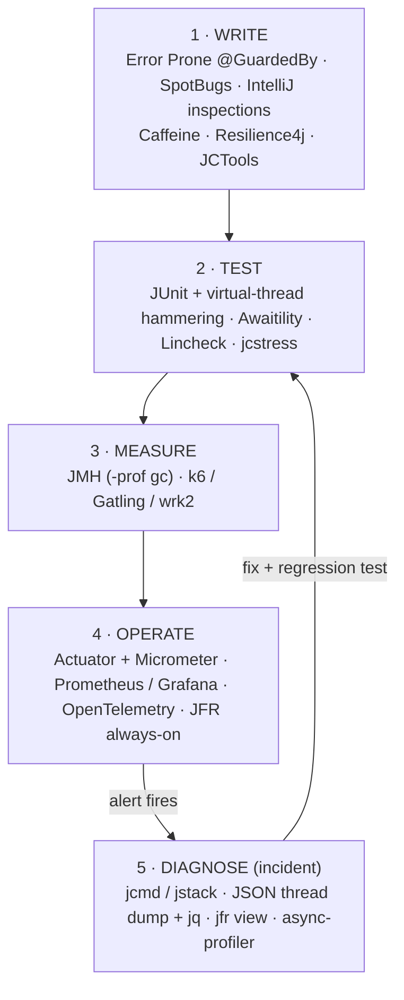

# Concurrency Tools

<span class="level l2">L2</span> → <span class="level l4">L4</span>

These are the tools a Java engineer uses to **write, test, measure, diagnose, and operate** concurrent code. Every tool
marked ✅ was **run for this playbook on JDK 21**, and its page shows the real command and real output. The practice
projects live in [`examples/tools-lab`](https://github.com/khiruashish/java-multithreading-playbook/tree/main/examples/tools-lab).

## Where each tool fits



## Symptom → tool

| Symptom | First tool | Then |
|---|---|---|
| Service hangs, CPU ≈ 0 | `jstack -l <pid>` (prints "Found one Java-level deadlock") | `jcmd Thread.dump_to_file -format=json` for virtual threads |
| Slow, CPU high | `jfr view hot-methods`, async-profiler `-e cpu` | JMH micro-benchmark of the hot path |
| Slow, CPU low | `jfr view contention-by-site`, async-profiler `-e wall` / `-e lock` | Thread dumps ×3, five seconds apart |
| Virtual threads not running | `jfr view pinned-threads` | JSON dump: count threads per frame with `jq` |
| Pool or DB starvation | JSON dump grouped by frame | Hikari/bulkhead metrics in Prometheus |
| "Works on my machine" race | jcstress / Lincheck | SpotBugs + Error Prone in CI |
| Flaky async test | Awaitility (replace `Thread.sleep`) | Lincheck for the data structure |
| "Is A faster than B?" | JMH (`-prof gc` too) | Load test the real service |

## Complete catalogue

| Category | Tool | Cost | Use it for | Run here |
|---|---|---|---|---|
| **JDK CLI** | `jps`, `jcmd`, `jstack`, `jstat`, `jinfo`, `jhsdb` | Free (JDK) | Thread dumps, deadlocks, JFR control, GC stats | ✅ |
| | `jconsole`, VisualVM | Free | Live GUI: threads, deadlock button, CPU sampling | GUI, not run |
| **Recording** | Java Flight Recorder (`jcmd JFR.*`, `jfr` CLI incl. `jfr view`) | Free (JDK 11+) | Low-overhead production recording: locks, parks, pinning, CPU | ✅ |
| | JDK Mission Control (JMC) | Free | GUI analysis of `.jfr` files: lock instances, thread timeline | GUI, not run |
| **Profilers** | async-profiler | Free (OSS) | CPU / wall / lock / alloc flame graphs, low overhead | ✅ CPU mode |
| | IntelliJ IDEA Profiler | Ultimate | async-profiler + JFR inside the IDE | Not run |
| | JProfiler, YourKit | Commercial | Thread history, monitor views, deadlock UI | Not run |
| **Benchmarking** | JMH | Free (OpenJDK) | Correct micro-benchmarks, `@Threads`/`@Group` contention tests | ✅ |
| **Correctness testing** | jcstress | Free (OpenJDK) | Memory-model and atomicity tests (reorderings, lost updates) | ✅ |
| | Lincheck | Free (JetBrains) | Linearizability checking with model checking and printed interleavings | ✅ |
| | Awaitility | Free | Asserting async outcomes without `sleep` | ✅ |
| | JUnit 5 + virtual threads | Free | Hammer tests with thousands of threads | ✅ (whole repo) |
| | ConcurrentUnit, tempus-fugit | Free | Multi-thread assertions / repeat rules (older but simple) | Not run |
| | VMLens | Free/commercial | Race and deadlock detection with interleaving exploration | Not run |
| **Static analysis** | Error Prone (`@GuardedBy`, `@ThreadSafe`) | Free | Compile-time lock discipline checks | ✅ |
| | SpotBugs (MT_CORRECTNESS) | Free | Inconsistent sync, double-checked locking, wait-not-in-loop | ✅ |
| | Checker Framework Lock Checker | Free | Type-system-level `@GuardedBy` verification | Not run |
| | IntelliJ inspections, SonarQube, PMD | Free/commercial | "Synchronization on non-final field", "wait not in loop", … | Not run |
| | ArchUnit | Free | Architectural rules ("no `newFixedThreadPool` with VT factory") | See [Static Analysis](static-analysis.md) |
| **Observability** | Spring Boot Actuator (`/threaddump`, `/metrics`) | Free | Thread dump and executor/bulkhead metrics over HTTP | ✅ |
| | Micrometer `ExecutorServiceMetrics` | Free | Pool active/queued/completed metrics | ✅ |
| | Prometheus + Grafana, OpenTelemetry | Free | Dashboards, alerts, traces across threads | Queries only |
| **Load testing** | k6, Gatling, wrk2, hey, JMeter | Free | Throughput/latency at a constant rate | Not run |
| **Dump analyzers** | `jq`, IntelliJ "Analyze Stack Trace", TDA, fastThread.io | Free/freemium | Grouping thousands of threads | ✅ `jq` |
| **Libraries** | Caffeine, Resilience4j, Bucket4j, JCTools, Disruptor, … | Free | Don't hand-roll what these do | See [Libraries](libraries.md) |

!!! warning "Production safety"
    `jcmd Thread.print`, `jstack`, and JSON thread dumps pause the JVM briefly (a safepoint): milliseconds for hundreds of
    threads, more with huge stacks. JFR with the default settings costs about 1% overhead. Async-profiler in CPU mode costs a few percent.
    `jmap -dump` and heap dumps can pause for **seconds**, so avoid them on a hot pod without draining traffic first.

## The practice target: `TroubledService`

Most pages on this tab attach tools to one deliberately broken program. It contains a deadlock, a contended lock, pinned
virtual threads, 10,000 virtual threads starving on a 5-permit "connection pool", and a CPU hog. That way every tool has
something real to find.

```java title="examples/tools-lab/diagnostics/TroubledService.java"
--8<-- "examples/tools-lab/diagnostics/TroubledService.java"
```

```bash
cd examples/tools-lab/diagnostics
java -XX:+UnlockDiagnosticVMOptions -XX:+DebugNonSafepoints TroubledService.java      # prints pid=...
```

`-XX:+DebugNonSafepoints` makes profilers attribute samples to the exact line, not only the nearest safepoint.
